# Zephyr

AI Agent framework in Rust.

基于 Rust 从零实现的 AI Agent 框架：自带 ReAct 式运行时、工具系统、会话管理、长期记忆（RAG）、上下文优化器、MCP 客户端、代码沙箱、技能（Skill）加载与多智能体编排，并附带 GAIA 基准评测入口。

- crate 名：`zephyr`（edition 2024）
- LLM 网关：百炼 DashScope 的 OpenAI 兼容接口（`async-openai`）
- 技术演进路线：[技术演进流程](#技术演进流程)（ep04 → ep15，共 17 个里程碑 tag，全部指向本项目自己的提交）

---

## 目录

- [核心特性](#核心特性)
- [快速开始](#快速开始)
- [技术演进流程](#技术演进流程)
- [代码阅读路线](#代码阅读路线)
- [图解总览](#图解总览)
- [项目全景脑图](#项目全景脑图)
- [分层架构图](#分层架构图)
- [Agent 运行主流程](#agent-运行主流程)
- [模块详解](#模块详解)
- [回调机制（Callback）](#回调机制callback)
- [工具系统](#工具系统)
- [长期记忆系统](#长期记忆系统)
- [文档知识库（RAG）](#文档知识库rag)
- [上下文优化器](#上下文优化器)
- [会话与事件模型](#会话与事件模型)
- [GAIA 基准评测](#gaia-基准评测)
- [配置项](#配置项)
- [目录结构](#目录结构)
- [开发约定](#开发约定)
- [已知限制与改进方向](#已知限制与改进方向)

---

## 核心特性

| 能力         | 说明                                                                      | 主要代码位置                                                         |
| ------------ | ------------------------------------------------------------------------- | -------------------------------------------------------------------- |
| ReAct 运行时 | `think → act → observe` 循环，最多 `max_steps` 步                         | `src/agent/runtime/`                                                 |
| 工具系统     | 统一 `Tool` trait，schema 由 `schemars` 自动生成                          | `src/tool.rs`、`src/tool/`                                           |
| 工具人工确认 | 危险工具挂起为 `PendingToolCall`，等待外部批准后恢复                      | `src/agent/tool_confirmation.rs`                                     |
| 会话管理     | `SessionManager` 抽象，默认内存实现，可插拔持久化                         | `src/session/`                                                       |
| 事件溯源     | 所有消息 / 工具调用 / 工具结果统一记录为 `AgentEvent`                     | `src/agent/event.rs`                                                 |
| 长期记忆     | SQLite 存储 + embedding 向量检索 + LLM 查重 + 自动注入                    | `src/memory/`                                                        |
| 文档知识库   | 文档 → 切片 → embedding → SQLite 落库 → **混合检索（向量 + BM25 + RRF）** | `src/knowledge/`                                                     |
| 知识库工具   | `search_knowledge` / `add_knowledge`，Agent 主动检索与入库                | `src/tool/knowledge_tool.rs`                                         |
| 上下文优化   | token 计数、结果压缩、滑动窗口、增量摘要                                  | `src/agent/callback/before_llm_callback/context_optimizer/`          |
| 结构化输出   | `ask::<T>()` 强制 JSON Schema 严格模式 + 指数退避重试                     | `src/llm/ask.rs`                                                     |
| MCP 客户端   | 通过子进程 stdio 接入外部 MCP Server，动态注册工具                        | `src/tool/mcp/`                                                      |
| 规划工具     | `create_tasks` 任务清单，供复杂多步任务使用                               | `src/tool/planning.rs`、`src/planning/`                              |
| 反思工具     | `reflection` 显式暴露"是否需要重新规划"的决策点                           | `src/tool/reflection.rs`                                             |
| 代码沙箱     | Podman 容器内跑 Python / Bash，宿主工具经 bridge 回调                     | `src/sandbox/`、`src/tool/code/`                                     |
| 技能加载     | 扫描 `SKILL.md`，只把 name/description 注入提示词                         | `src/skill.rs`                                                       |
| 多智能体     | Agent 树 + `transfer_to_agent` 交接 + Agent-as-Tool                       | `src/multi_agent/`、`src/tool/transfer.rs`、`src/tool/agent_tool.rs` |
| 基准评测     | GAIA 数据集加载、附件下载、有/无工具对照评测                              | `src/gaia/`                                                          |

---

## 快速开始

### 1. 环境准备

```bash
# Rust 工具链（edition 2024 需要 1.85+）
rustup update stable

# 安装依赖（MCP Server 需要 cargo run 子进程）
cargo build --release
```

### 2. 配置 `.env`

```bash
cp .env.example .env
```

| 变量                | 用途              | 说明                                                                                                                                      |
| ------------------- | ----------------- | ----------------------------------------------------------------------------------------------------------------------------------------- |
| `OPENAI_BASE_URL`   | 网关地址          | 仓库 `.env.example` 默认 `https://openrouter.ai/api/v1`；实际使用百炼时改为 `https://cn-beijing.maas.qianwenaiapi.com/compatible-mode/v1` |
| `OPENAI_API_KEY`    | 网关密钥          | 必填                                                                                                                                      |
| `HF_TOKEN`          | HuggingFace Token | GAIA 数据集与附件下载用                                                                                                                   |
| `TAVILY_API_KEY`    | Tavily 搜索 Key   | `web_search` 工具用                                                                                                                       |
| `CODE_EXECUTION`    | 代码执行开关      | `off`（默认）/ `podman`；设为 `podman` 时启用沙箱内的 Python / Bash                                                                       |
| `SANDBOX_WORKSPACE` | 沙箱工作区        | 宿主目录挂载为容器内 `/workspace`，默认 `./workspace`                                                                                     |
| `UPLOAD_ROOT`       | 上传白名单根目录  | 仅该目录下的文件可被 `upload_file` 上传；不设则不注册上传工具                                                                             |
| `SKILLS_DIR`        | 技能目录          | 宿主目录只读挂载为 `/skills`，扫描其中的 `SKILL.md`                                                                                       |

> 注意：该网关只接受**不带厂商前缀**的模型名（例如 `qwen-plus`），`provider/model` 形式会返回 `Model not exist`。
> 代码在启动时通过 `dotenv::dotenv()` 加载 `.env`；`src/search/embedding.rs` 与 `vector_search.rs` 内部也会自行加载。

### 3. 运行

```bash
# 交互式终端 Agent（src/main.rs，行式 REPL，不进入 alternate screen）
cargo run
cargo run -- 你的问题          # 单次问答

# 多智能体演示（examples/multi_agent.rs）
cargo run --example multi_agent -- transfer
cargo run --example multi_agent -- sequential
cargo run --example multi_agent -- parallel
cargo run --example multi_agent -- loop
cargo run --example multi_agent -- agent-tool

# 记忆闭环演示（examples/memory_demo.rs）
cargo run --example memory_demo

# 文档知识库（RAG）演示（examples/knowledge_demo.rs）
cargo run --example knowledge_demo

# 混合检索对比演示（examples/hybrid_search_demo.rs）
cargo run --example hybrid_search_demo

# 知识库工具端到端演示（examples/knowledge_tool_demo.rs）
cargo run --example knowledge_tool_demo

# GAIA 基准评测（src/bin/gaia.rs）
cargo run --bin gaia

# 本地 MCP Server（wikipedia）
cargo run --bin wikipedia_mcp_server
```

### 4. 交互式主程序演示了什么

`src/main.rs` 是一个行式 REPL：保留终端滚动与复制粘贴，助手回答用 Markdown 渲染（`termimad`）。它装配了一棵 Agent 树：

```
assistant（根，24 步）
├── researcher  联网检索 + github_stars（12 步）
├── math        calculator（6 步）
└── coder       execute_python / bash_tool / upload_file / 文件工具（12 步）
```

- 根 Agent 通过 `transfer_to_agent` 把控制权交给专家，专家在**同一会话**里继续，因此能看到交接过程；
- 危险工具执行前挂起为 `PendingToolCall`，终端询问 `y/n` 后恢复执行；
- `/remember` 把当前会话沉淀为长期记忆，之后自动检索注入；
- `/knowledge` 列出知识库里的文档（Agent 也可用 `add_knowledge` 入库、`search_knowledge` 检索）；
- `/agents`、`/tools`、`/history` 可查看 Agent 树、工具清单与事件流。

```
/help        显示帮助
/new         开始新会话
/status      查看模型、会话与功能状态
/agents      查看 agent 树和转移目标
/tools       查看每个 agent 的工具
/history [n] 查看最近 n 条事件
/remember    把当前会话提取为长期记忆
/knowledge   列出知识库中的文档
/clear       清屏
/quit        退出
```

> MCP、沙箱、长期记忆、文档知识库都是**可选能力**：启动失败时程序会打印 warning 并回退到基础工具集，不影响对话。

---

## 技术演进流程

本节按 git tag 记录的真实提交顺序，梳理 Zephyr 从"能调用 LLM"到"可运营的多智能体终端"的全过程。每个阶段都说明三件事：**当时要解决什么问题**、**代码上怎么落地**、**留下了什么可复用的结构**。

### 演进主线

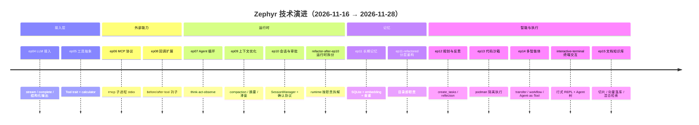

### 阶段总览

| 阶段           | tag / 提交             | 本项目提交     | 日期          | 规模     | 解决的问题                                     | 沉淀的核心结构                                     |
| -------------- | ---------------------- | -------------- | ------------- | -------- | ---------------------------------------------- | -------------------------------------------------- |
| ① LLM 接入     | `ep04`                 | `21a73df`     | 2026-11-16    | 30 文件  | 怎么稳定地跟 LLM 对话、拿到可解析的结构化结果  | `llm/{stream,complete,structured}.rs`、`semaphore` |
| ② 工具抽象     | `ep05`                 | `9e72149`     | 2026-11-17    | 19 文件  | 怎么让模型"调用能力"，而不是只会说话           | `Tool` trait、`ToolBox`                            |
| ③ MCP 接入     | `ep06`                 | `11f218f`     | 2026-11-17    | 12 文件  | 怎么复用外部已有工具服务，而不是重复造轮子     | `McpClient`（rmcp 子进程 stdio）                   |
| ④ Agent 运行时 | `ep07`                 | `1e63970`     | 2026-11-17    | 18 文件  | 怎么把"想→做→看结果"变成可循环的运行时         | `Agent`、`ExecutionContext`、`Event`/`ContentItem` |
| ⑤ GAIA 评测    | `ep07-gaia`            | `c6a7396`     | 2026-11-17    | 4 文件   | 怎么量化 Agent 到底比裸 LLM 强多少             | 有/无工具对照评测流程                              |
| ⑥ 回调机制     | `ep08`                 | `5c75496`     | 2026-11-18    | 44 文件  | 怎么在不改动运行时核心的前提下插入横切逻辑     | 三类 callback trait                                |
| ⑦ 上下文优化   | `ep09`                 | `7c27d67`     | 2026-11-20    | 15 文件  | 怎么让长会话不撑爆上下文                       | `LlmRequest` + `ContextOptimizer`                  |
| ⑧ 会话与审批   | `ep10`                 | `d66a45f`     | 2026-11-20    | 25 文件  | 怎么跨多轮保留状态，怎么在危险操作前停下来问人 | `SessionManager`、`confirmation.rs`                |
| ⑨ 长期记忆     | `ep11`                 | `32e99b4`     | 2026-11-22    | 148 文件 | 怎么让经验跨会话沉淀并复用                     | `TaskMemoryManager` + SQLite                       |
| ⑩ 分层重构     | `ep11-refactored`      | `32e99b4`     | 2026-11-22    | 148 文件 | 怎么让前 9 个阶段的代码摆放得可读              | 目录即职责的模块布局                               |
| ⑪ 规划与反思   | `ep12`                 | `137f702`     | 2026-11-25    | 3 文件   | 怎么让模型显式管理待办、显式承认走错路         | `create_tasks`、`reflection`                       |
| ⑫ 代码沙箱     | `ep13`                 | `b1329ef`     | 2026-11-27    | 23 文件  | 怎么让模型安全地执行真实代码                   | `sandbox/`（podman + bridge）                      |
| ⑬ 多智能体     | `ep14`                 | `2dd43fa`     | 2026-11-27    | 29 文件  | 怎么把单一 Agent 拆成有分工的团队              | `multi_agent/`、`TransferTool`、`AgentTool`        |
| ⑭ 终端交互     | `interactive-terminal` | `c599d2b`     | 2026-11-28    | 11 文件  | 怎么让框架成为可日常使用的终端产品             | 行式 REPL、Agent 树装配                            |
| ⑮ 运行时拆分   | `refactor-after-ep10`  | `7c27d67`     | 2026-11-20    | 15 文件  | 怎么让过大的 runtime.rs 职责单一                | `agent/runtime/` 按职责拆分                        |
| ⑯ 文档知识库   | `ep15`                 | `022c7cc`     | 2026-11-28    | 20 文件  | 怎么让外部文档变成可检索的向量知识库           | `src/knowledge/`、混合检索、知识库工具            |

---

### 阶段 ① LLM 接入层（ep04）

**问题**：一切从"能不能稳定地跟模型说话并拿到 JSON"开始。这个阶段还没有 Agent，只有一个 LLM 工具箱。

**实现细节**：

`src/llm/` 下分出四条并行的调用路径，各自有明确的适用场景：

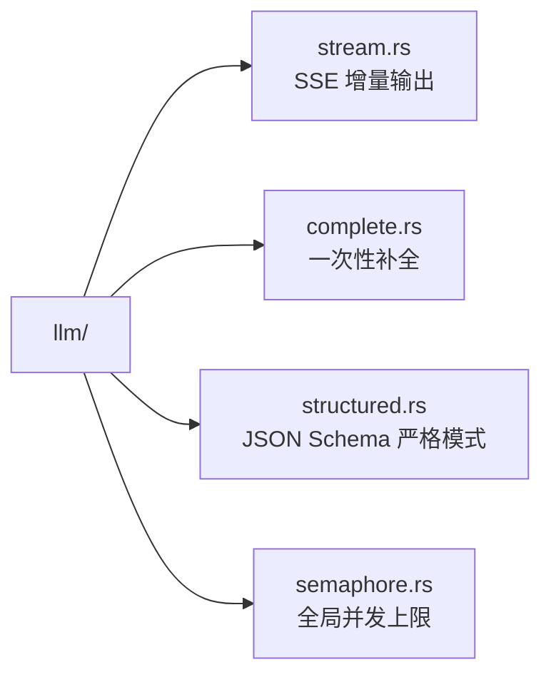

结构化输出是这个阶段最关键的技术决策。用 `schemars` 从 Rust 类型反推 JSON Schema，再以 `strict: true` 交给网关：

```rust
let schema = schemars::schema_for!(ActionPlan);
let format_setting = ResponseFormat::JsonSchema {
    json_schema: ResponseFormatJsonSchema {
        name: "action_plan".into(),
        schema: schema.as_value().clone(),
        strict: Some(true),
        ..Default::default()
    },
};
```

`strict: true` 意味着模型**不能**返回 schema 之外的字段，`serde_json::from_str` 的解析失败率因此从"经常失败"降到"极少失败"。这一条后来被完整继承到 `src/llm/ask.rs`，成为整个记忆模块与评测模块的解析基础。

流式实现用 `async_stream::stream!` 把 `create_stream` 的 chunk 逐个 yield，并借助 `backon` 的指数退避处理重试：

```rust
let mut stream = client.chat().create_stream(request).await?;
while let Some(response_result) = stream.next().await {
    match response_result {
        Ok(chunk) => {
            if let Some(choice) = chunk.choices.first()
                && let Some(new_text) = &choice.delta.content {
                    yield Ok(new_text.clone())
            }
        }
        Err(err) => yield Err(err.into()),
    }
}
```

**沉淀**：`llm/semaphore.rs` 里的全局 `Semaphore` 在这一阶段就存在，最初用于 GAIA 批量调用限流；后来成为所有并发 LLM 调用的统一入口。

**同时发生的事**：GAIA 评测的骨架也在这个阶段搭起来了（`gaia/{dataset,evaluator,models,solver}.rs`），但当时只能做"裸 LLM 单次调用"，还没有工具。

---

### 阶段 ② 工具抽象（ep05）

**问题**：要让模型调用能力，必须给每个能力定义**统一契约**：名字、描述、参数 schema、执行方式。

**实现细节**：`src/tools/tool.rs` 定义了此后一直没变的 trait 骨架：

```rust
#[async_trait::async_trait]
pub trait Tool: Send + Sync {
    fn name(&self) -> &str;
    fn description(&self) -> &str;
    fn parameters(&self) -> Value;
    async fn execute(&self, args_json: &str) -> anyhow::Result<String>;
    fn definition(&self) -> anyhow::Result<ChatCompletionTools> { /* 默认实现 */ }
}
```

关键设计是 `definition()` 作为**默认方法**：子类只管实现 `name` / `description` / `parameters` / `execute` 四件事，OpenAI 的 `tools` 数组元素由基类统一打包，不会出现各家工具的 schema 格式不一致。

参数 schema 不手写 JSON，而是用类型系统生成：

```rust
fn parameters(&self) -> Value {
    serde_json::to_value(schema_for!(CalculatorArgs))
        .expect("Failed to serialize CalculatorArgs schema")
}
```

`CalculatorArgs` 既是参数定义，也是反序列化目标——一份类型同时服务于"告诉模型要传什么"和"解析模型传了什么"，避免了 schema 与解析逻辑漂移。

目录结构上，每个工具拆成 `xxx.rs`（trait 实现）+ `xxx/definition.rs`（schema）+ `xxx/execute.rs`（业务），是典型的 Rust 模块化惯用法。

**沉淀**：`Tool` trait、`ToolBox = HashMap<String, Box<dyn Tool>>`（按名索引，O(1) 查找）、`definition()` 默认实现。这三样东西到今天的 `src/tool.rs` 里只改了签名（`execute` 多了 `context` 参数、多了 `requires_confirmation`），骨架完全保留。

---

### 阶段 ③ MCP 接入（ep06）

**问题**：工具越写越多，能不能直接接现成的工具服务？MCP（Model Context Protocol）就是干这个的。

**实现细节**：`src/tools/mcp/client.rs` 用 `rmcp` 库把 MCP Server 当作**子进程**拉起，走 stdio 通信：

```rust
pub async fn connect() -> Result<Self> {
    let service = ()
        .serve(TokioChildProcess::new(Command::new("cargo").configure(
            |cmd| { cmd.args(["run", "--quiet", "--bin", "expense_mcp_server"]); },
        ))?)
        .await?;
    Ok(Self { service })
}
```

拿到工具列表后，把 rmcp 的 `Tool` 适配成本项目的 `Tool` trait（`mcp/tool.rs`），于是 MCP 工具和本地工具在 Agent 眼里完全一样。

调用结果的处理值得注意——MCP 返回的是 content block 数组，需要过滤出文本块再拼接：

```rust
let text = result.content.iter()
    .filter_map(|block| block.as_text().map(|t| t.text.clone()))
    .collect::<Vec<_>>()
    .join("\n");
```

同时新增了 `src/bin/expense_mcp_server.rs` 作为本仓库自带的 MCP Server，实现"既当客户端又当服务端"的双向验证。

**沉淀**：MCP 的接入方式（子进程 stdio + `list_tools` + `call_tool`）此后完全没变，只是服务端从 `expense_mcp_server` 换成了 `wikipedia_mcp_server`。

---

### 阶段 ④ Agent 运行时（ep07）

**问题**：把"模型说要调工具"变成"真的去调、调完把结果喂回去、继续想"的循环。这是整个框架的心脏。

**实现细节**：`src/agent/` 出现，四个文件各司其职：

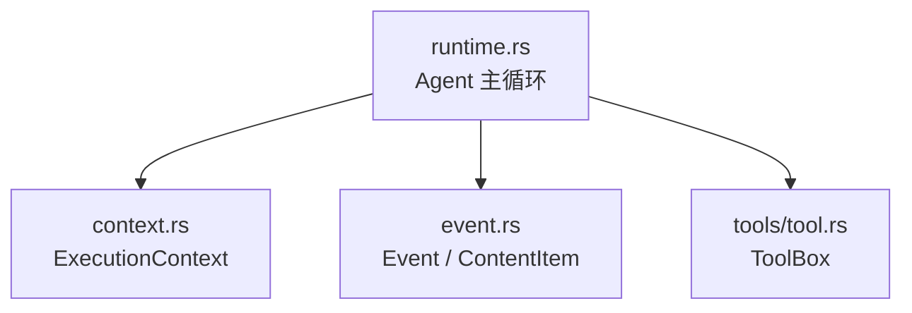

`ExecutionContext` 是"一次执行"的临时态：

```rust
pub struct ExecutionContext {
    pub execution_id: String,
    pub current_step: usize,
    pub events: Vec<Event>,
}
```

`Event` / `ContentItem` 用了**二分联合**建模，这是本项目最重要的一个架构决策：

```rust
pub enum ContentItem {
    Message { role: String, content: String },
    ToolCall { tool_call_id: String, name: String, arguments: Value },
    ToolResult { tool_call_id: String, name: String, status: ToolResultStatus, content: String },
}
```

把"消息 / 工具调用 / 工具结果"统一进一个枚举，好处是**整个会话历史只有一个类型**（`Vec<Event>`），任何地方都能遍历，不需要为工具调用单独维护一条并行历史。

主循环则是标准的 ReAct：

```rust
loop {
    if context.current_step >= self.max_steps {
        anyhow::bail!("Agent exceeded the maximum of {} steps without a final answer", self.max_steps);
    }
    let messages = self.build_messages(&context)?;
    // ... 调用模型 → 有 tool_calls 就执行工具 → 结果写回 context → 继续
}
```

`max_steps` 保护是硬性熔断：模型可能反复调同一个工具，不设上限就会烧钱。

**沉淀**：`Agent`、`ExecutionContext`、`Event`/`ContentItem`、ReAct 循环——这四样构成了后来所有阶段的地基。

---

### 阶段 ⑤ GAIA 对照评测（ep07-gaia）

**问题**：Agent 写完了，怎么证明它有用？

**实现细节**：GAIA（General AI Assistant Assessment）提供带附件的多步推理题。评测设计成**两组对照**：

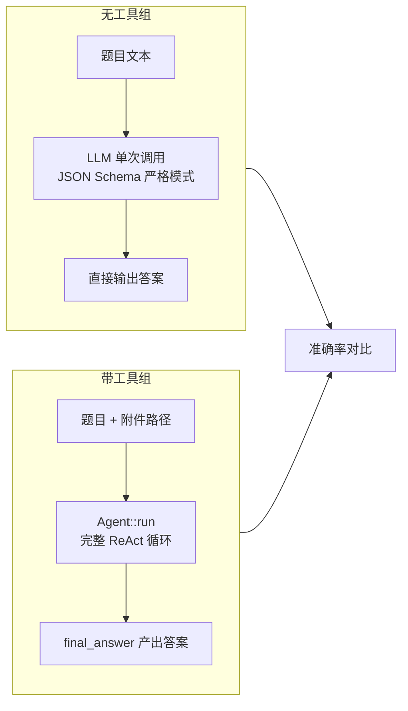

判分故意做得很朴素（去空白、忽略大小写、全等），因为 GAIA 的标准答案本身就是"尽量少的词"，复杂归一化反而会引入判分争议。

**沉淀**：评测方法论。这套"同一批题目、有无工具两组、准确率对照"的框架一直沿用到今天的 `src/gaia/`，README 里记录的实测结果是：无工具 12.73%，有工具 24.85%。

---

### 阶段 ⑥ 回调机制（ep08）

**问题**：陆续会需要"在调 LLM 前做 X"、"在调工具前做 Y"、"在工具返回后做 Z"。每加一个就要改运行时核心，运行时就会被撑成意大利面。

**实现细节**：解法是**回调 trait**。`src/callback.rs` 定义三个扩展点：

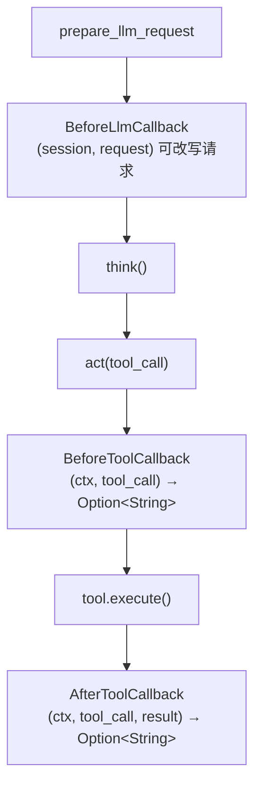

三者都返回 `Option<String>`，语义统一为**短路**：

- `BeforeToolCallback` 返回 `Some(文案)` → 拦截工具执行，该文案作为工具结果
- `AfterToolCallback` 返回 `Some(文案)` → 用该文案替换原工具结果
- 返回 `None` → 放行

这个阶段落地了两个真实回调：

**`ApprovalCallback`（before_tool）** —— 危险工具白名单：

```rust
const DANGEROUS_TOOLS: &[&str] = &["delete_file", "send_email", "execute_sql"];
```

命中后从 stdin 读一行，`y` 放行（返回 `None`），`n` 或非法输入返回错误文案（返回 `Some`）——LLM 会看到"用户拒绝执行"，并自行调整策略，而不是直接崩掉。

**`SearchCompressor`（after_tool）** —— web_search 结果超过 2000 字符时自动压缩：

```rust
const COMPRESS_THRESHOLD: usize = 2000;
const CHUNK_SIZE: usize = 500;
const CHUNK_OVERLAP: usize = 50;
const TOP_K: usize = 3;
```

流程是：把长结果切片 → 向量检索 query 相关的 top-3 → 拼回压缩文本。这个回调实际上**复用**了同期建设的 `knowledge_base`（RAG）模块——一个能力被两个场景共享。

**沉淀**：三扩展点机制。此后 `ContextOptimizer`、`MemoryInjectionCallback` 全都是挂在这个机制上的新回调，运行时核心再没改过结构。

---

### 阶段 ⑦ 上下文优化（ep09）

**问题**：长会话必然撑爆上下文。要么截断，要么压缩，但直接截断会把工具调用和结果配对拆散，触发 API 报错。

**实现细节**：这个阶段先做了一件基础工作——把"发给 LLM 的请求"从 `runtime.rs` 里抽成独立类型 `src/agent/llm_request.rs`：

```rust
pub struct LlmRequest {
    pub instructions: Vec<String>,
    pub contents: Vec<ContentItem>,
    pub tools: Option<Vec<Box<dyn Tool>>>,
    pub tool_choice: ToolChoice,
}
```

有了可改写的请求对象，`ContextOptimizer` 才能作为 `BeforeLlmCallback` 挂上去。它提供三种手段，按代价从低到高依次尝试：

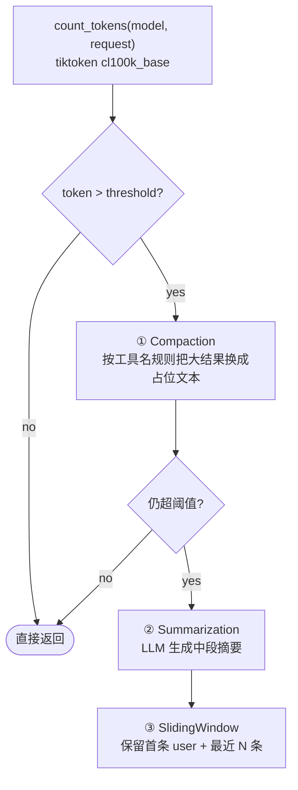

三种手段的关键实现细节：

**Compaction（规则压缩）** —— 用一张工具名 → 占位文本的规则表，把大块内容替换掉：

```rust
TOOLRESULT_COMPACTION_RULES = {
    "read_file"    => "File content from {file_path}. Re-read if needed.",
    "tavily_search"=> "Search results processed. Query: {query}. Re-search if needed.",
}
```

`{file_path}` / `{query}` 从对应的 `ToolCall.arguments` 里提取。压缩后模型仍知道"这里有内容、需要时可以重新读"，但 token 降了三个数量级。

**Summarization（增量摘要）** —— 关键是不每次重做，而是靠 session state 里的两个键做增量：

```
session.state["last_summary_idx"]  → 上次摘要覆盖到的内容下标
session.state["context_summary"]   → 已累积的摘要全文
```

下一轮只摘要 `[last_summary_idx+1 .. len-keep_recent]` 这一段，摘要文本追加到旧摘要后面。`keep_recent` 默认 5，即永远保留最近 5 条原文不摘要。

**SlidingWindow（滑动窗口）** —— 保留首条 user 消息 + 最近 N 条，其余裁掉。

**最容易被忽略的实现难点：孤儿 ToolCall 修复**。裁剪历史时，如果某个 `ToolResult.tool_call_id` 对应的 `ToolCall` 被裁掉了，OpenAI 接口会直接报错（tool message 找不到对应 assistant tool_calls）。因此裁剪后必须做一次"配对修复"：

```
裁剪前:  [user] [call_A] [result_A] [call_B] [result_B] [call_C] [result_C]
                            ↑ 被裁掉
裁剪后:  [user]              [call_C] [result_C]
                              └─ 补回 call_B，保证 result_B 有对应 call
```

实现方式是：从保留下来的片段收集所有 `ToolCall.tool_call_id`，找出 id 不在其中（孤儿）的 `ToolResult`，再回到 `session.events` 里把对应的 `ToolCall` 找回并插回。

**沉淀**：`LlmRequest` 抽象 + 三种优化手段 + 孤儿修复。这一层逻辑此后基本没变，只是被重构到 `src/agent/callback/before_llm_callback/context_optimizer/` 下。

---

### 阶段 ⑧ 会话管理与工具审批（ep10）

**问题**：两个具体痛点。一是**跨多轮**——`run()` 结束后上下文就没了，没法连续对话；二是**危险操作**——`ApprovalCallback` 的阻塞式 stdin 读取只能用于交互式终端，嵌进服务就废了。

**实现细节**：

**会话抽象** —— `src/session/` 引入 `Session` 与 `SessionManager`：

```rust
pub struct Session {
    pub session_id: String,
    pub user_id: Option<String>,
    pub events: Vec<Event>,
    pub state: HashMap<String, Value>,   // 扩展状态字典
    pub created_at: DateTime<Utc>,
    pub updated_at: DateTime<Utc>,
}
```

`state: HashMap<String, Value>` 是刻意设计的**弱类型扩展槽**：框架不认识的键（`tool_confirmations`、`context_summary`、`last_summary_idx`）都放这里，避免为了加一个状态就给 `Session` 加字段。`SessionManager` 是 trait，默认实现是内存版，后续可插拔 SQLite / Redis。

**两阶段审批协议** —— 这是本项目"人工介入"的核心机制，跨越两次 `run()` 调用：

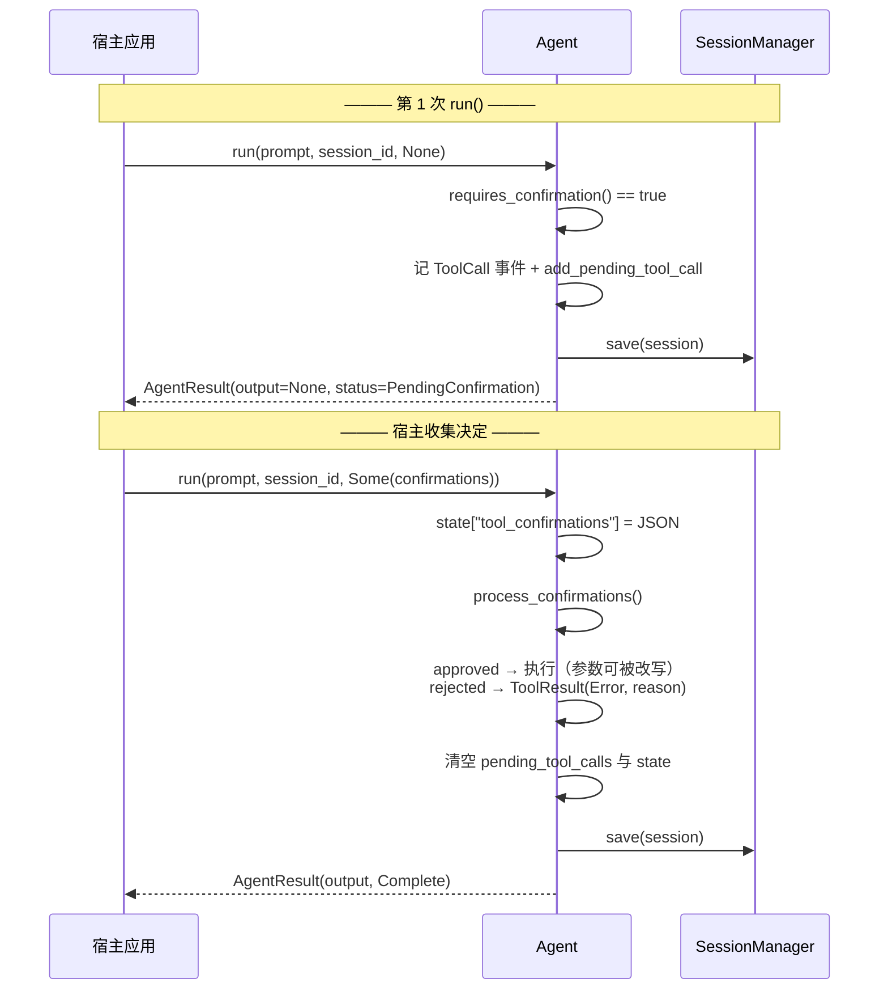

两个设计细节值得强调：

1. **审批结果放在 `session.state` 里跨调用传递**，而不是靠内存传递——所以这个机制天然支持"进程重启后仍可恢复审批"。
2. **`ToolConfirmation.modified_arguments`** 允许审批者在批准的同时**改写工具参数**。例如批准 `delete_file` 但把路径换成别的目录，这比简单的 yes/no 实用得多。

同时，这个阶段把 `runtime.rs` 按职责拆开（`refactor-after-ep10`），并引入 `src/agent/tool_exec.rs` 承接工具执行逻辑。

**沉淀**：`SessionManager` 抽象、`state` 扩展字典、两阶段审批协议。这三样到今天仍是同一套语义。

---

### 阶段 ⑨ 长期记忆（ep11）

**问题**：会话内的上下文能记住，但**跨会话**的经验完全丢失。一个反复犯的错误，Agent 每次都要重犯。

**实现细节**：核心是 `src/memory/manager.rs` 的 `TaskMemoryManager`，一条完整的写入链路包含 6 步：

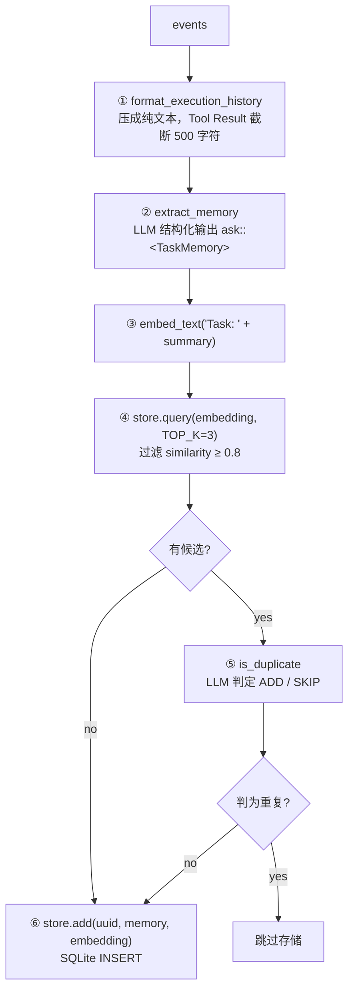

沉淀下来的记忆结构：

```rust
pub struct TaskMemory {
    pub task_summary: String,           // 问题摘要（中性描述，不含结果）
    pub approach: String,               // 实际使用的方法
    pub final_answer: String,
    pub is_correct: bool,
    pub error_analysis: Option<String>,
}
```

几个关键决策：

**（1）查重标准包含"结果"**，所以比较文本必须带上 `final_answer`：

```rust
fn render_for_dedup(mem: &TaskMemory) -> String {
    format!("task_summary: {}, approach: {}, final_answer: {}, is_correct: {}",
        mem.task_summary, mem.approach, mem.final_answer, mem.is_correct)
}
```

判重语义：同问题+不同方法 **或** 不同结果 → 新信息（ADD）；同问题+同方法+同结果 → 重复（SKIP）。

**（2）查重失败默认返回 false（继续存储）**。理由是记忆是辅助功能，宁可多存也不要因一次 LLM 抖动丢掉经验——这是"失败偏向可用"的取舍。

**（3）`Mutex<Connection>` 包裹 SQLite 连接**。注释里写清了原因：

```rust
/// 用 Mutex 包裹 Connection：rusqlite::Connection 内部用 RefCell
/// 做单线程内部可变性，天生不满足 Sync。Tool trait 要求
/// `Send + Sync`（因为要塞进 Box<dyn Tool> 在多线程 runtime 里跑），
/// Mutex<T> 只要 T: Send 就自动是 Sync。
```

这是"类型系统约束驱动设计"的典型例子：不是先想到要加锁，而是 `Tool: Send + Sync` 这个约束逼出来的。

**（4）注入用 `Mutex<Option<CachedRecall>>` 缓存**，避免同一 query 反复 embedding：

```
每轮请求 → 取最近一条 user 消息作为 query
   ├─ 缓存命中（同 query）→ 直接复用文本
   ├─ 未命中 → search(query, top_k=3)
   │     ├─ 命中 → 缓存 (query, Some(text))
   │     ├─ 空结果 → 缓存 (query, None)（避免反复空检索）
   │     └─ 出错 → 不缓存，下次重试
```

这里有个 Rust 特有的坑：因为 `MutexGuard` 不能跨 `.await` 持有，代码把"查缓存"和"写缓存"拆成了两个独立函数。

**沉淀**：`TaskMemoryManager`、`TaskMemory`、`TaskMemoryStore`（SQLite）、`MemoryInjectionCallback`。注入文本格式固定为：

```
以下是过去解决类似问题的记录:
<PAST_EXPERIENCES> ... </PAST_EXPERIENCES>
请参考成功的方法,避免重复失败的尝试。
```

---

### 阶段 ⑩ 分层重构（ep11-refactored）

**问题**：到 ep11 为止，代码是"边写边长"出来的。目录名与职责已经开始错位（例如 `src/tools/` 复数、`src/callback/` 与 `src/agent/callback/` 语义重复），继续加功能只会更乱。

**实现细节**：这一次重构改动 **148 个文件、+4809 / -8409 行**，是一次整体搬迁而非局部修补。核心规则是"**目录名 = 职责名**"：

| 重构前                                              | 重构后                                       | 变化原因                                       |
| --------------------------------------------------- | -------------------------------------------- | ---------------------------------------------- |
| `src/tools/`                                        | `src/tool/`                                  | 与 `Tool` trait 同名，扁平化后每个工具一个文件 |
| `src/callback/` + `src/agent/callback.rs`           | `src/agent/callback/before_llm_callback/` 等 | 回调按**触发时机**分目录，名字自带语义         |
| `src/knowledge_base/`                               | `src/search/`                                | 它不是"知识库"，而是"检索能力"，与 memory 解耦 |
| `src/memory/manager.rs`                             | `src/memory/memory_manager.rs`               | 避免与 `memory` 模块名混淆                     |
| `src/tools/xxx/{impl,execute,definition}.rs` 三段式 | `src/tool/xxx.rs` 单文件                     | 三段式在 Rust 里割裂了同一个类型的上下文       |
| `src/agent/llm_request.rs`                          | `src/llm/llm_request.rs`                     | `LlmRequest` 是 LLM 协议层的事，不属于 agent   |
| `src/gaia/models.rs`                                | `src/gaia/model.rs`                          | 与 Rust 类型命名惯例一致                       |

> **注意 `src/knowledge/` 与历史 `src/knowledge_base/` 的区别**：
> 历史上的 `src/knowledge_base/` 只是切片 + embedding + 检索的**原语集合**，
> 没有存储层，每次检索都要把候选重新算一遍向量，所以当时判定它"不是知识库"
> 而并入了 `src/search/`。
> 后来新增的 `src/knowledge/` 才是真正的**文档知识库**：切片向量落到 SQLite，
> 检索时直接查库，并提供入库 / 删除 / 列表等完整管理能力。
> 两者是**互补**关系，不是重复：`src/search/` 提供原语，`src/knowledge/` 提供落地。

重构后的 `src/agent/callback/` 目录本身就是一种文档：

```
src/agent/callback/
├── before_llm_callback.rs          trait 定义
├── before_llm_callback/
│   ├── memory_injection.rs         记忆注入
│   └── context_optimizer.rs        上下文优化
│       ├── compaction.rs
│       ├── sliding_window.rs
│       └── summarization.rs
├── before_tool_callback.rs
├── before_tool_callback/approval_callback.rs
└── after_tool_callback.rs
└── after_tool_callback/search_compressor.rs
```

**沉淀**：这是整个项目**最重要的一次投资**。此后所有新功能（沙箱、多智能体、技能）都只是往这套目录里填文件，没有任何一次再做过结构性重排。
---

### 阶段 ⑪ 规划与反思（ep12）

**问题**：Agent 缺少两种表达：一是"我现在有哪些待办"（进度不可见），二是"我刚才走错了"（模型很难自我否定）。

**实现细节**：

**`create_tasks`（规划）** —— 让模型显式维护任务清单。数据结构极简：

```rust
pub struct Task { pub content: String, pub status: TaskStatus }
pub enum TaskStatus { Pending, InProgress, Completed }
```

`Display` 实现直接渲染成 Markdown 风格清单，让进度**显式出现在对话历史里**：

| 状态         | 渲染           |
| ------------ | -------------- |
| `Pending`    | `[ ] 内容`     |
| `InProgress` | `[>] **内容**` |
| `Completed`  | `[x] ~~内容~~` |

关键约束是模型**每次必须重新生成整个清单**并更新状态，而不是做增量修改——这样清单永远是当前状态的完整快照，不存在状态漂移。

**`reflection`（反思）** —— 参数只有两个字段：

```rust
pub struct ReflectionArgs {
    pub analysis: String,
    pub need_replan: bool,
}
```

它的作用不是"让模型再想一遍"，而是**制造一个显式的决策点**：模型必须写下问题出在哪，并明确声明是否需要重新规划。`need_replan` 为真时，配合 `create_tasks` 就能触发一次计划重排。

同阶段还加了 `AlwaysFailingWikipediaTool`——一个**故意失败**的工具，用来演示模型在工具报错后的恢复行为（今天仍在 `build_basic_toolbox` 里，交互模式会把它删掉）。

**沉淀**：`planning/` 模块、`create_tasks` 工具、`reflection` 工具。

---

### 阶段 ⑫ 代码沙箱（ep13）

**问题**：让模型执行真实代码是能力跃迁，但也是最大的安全风险。直接在宿主跑 Python 等于把机器交给模型。

**实现细节**：`src/sandbox/` 的架构是**容器隔离 + 宿主桥接**两层：

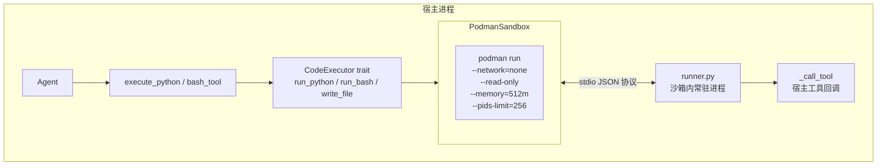

安全策略写在 `PodmanConfig` 的默认值里：

```rust
PodmanConfig {
    memory: "512m",
    cpus: 1.0,
    pids_limit: 256,
    network: NetworkPolicy::Disabled,   // 默认断网
    read_only_rootfs: true,             // 根文件系统只读
    lifetime: Duration::from_secs(300),// 会话最长 5 分钟
    exec_timeout: Duration::from_secs(30),
    ..Default::default()
}
```

**宿主桥接（bridge）** 是设计上最巧的一环。沙箱里的 Python 可以直接调用宿主上的工具（比如查 Wikipedia 版本历史），做法是：

1. 宿主为每个 `SandboxTool` 生成一段 Python stub 注入沙箱：

```rust
pub fn python_stub(tool: &dyn SandboxTool) -> String {
    format!(
        "def {name}(**kwargs):\n    \"\"\"{desc}\"\"\"\n    return _call_tool(\"{name}\", kwargs)\n"
    )
}
```

2. `runner.py` 收到调用后，通过 stdin 把 JSON 发回宿主；
3. 宿主执行真正的工具，把结果写回 stdout；
4. Python stub 返回结果。

注意 `SandboxTool` 的签名**故意不带 `ExecutionContext`**——沙箱内的代码不能依赖 Agent 状态，这是有意的隔离边界。

**配置开关**（`.env`）：

```
CODE_EXECUTION=off|podman     # off = 禁用
SANDBOX_WORKSPACE=./workspace # 挂载为 /workspace
UPLOAD_ROOT=                  # 上传白名单根目录
SKILLS_DIR=                   # 只读挂载为 /skills
```

`register_code_tools` 在 `CODE_EXECUTION` 未开启时直接返回空，工具也不注册——沙箱是完全可选的能力。

**沉淀**：`sandbox/` 模块（`config` / `podman` / `runner` / `bridge` / `workspace`）、`execute_python` / `bash_tool` / `upload_file` 三个工具。

---

### 阶段 ⑬ 多智能体（ep14）

**问题**：单个 Agent 什么都会一点但什么都不精，而且不同子任务需要不同的工具集、不同的系统提示、不同的步数预算。

**实现细节**：这一阶段实现了**两种不同的协作模式**，它们的语义差别很大：

| 模式                 | 上下文                         | 控制权                                       | 典型场景             |
| -------------------- | ------------------------------ | -------------------------------------------- | -------------------- |
| **Transfer**（交接） | **同一 session**，共享全部历史 | 转移后**不返回**原 agent，由专家直接回答用户 | 路由到专业领域       |
| **Agent-as-Tool**    | 子代理**全新 session**         | 返回后控制权回到调用方                       | 并行调研、作为子能力 |

**Transfer 模式**通过动态生成的 `transfer_to_agent` 工具实现。这个工具每步都根据当前 Agent 树重新生成：

```rust
pub fn transfer_tool_definition(&self) -> Option<ChatCompletionTools> {
    let targets = self.transfer_targets();
    if targets.is_empty() { return None; }
    match TransferTool::new(targets).definition() { ... }
}
```

刻意**不做缓存**：Agent 建立父子关系后兄弟节点才可见，按需生成比构造时缓存更不容易产生过期数据。

Rust 特有的实现难点是**父子循环引用**：`Arc<Agent>` 持子节点、子节点需要 `Weak<Agent>` 指回父节点，否则 `Arc` 计数永远不归零。所以用了 `OnceLock`：

```rust
sub_agents: OnceLock<Vec<Arc<Agent>>>,   // 强引用：持有子节点
parent: OnceLock<Weak<Agent>>,            // 弱引用：指回父节点，避免泄漏
```

因为 Rust 必须先有 `Arc<Self>` 才能创建 `Weak<Self>`，树的组装被拆成两步：

```rust
let math = Arc::new(Agent::new(...));
let router = Arc::new(Agent::new(...));
router.set_sub_agents(vec![math])?;
```

`set_sub_agents` 里做了一整套校验：同级重名、单父节点、整棵树重名、环形引用。单元测试覆盖了这些边界：

```rust
#[test] fn an_agent_cannot_have_two_parents() { ... }
#[test] fn duplicate_names_across_branches_are_rejected() { ... }
#[test] fn cycles_are_rejected() { ... }
```

**运行时交接**发生在一步结束之后，而不是在 `Tool::execute` 里：

```rust
// 一步结束后检查转移请求
if let Some(target_name) = context.transfer_to.take() {
    if context.transfer_count >= MAX_TRANSFERS { /* 熔断，防止无限来回 */ }
    let next_agent = self.find_transfer_target(&target_name)?;
    context.current_step = 0;                    // 每个 agent 有自己的步数预算
    context.transfer_count += 1;
    context.transfer_history.push(format!("{} -> {}", self.name, next_agent.name));
    return Box::pin(next_agent.run_in_context(context)).await;  // 递归装箱，避免无限大小 Future
}
```

两个细节：交接前先 `save` 一次会话，避免接手的 agent 中途失败丢会话；`Box::pin` 是因为递归调用会产生无限大小的 Future，必须装箱。

**Workflow 编排**（`src/multi_agent/workflow/`）提供三种组合：

| 工作流               | 语义                                      | 上下文处理                                         |
| -------------------- | ----------------------------------------- | -------------------------------------------------- |
| `SequentialWorkflow` | 串行流水线，后一个看得到前一个的工作      | 共享同一 context                                   |
| `ParallelWorkflow`   | 并行分叉，各分支基于同一初始状态          | 每个分支拿 context **副本**，结果按 agent 顺序合并 |
| `LoopWorkflow`       | 循环直到达标（如评分 ≥ 85）或达到最大轮数 | 共享，writer ↔ reviewer 反复迭代                   |

`LoopWorkflow` 的终止条件是它比 `Sequential` 多出来的东西——串行工作流跑一次就完，循环工作流需要"够好了才停"。

**沉淀**：`AgentNode` trait（统一 `Agent` 与 `Workflow` 的节点接口）、`TransferTool`、`AgentTool`、`multi_agent/workflow/` 三种编排。

---

### 阶段 ⑭ 终端交互产品化（interactive-terminal）

**问题**：框架能力已经齐了，但用户面对的仍然是一个需要写代码才能用的库。

**实现细节**：`src/main.rs` 被重写为**行式 REPL**，关键技术选择：

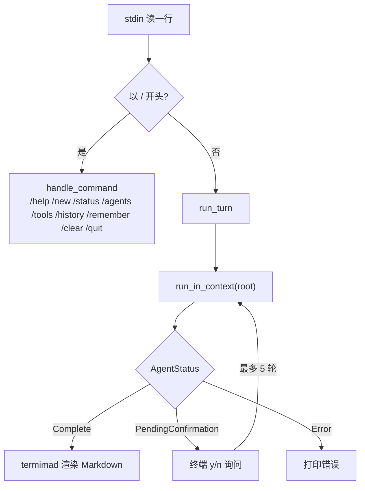

刻意**不进入 alternate screen**：这样用户可以正常滚动、复制粘贴上一轮的输出。`termimad` 的 `MadSkin` 负责把回答渲染成终端 Markdown。

Agent 树在启动时一次性装配，工具按专长分配：

```
assistant（根，24 步）：文件、规划、反思、记忆、MCP
├── researcher（12 步）：web_search + github_stars
├── math（6 步）：calculator
└── coder（12 步）：execute_python + bash_tool + upload_file + 文件工具
```

`/status`、`/agents`、`/tools`、`/history` 这些命令把框架的内部状态（Agent 树、工具清单、事件流）**暴露给用户看**——既是调试手段，也是产品能力。

沙箱 prompt 会被拼接进 coder 的系统提示：

```rust
let mut coder_instructions = CODER_INSTRUCTIONS.to_owned();
if !sandbox_prompt.is_empty() {
    coder_instructions.push_str("\n\n");
    coder_instructions.push_str(&sandbox_prompt);
}
```

**沉淀**：一个可以直接当产品用的终端 Agent。


---

### 阶段 ⑮ 运行时拆分（refactor-after-ep10）

**问题**：ep10 之后 `src/agent/runtime.rs` 已经膨胀到 1400+ 行，Agent 循环、LLM 请求构造、工具执行、事件发射全塞在一个文件里。改一个分支要翻半屏，稍有不慎就踩到别的逻辑。

**实现细节**：按**职责**而不是按"函数多少"来拆——把三块最重的逻辑独立成文件：

```
src/agent/runtime.rs        # 只留主循环：think → act → observe
src/agent/llm_request.rs    # 事件 → OpenAI messages 的翻译层
src/agent/tool_exec.rs      # 工具调用的执行、确认挂起与恢复
src/agent/confirmation.rs   # 审批数据结构与两阶段恢复协议
```

**关键点**：拆分的判据是"这段逻辑会不会独立演进"。`llm_request` 会随协议变化而变（换 Anthropic API 只改这一个文件），`tool_exec` 会随工具生态扩张而变，两者都是独立演进的，因此独立；反之 `AgentEvent` / `ContentItem` 是跨阶段共用的数据模型，留在 `agent/` 根目录。

**沉淀**：一个"改一个分支不用翻半屏"的运行时内核，也是后续 `agent/runtime/{step,think}.rs` 进一步细化的基础。


---

### 阶段 ⑯ 本项目独有的增强

在按 upstream 里程碑推进（ep04 → ep15）的同时，本项目还叠加了一批上游没有的能力：

| 提交                              | 内容                                                          |
| --------------------------------- | ------------------------------------------------------------- |
| `e098a0f` / `adb6cf0` / `024582e` | 新增 LLM 前后与任务结束回调、交互式审批回调                  |
| `7c27d67`                         | 上下文优化器重构 + `test_context_optimizer` 示例             |
| `edff725` / `ff12606`             | Agent 执行流程增强、工具执行的**用户反馈机制**               |
| `32e99b4`                         | 覆盖为 upstream `ep11-refactored` 代码结构（tree 逐字节一致） |
| `4ca37e8`                         | 项目从 `study-agent` 更名为 `zephyr`                          |
| `137f702` / `b1329ef`             | 新工具入库、新依赖与环境变量                                  |
| `c599d2b`                         | `.gitignore` / Cargo 更新，工具功能增强                       |
| `022c7cc`                         | 文档知识库（`src/knowledge/`）+ 知识库工具                    |
| `f3b05a4` / `6f6b670`             | README 文档维护与数据校正                                     |

同时新增了两个本项目独有的模块：

**`src/skill.rs`（技能加载）** —— 一种"渐进式披露"的提示词技术：

```rust
/// A skill: a folder containing a `SKILL.md`. Only `name` and `description` go into the prompt;
/// the full instructions are read on demand, which keeps the prompt small.
pub struct SkillInfo {
    pub name: String,
    pub description: String,
    pub path: PathBuf,
}
```

只把 `name` + `description` 注入系统提示，完整指令由模型自己在沙箱里 `cat /skills/<name>/SKILL.md` 读取。这样无论装多少技能，提示词都不会膨胀。技能目录被只读挂载进沙箱。

**`src/tool/github_stars.rs`** —— 精确查询 GitHub Star 数（避免模型凭记忆编造数字）。

---

### 阶段 ⑰ 文档知识库（ep15）

**问题**：`src/search/` 只提供了切片、embedding、余弦相似度这些**检索原语**，每次检索都要把候选重新算一遍向量，没有落库；而且只有向量召回，遇到专有名词、型号、缩写时经常召回不到。项目里一直缺一个能把外部资料（技术文档、笔记、网页）真正沉淀下来的知识库。

**实现细节**：新增 `src/knowledge/` 模块，补齐「文档 → 切片 → embedding → 落库 → 混合检索 → 拼进 prompt」完整链路：

| 文件                              | 职责                                                        |
| --------------------------------- | ----------------------------------------------------------- |
| `src/knowledge/model.rs`          | 领域模型：`Document`、`Chunk`、`SearchHit`                  |
| `src/knowledge/store.rs`          | SQLite 存储层：文档表、切片表、FTS5 虚表                    |
| `src/knowledge/index.rs`          | `sqlite-vec` 的 `vec0` 向量索引（**建连接前必须注册扩展**） |
| `src/knowledge/tokenizer.rs`      | 中英混合分词（中文 bigram + 英文词干）                      |
| `src/knowledge/embedder.rs`       | `Embedder` trait 抽象（可注入假实现便于测试）               |
| `src/knowledge/hybrid.rs`         | 混合检索：向量 + BM25(FTS5) → RRF 融合排序                  |
| `src/knowledge/knowledge_base.rs` | 入库 / 混合检索 / 删除 / 列表的编排层                       |

两个关键设计：

1. **向量与关键词双路召回**。纯向量检索对"Rust 的 `Rc` 和 `Arc` 区别"这类精确词匹配很弱，于是用 SQLite FTS5 建关键词虚表，与 `vec0` 向量表各自召回，再用 **RRF（Reciprocal Rank Fusion）** 融合两路排名——不需要训练、不需要调权重，效果稳定。
2. **Agent 可主动调用知识库**。新增 `src/tool/knowledge_tool.rs`，提供 `search_knowledge`（语义检索，返回带来源的原文片段）与 `add_knowledge`（文档入库：切片 + 向量 + 落库）两个工具，让模型自己决定何时检索、何时写入，而不是靠框架硬塞上下文。

**沉淀**：一个既能被人主动查询、也能被 Agent 自主检索的文档知识库。

---

### 演进规律总结

把 17 个阶段串起来看，有五条贯穿始终的技术规律：

**规律一：先立契约，再填实现。** 每个阶段都先定义 trait（`Tool`、`SessionManager`、`CodeExecutor`、`AgentNode`、`SandboxTool`），实现可以后补、可以替换。这让 `ToolBox` 里既有本地工具、又有 MCP 工具、又有 Agent-as-Tool，对 Agent 而言毫无区别。

**规律二：横切能力一律走回调，不改运行时。** 审批、压缩、记忆注入、搜索结果压缩，全部通过 `BeforeLlmCallback` / `BeforeToolCallback` / `AfterToolCallback` 挂载。运行时核心从 ep08 之后再没改过结构——新增能力不需要重新审视主循环。

**规律三：状态与协议解耦。** `AgentEvent` / `ContentItem` 是内部事件模型，`LlmRequest::build_message()` 负责翻译成 OpenAI 的 `messages`。因此换成 Anthropic 的 API 只需要改一个文件。

**规律四：失败偏向可用。** 查重失败 → 继续存储；记忆检索出错 → 不缓存下次重试；MCP 起不来 → 回退基础工具集；沙箱不可用 → 关闭代码执行但保留对话。辅助能力失败不应该拖垮主流程。

**规律五：一切可观测。** 从 ep07 的 `tracing` 日志，到 ep08 的审批回调输出，到 ep14 的 `/status` `/agents` `/history` 命令，到每一步的 `transfer_history` 路径记录。Agent 的多步行为本质上是黑盒，不给观察窗口就无法调试。

### 技术选型速查

| 领域        | 选型                          | 为什么                                              |
| ----------- | ----------------------------- | --------------------------------------------------- |
| LLM SDK     | `async-openai`                | OpenAI 兼容协议可复用多家网关（百炼 / OpenRouter）  |
| Schema 生成 | `schemars`                    | 从 Rust 类型反推 JSON Schema，杜绝手写 schema 漂移  |
| 协议适配    | `rmcp`                        | 官方 MCP Rust 实现，支持子进程 stdio 传输           |
| 结构化解析  | `serde_json` + `strict: true` | 网关侧强制约束 + 本地反序列化双保险                 |
| 重试        | `backon` 指数退避             | 声明式写法，`when(is_retryable)` 精确控制可重试类型 |
| 持久化      | `rusqlite`（bundled）         | 单文件、零运维；`bundled` 免去系统装 SQLite         |
| 相似度      | 余弦相似度                    | 向量归一化后等价于点积，实现简单                    |
| 沙箱        | Podman                        | rootless 容器，网络默认关闭，根文件系统只读         |
| Token 计数  | `tiktoken-rs`                 | 与主流模型 tokenizer 一致，阈值判断可靠             |
| 终端渲染    | `termimad`                    | 终端内 Markdown 渲染，不侵入 alternate screen       |

---

## 代码阅读路线

第一次读这个项目，按下面的顺序最容易建立整体认知。每个阶段都对应一组"必须读懂的文件"。


### 阶段 ① 骨架：先看清"一次 run 做了什么"

| 顺序 | 文件                         | 读它是为了知道                                 |
| ---- | ---------------------------- | ---------------------------------------------- |
| 1    | `src/main.rs`                | 全部依赖怎么装配、Agent 怎么被配置             |
| 2    | `src/agent/runtime.rs`       | 主循环长什么样、什么条件下结束                 |
| 3    | `src/agent/runtime/step.rs`  | 一步 = 准备请求 → 调 LLM → 执行工具 → 判定终局 |
| 4    | `src/agent/model.rs`         | `Agent` 有哪些字段、回调怎么注册、请求怎么准备 |
| 5    | `src/agent/runtime/think.rs` | 真正发给 LLM 的请求长什么样                    |

> 读完这 5 个文件，就应该能画出"一次 `run()` 的完整流程图"。

### 阶段 ② 数据模型：把概念对应到类型

| 顺序 | 文件                   | 读它是为了知道                                                   |
| ---- | ---------------------- | ---------------------------------------------------------------- |
| 6    | `src/agent/event.rs`   | `AgentEvent` / `ContentItem` 三种内容如何组织历史                |
| 7    | `src/session/model.rs` | `Session` 三块数据（events / state / pending_tool_calls）        |
| 8    | `src/agent/context.rs` | `ExecutionContext` 与 `Session` 的区别（前者是单次执行的临时态） |

### 阶段 ③ 单步流程：把工具与确认机制吃透

| 顺序 | 文件                             | 读它是为了知道                                |
| ---- | -------------------------------- | --------------------------------------------- |
| 9    | `src/agent/runtime/act.rs`       | 工具怎么执行、回调怎么短路、确认怎么挂起      |
| 10   | `src/tool.rs`                    | `Tool` trait 契约、`build_toolbox()` 装配逻辑 |
| 11   | `src/agent/tool_confirmation.rs` | 审批数据结构和两阶段恢复协议                  |
| 12   | `src/llm/llm_request.rs`         | 事件如何翻译成 OpenAI 的 `messages`           |

### 阶段 ④ 扩展点：理解框架的"可插拔"设计

| 顺序 | 文件                                         | 读它是为了知道          |
| ---- | -------------------------------------------- | ----------------------- |
| 13   | `src/agent/callback/before_llm_callback.rs`  | 回调 trait 的签名与语义 |
| 14   | `src/agent/callback/before_tool_callback.rs` | 同上                    |
| 15   | `src/agent/callback/after_tool_callback.rs`  | 同上                    |

### 阶段 ⑤ 能力模块：按兴趣深入

| 方向     | 文件                                                          | 亮点                                     |
| -------- | ------------------------------------------------------------- | ---------------------------------------- |
| 记忆     | `src/memory/memory_manager.rs`                                | 提取 → embedding → 查重 → 存储的完整链路 |
| 上下文   | `src/agent/callback/before_llm_callback/context_optimizer.rs` | token 预算管理三种手段                   |
| 检索     | `src/search/vector_search.rs`                                 | RAG 管线的实现                           |
| 评测     | `src/gaia/`                                                   | 有/无工具对照实验                        |
| MCP      | `src/tool/mcp/client.rs`                                      | 子进程 stdio 协议                        |
| 沙箱     | `src/sandbox/podman.rs` + `bridge.rs`                         | 容器隔离 + 宿主工具回调                  |
| 多智能体 | `src/multi_agent/workflow/`                                   | 串行 / 并行 / 循环三种编排               |
| 技能     | `src/skill.rs`                                                | 只注入 name/description 的渐进式披露     |

### 容易踩坑的四个点

```mermaid
flowchart TD
    P1["① Agent.model 字段<br/>实际未被 think&#40;&#41; 使用<br/>模型常量是硬编码的"]
    P2["② 审批结果跨调用传递<br/>run&#40;&#41; 需显式传 confirmations<br/>或直接写 session.state"]
    P3["③ ContextOptimizer 的<br/>sliding_window 已实现<br/>但未挂到 before_llm_call"]
    P4["④ transfer 走动态工具<br/>think&#40;&#41; 必须用 request.tools<br/>不能重新取 tool_definitions"]

    style P1 fill:#fff4e6
    style P2 fill:#fff4e6
    style P3 fill:#fff4e6
    style P4 fill:#fff4e6
```

补充说明：

- **①** `src/agent/runtime/think.rs` 里 `.model(GPT_6_LUNA_PRO_MODEL)` 是写死的，`Agent.model` 字段目前只作记录用。
- **②** `prepare_llm_request` 检测的是 `session.pending_tool_calls` + `session.state["tool_confirmations"]` 的组合。通过 `Agent::run(prompt, id, Some(confirmations))` 走标准入口，或像 `src/main.rs` 那样直接写 `state` 再调 `run_in_context` 都可以。
- **③** `sliding_window::slide_window()` 已实现但没有挂进 `before_llm_call` 的自动流程，需要手动调用。
- **④** `think()` 必须用 `llm_request.tools` 而不是 `self.tool_definitions()`，否则动态生成的 `transfer_to_agent` 会被丢掉。

---

## 图解总览

全篇用 30+ 张图串起整个项目。建议按下表顺序阅读：

| #   | 图                            | 所在小节                              | 类型            | 回答什么问题                       |
| --- | ----------------------------- | ------------------------------------- | --------------- | ---------------------------------- |
| 1   | 演进主线时间线                | [技术演进流程](#技术演进流程)         | timeline        | 15 个阶段怎么走过来的？            |
| 2   | 项目全景脑图                  | [项目全景脑图](#项目全景脑图)         | mindmap         | 这个项目有哪些部分？               |
| 3   | 模块依赖关系图                | [分层架构图](#分层架构图)             | flowchart       | 模块之间怎么依赖？                 |
| 4   | 层级职责速览                  | [分层架构图](#分层架构图)             | flowchart       | 五层职责怎么划？                   |
| 5   | Agent 主流程（入口 + 主循环） | [Agent 运行主流程](#agent-运行主流程) | flowchart       | `run()` 前后做了什么？             |
| 6   | Agent 状态机                  | [Agent 运行主流程](#agent-运行主流程) | stateDiagram    | `run()` 可能返回哪些状态？         |
| 7   | 单步决策树                    | [Agent 运行主流程](#agent-运行主流程) | flowchart       | LLM 响应三种分支分别怎么走？       |
| 8   | 工具执行细节                  | [Agent 运行主流程](#agent-运行主流程) | flowchart       | `act.rs` 里发生了什么？            |
| 9   | 工具确认时序图                | [Agent 运行主流程](#agent-运行主流程) | sequenceDiagram | 人工审批如何跨两次 `run()`？       |
| 10  | 回调三个扩展点                | [回调机制](#回调机制callback)         | flowchart       | 回调能改写什么？                   |
| 11  | 回调顺序对比                  | [回调机制](#回调机制callback)         | flowchart       | 为什么记忆注入要在优化前？         |
| 12  | `Tool` trait 装配             | [工具系统](#工具系统)                 | flowchart       | schema 怎么变成 LLM 的 tools？     |
| 13  | 工具来源分类                  | [工具系统](#工具系统)                 | flowchart       | 内置/沙箱/MCP/Agent 工具怎么统一？ |
| 14  | `final_answer` 终局判定       | [工具系统](#工具系统)                 | flowchart       | 什么时候算"答完了"？               |
| 15  | `build_toolbox()` 组装        | [工具系统](#工具系统)                 | flowchart       | 工具从哪来？                       |
| 16  | MCP 动态工具时序              | [工具系统](#工具系统)                 | sequenceDiagram | 子进程 MCP 怎么跑？                |
| 17  | 记忆写入 / 读取流程           | [长期记忆系统](#长期记忆系统)         | flowchart       | 记忆怎么存、怎么查？               |
| 18  | 记忆闭环时序                  | [长期记忆系统](#长期记忆系统)         | sequenceDiagram | 写入→检索→注入完整链路？           |
| 19  | 上下文优化四种手段            | [上下文优化器](#上下文优化器)         | flowchart       | token 超了怎么办？                 |
| 20  | 核心类型关系图                | [会话与事件模型](#会话与事件模型)     | classDiagram    | 类型之间什么关系？                 |
| 21  | GAIA 评测流程                 | [GAIA 基准评测](#gaia-基准评测)       | flowchart       | 有/无工具如何对照？                |
| 22  | RAG 检索管线                  | [模块详解](#模块详解)                 | flowchart       | 切片→向量化→排序怎么做？           |
| 23  | 沙箱宿主桥接时序              | [模块详解](#模块详解)                 | sequenceDiagram | 沙箱里的代码怎么回调宿主工具？     |
| 24  | 三种工作流上下文语义          | [模块详解](#模块详解)                 | flowchart       | 串行/并行/循环怎么共享上下文？     |

> **图例约定**：
> 🟦 蓝 = 入口/数据流　🟧 橙 = Agent 编排　🟪 紫 = 扩展点/回调　🟩 绿 = 能力模块　🟥 红 = 错误/失败路径

---

## 项目全景脑图

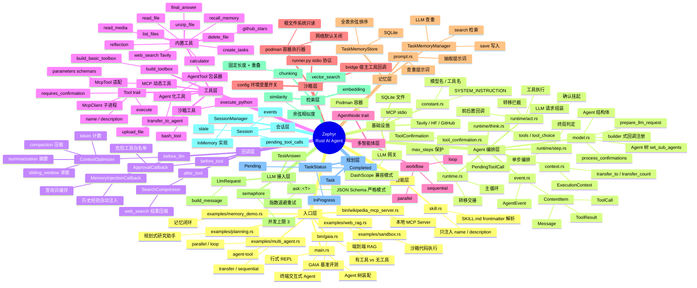

---

## 分层架构图

### 模块依赖关系

```mermaid
flowchart TB
    subgraph ENTRY["入口层 src/ · src/bin/ · examples/"]
        MAIN["main.rs<br/>终端交互式 Agent"]
        GAIA["bin/gaia.rs<br/>GAIA 评测"]
        MCPBIN["bin/wikipedia_mcp_server.rs"]
        EX1["examples/web_rag.rs"]
        EX2["examples/planning.rs"]
        EX3["examples/multi_agent.rs"]
        EX4["examples/memory_demo.rs"]
        EX5["examples/sandbox.rs"]
        EX6["examples/knowledge_demo.rs<br/>examples/hybrid_search_demo.rs"]
    end

    subgraph AGENT["Agent 编排层 src/agent/"]
        MODEL["model.rs<br/>Agent / 回调注册 / Agent 树"]
        RUNTIME["runtime.rs<br/>主循环 + 转移交接"]
        STEP["runtime/step.rs<br/>单步编排"]
        THINK["runtime/think.rs"]
        ACT["runtime/act.rs"]
        CTX["context.rs<br/>ExecutionContext"]
        EVENT["event.rs<br/>AgentEvent"]
        CONF["tool_confirmation.rs"]
    end

    subgraph MULTI["多智能体层 src/multi_agent/"]
        MA["node.rs<br/>AgentNode trait"]
        MWF["workflow/<br/>sequential / parallel / loop"]
    end

    subgraph CALLBACK["回调层 src/agent/callback/"]
        MEM["before_llm<br/>MemoryInjectionCallback"]
        OPT["before_llm<br/>ContextOptimizer"]
        APPROVAL["before_tool<br/>ApprovalCallback"]
        COMP["after_tool<br/>SearchCompressor"]
    end

    subgraph TOOLS["工具层 src/tool/"]
        TOOL["tool.rs<br/>Tool trait + build_toolbox"]
        BUILTIN["calculator / web_search<br/>file/* / final_answer<br/>recall_memory / planning<br/>reflection / github_stars"]
        KTOOL["knowledge_tool.rs<br/>search_knowledge / add_knowledge"]
        CODET["code/<br/>execute_python / bash / upload"]
        AGTT["agent_tool.rs<br/>Agent-as-Tool"]
        TRF["transfer.rs<br/>transfer_to_agent"]
        MCPC["mcp/client.rs<br/>mcp/mcp_tool.rs"]
    end

    subgraph SANDBOX["沙箱层 src/sandbox/"]
        SBOX["podman.rs<br/>容器执行器"]
        SBRIDGE["bridge.rs<br/>宿主工具回调"]
        SCFG["config.rs<br/>环境变量开关"]
    end

    subgraph MEMORY["记忆层 src/memory/"]
        MGR["memory_manager.rs<br/>TaskMemoryManager"]
        STORE["store.rs<br/>TaskMemoryStore (SQLite)"]
        MEMPROMPT["prompt.rs"]
    end

    subgraph LLM["LLM 接入层 src/llm/"]
        ASK["ask.rs<br/>ask::&lt;T&gt;"]
        REQ["llm_request.rs<br/>LlmRequest"]
        ANS["llm_answer.rs<br/>TextAnswer"]
        SEM["semaphore.rs"]
    end

    subgraph SEARCH["检索层 src/search/"]
        EMB["embedding.rs"]
        CHUNK["chunking.rs"]
        SIM["similarity.rs"]
        VEC["vector_search.rs"]
    end

    subgraph KNOW["知识库层 src/knowledge/"]
        KBMGR["knowledge_base.rs<br/>KnowledgeBaseManager"]
        KBSTORE["store.rs<br/>KnowledgeStore (SQLite)"]
        KBIDX["index.rs<br/>vec0 + FTS5 索引"]
        KBTOK["tokenizer.rs<br/>中英混合分词"]
        KBHYB["hybrid.rs<br/>RRF 融合"]
        KBMODEL["model.rs<br/>Document / Chunk"]
        KBEMB["embedder.rs<br/>Embedder trait"]
    end

    subgraph SESSION["会话层 src/session/"]
        SM["session_manager.rs<br/>SessionManager"]
        SMODEL["model.rs<br/>Session"]
    end

    subgraph PLAN["规划层 src/planning/"]
        TASK["task.rs<br/>Task / TaskStatus"]
    end

    subgraph CONST["基础设施"]
        CONSTANT["constant.rs<br/>模型名 / 工具名 / 提示词"]
    end

    subgraph EXT["外部服务"]
        GATEWAY["DashScope<br/>OpenAI 兼容网关"]
        MCPSRV["MCP Server<br/>(子进程 stdio)"]
        TAVILY["Tavily Search"]
        HF["HuggingFace Dataset"]
        DB[("SQLite 文件")]
        PODMAN["Podman 容器"]
        GH["GitHub API"]
    end

    MAIN --> AGENT
    MAIN --> MEMORY
    MAIN --> TOOLS
    MAIN --> SANDBOX
    MAIN --> MULTI
    GAIA --> AGENT
    GAIA --> TOOLS
    GAIA --> HF
    EX1 --> SEARCH
    EX1 --> TOOLS
    EX2 --> AGENT
    EX2 --> TOOLS
    EX3 --> MULTI
    EX4 --> MEMORY
    EX5 --> SANDBOX
    EX6 --> KNOW
    MCPBIN -.stdio.-> MCPC

    AGENT --> CALLBACK
    AGENT --> TOOLS
    AGENT --> LLM
    AGENT --> SESSION
    AGENT --> MULTI

    MODEL --> TOOL
    RUNTIME --> STEP
    STEP --> THINK
    STEP --> ACT
    ACT --> TOOL
    THINK --> REQ
    THINK --> TOOL

    MEM --> MGR
    OPT --> REQ
    APPROVAL -.-> ACT
    COMP -.-> ACT

    TOOL --> BUILTIN
    TOOL --> MCPC
    TOOL --> CODET
    TOOL --> AGTT
    TOOL --> KTOOL
    MODEL --> TRF
    BUILTIN --> TAVILY
    BUILTIN --> GH
    MCPC --> MCPSRV
    AGTT --> AGENT
    KTOOL --> KBMGR

    CODET --> SANDBOX
    SANDBOX --> PODMAN
    SBRIDGE -.-> BUILTIN
    SCFG -.-> SANDBOX

    MULTI --> AGENT

    MGR --> STORE
    MGR --> MEMPROMPT
    MGR --> EMB
    MGR --> ASK
    STORE --> DB

    EMB --> GATEWAY
    ASK --> GATEWAY
    THINK --> GATEWAY
    VEC --> EMB
    VEC --> SIM
    VEC --> CHUNK

    KBMGR --> KBSTORE
    KBMGR --> KBMODEL
    KBMGR --> KBEMB
    KBMGR --> CHUNK
    KBEMB --> EMB
    KBSTORE --> DB
    KBSTORE --> KBIDX
    KBIDX --> KBTOK
    KBSTORE --> KBHYB
    KBHYB --> KBIDX

    SM --> SMODEL
    TOOL --> PLAN
    AGENT -.-> CONST
    SEM -.-> GAIA

    classDef entry fill:#e8f4ff,stroke:#4a90d9
    classDef agent fill:#fff4e6,stroke:#e8912d
    classDef cb fill:#f0e8ff,stroke:#8b5cf6
    classDef tool fill:#e8f8f0,stroke:#22a06b
    classDef mem fill:#ffe8ec,stroke:#d6405f
    classDef llm fill:#e6f7f7,stroke:#17a2b8
    classDef ext fill:#f5f5f5,stroke:#888

    class MAIN,GAIA,MCPBIN,EX1,EX2,EX3,EX4,EX5,EX6 entry
    class MODEL,RUNTIME,STEP,THINK,ACT,CTX,EVENT,CONF,MA,MWF agent
    class MEM,OPT,APPROVAL,COMP cb
    class TOOL,BUILTIN,MCPC,CODET,AGTT,TRF,SBOX,SBRIDGE,SCFG,KTOOL tool
    class MGR,STORE,MEMPROMPT mem
    class KBMGR,KBSTORE,KBMODEL,KBEMB,KBIDX,KBTOK,KBHYB tool
    class ASK,REQ,ANS,SEM llm
    class GATEWAY,MCPSRV,TAVILY,HF,DB,PODMAN,GH ext
```

### 层级职责速览

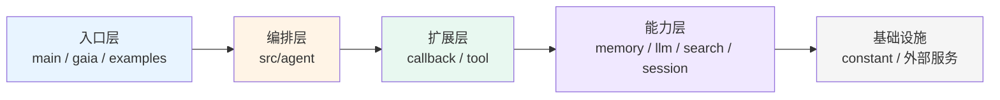

| 层       | 位置                                                                                                        | 职责                     | 关键规则                     |
| -------- | ----------------------------------------------------------------------------------------------------------- | ------------------------ | ---------------------------- |
| 入口层   | `src/main.rs`、`src/bin/`、`examples/`                                                                      | 装配依赖、驱动场景       | 不写业务逻辑，只做装配       |
| 编排层   | `src/agent/`、`src/multi_agent/`                                                                            | 控制"想 → 做 → 判"的循环 | 只依赖 trait，不依赖具体实现 |
| 扩展层   | `src/agent/callback/`、`src/tool/`                                                                          | 提供可插拔能力点         | 全部通过 trait 注册          |
| 能力层   | `src/memory/`、`src/llm/`、`src/search/`、`src/knowledge/`、`src/session/`、`src/sandbox/`、`src/planning/` | 提供具体能力             | 相互之间尽量不横向依赖       |
| 基础设施 | `src/constant.rs`、`src/skill.rs`、外部服务                                                                 | 配置与 IO                | 配置不硬编码在业务代码       |

---

## Agent 运行主流程

### 1. 入口与上下文准备


`Session` 承载三类数据：

| 字段                                       | 用途                                                                  |
| ------------------------------------------ | --------------------------------------------------------------------- |
| `events: Vec<AgentEvent>`                  | 完整对话/工具历史，是 LLM 请求的唯一来源                              |
| `state: HashMap<String, Value>`            | 扩展状态：`tool_confirmations`、`context_summary`、`last_summary_idx` |
| `pending_tool_calls: Vec<PendingToolCall>` | 等待人工确认的工具调用                                                |

### 2. 主循环

```mermaid
flowchart TD
    LOOP{{"loop"}} --> GUARD{"current_step >= max_steps?"}
    GUARD -->|yes| BAIL["bail! 'exceeded max steps'"]
    GUARD -->|no| STEP["step&#40;&client, &mut context&#41;"]

    STEP --> RES{"StepResult"}
    RES -->|"Final(s)"| PARSE{"has_final_answer_tool?"}
    PARSE -->|yes| JSON["s 作为 JSON 解析"]
    PARSE -->|no| TEXT["s 作为 String"]
    JSON --> SAVE1["session_manager.save&#40;session&#41;"]
    TEXT --> SAVE1
    SAVE1 --> RETC["return AgentResult&#40;output, Complete&#41;"]

    RES -->|"Continue"| INC["current_step += 1"]
    INC --> PEND{"pending_tool_calls 非空?"}
    PEND -->|yes| SAVE2["session_manager.save&#40;session&#41;"]
    SAVE2 --> RETP["return AgentResult&#40;None, PendingConfirmation&#41;"]
    PEND -->|no| TRF{"transfer_to 有值?"}
    TRF -->|yes| TRFC{"transfer_count >= MAX_TRANSFERS?"}
    TRFC -->|yes| BAIL2["bail! 'transfer exceeded max'"]
    TRFC -->|no| TRFH["找目标 agent<br/>current_step = 0<br/>save&#40;session&#41;<br/>递归 run_in_context"]
    TRF -->|no| LOOP

    style BAIL fill:#ffe8ec
    style BAIL2 fill:#ffe8ec
    style RETC fill:#e8f8f0
    style RETP fill:#fff4e6
    style TRFH fill:#f0e8ff
```

> **审批优先于转移**：同一步里既请求了危险工具又请求了 transfer 时，先处理审批，否则 pending 会留在错误的 agent 上。

```mermaid
stateDiagram-v2
    [*] --> Idle: run&#40;&#41; 进入
    Idle --> Running: step&#40;&#41;
    Running --> Idle: StepResult 继续
    Running --> Completed: StepResult 终局
    Running --> AwaitingApproval: 产生 pending_tool_calls
    AwaitingApproval --> Running: 下次 run&#40;&#41; 携带 ToolConfirmation
    Idle --> Failed: 超过 max_steps / LLM 错误
    Running --> Failed: LLM 错误 / 空响应
    Completed --> [*]
    Failed --> [*]

    note right of AwaitingApproval
        AgentStatus 为 PendingConfirmation
        output = None
        session 已 save
    end note
```

### 3. 单步决策树

```mermaid
flowchart TD
    A["prepare_llm_request&#40;&#41;"] --> B{"pending_tool_calls 非空<br/>且 state 有 tool_confirmations?"}
    B -->|yes| PC["process_confirmations&#40;&#41;"]
    PC --> PC1["approved → 按（可被修改的）参数执行工具"]
    PC --> PC2["rejected → ToolResult&#40;Error, reason&#41;"]
    PC --> PC3["无对应确认 → ToolResult&#40;Error&#41;"]
    PC1 --> PCE["写入 tool 事件<br/>清空 pending_tool_calls 与 state"]
    PC2 --> PCE
    PC3 --> PCE
    B -->|no| D

    D["tool_choice = has_final_answer ? Required : Auto"] --> E["contents = session.events 摊平"]
    E --> F["LlmRequest::new&#40;instructions, contents&#41;"]
    F --> G["before_llm_callbacks 顺序执行"]
    G --> G1["① MemoryInjectionCallback<br/>注入历史经验"]
    G1 --> G2["② ContextOptimizer<br/>压缩 / 摘要上下文"]
    G2 --> H["think&#40;&#41; → LLM 请求"]

    H --> I{"响应类型"}
    I -->|"有 tool_calls"| J["act_all&#40;&#41;"]
    I -->|"仅 content"| K["记 assistant 事件"]
    I -->|"空响应"| L["bail! 'Empty response from model'"]

    K --> K1{"has_final_answer_tool?"}
    K1 -->|yes| M["StepResult::Continue"]
    K1 -->|no| N["StepResult::Final&#40;content&#41;"]

    J --> J1{"每个 tool_call"}
    J1 --> J2["工具不存在?"]
    J2 -->|yes| J3["ToolResult&#40;Error, unknown tool&#41;"]
    J2 -->|no| J4{"requires_confirmation&#40;&#41;?"}
    J4 -->|yes| J5["记 ToolCall 事件<br/>add_pending_tool_call<br/>→ 挂起"]
    J4 -->|no| J6["before_tool_callbacks"]
    J6 --> J7{"回调返回 Some?"}
    J7 -->|yes| J8["以回调文案作为工具结果"]
    J7 -->|no| J9["tool.execute&#40;args, ctx&#41;"]
    J9 --> J10["after_tool_callbacks"]
    J10 --> J11["SearchCompressor<br/>web_search 结果 ≥2000 字符 → top3"]
    J8 --> J3E["记 ToolResult 事件"]
    J11 --> J3E
    J3 --> J3E
    J5 --> O
    J3E --> O

    O{"final_answer_output&#40;&#41;<br/>倒序找 final_answer 的成功结果"} -->|yes| P["StepResult::Final&#40;json&#41;"]
    O -->|no| Q["StepResult::Continue"]

    style L fill:#ffe8ec
    style P fill:#e8f8f0
    style J5 fill:#fff4e6
```

### 4. 工具执行细节（`act.rs`）

```mermaid
flowchart TD
    T0["act_all&#40;&tool_calls&#41;"] --> T1{"ChatCompletionMessageToolCalls"}
    T1 -->|"Function"| T2{"tool.requires_confirmation&#40;&#41;"}
    T1 -->|"Custom"| TC["记 ToolResult&#40;Error,<br/>'Custom tool call not implemented'&#41;"]

    T2 -->|true| TP["记 AgentEvent&#40;assistant, ToolCall&#41;<br/>+ add_pending_tool_call&#40;确认文案&#41;<br/>continue 下一个"]
    T2 -->|false| TA["act&#40;tool_call, ctx&#41;"]

    TA --> TA1["记 AgentEvent&#40;assistant, ToolCall&#41;"]
    TA1 --> TA2["before_tool_callbacks 逐个调用<br/>任一返回 Some 即短路"]
    TA2 --> TA3{"短路?"}
    TA3 -->|yes| TA4["记 ToolResult&#40;Success, 回调文案&#41;"]
    TA3 -->|no| TA5["tool.execute&#40;args_json, ctx&#41;<br/>找不到工具 → Error 文案"]
    TA5 --> TA6["按 Ok/Err 映射为 Success/Error"]
    TA6 --> TA7["after_tool_callbacks 逐个调用<br/>任一返回 Some 即短路"]
    TA7 --> TA8{"短路?"}
    TA8 -->|yes| TA9["用回调结果替换原结果"]
    TA8 -->|no| TA10["保留原结果"]
    TA4 --> TA11["记 AgentEvent&#40;agent, ToolResult&#41;"]
    TA9 --> TA11
    TA10 --> TA11
    TC --> TA11

    style TP fill:#fff4e6
    style TA7 fill:#f0e8ff
```

### 5. 工具确认的两阶段协议

这是 Agent 支持"人工介入"的核心机制，跨越两次 `run()` 调用：

```mermaid
sequenceDiagram
    autonumber
    participant U as 用户/宿主应用
    participant A as Agent
    participant L as LLM
    participant T as Tool
    participant S as SessionManager

    Note over A,S: ——— 第 1 次 run() ———

    U->>A: run(prompt, session_id, None)
    A->>S: get_or_create(session_id)
    S-->>A: Session
    A->>L: think() → 请求 delete_file
    L-->>A: tool_calls[delete_file]
    A->>A: requires_confirmation&#40;&#41; == true
    A->>A: 记 Event&#40;assistant, ToolCall&#41;
    A->>A: session.add_pending_tool_call&#40;确认文案&#41;
    A->>S: save(session)
    A-->>U: AgentResult &#40;output=None,<br/>status=PendingConfirmation&#41;

    Note over U,S: ——— 宿主弹出确认框，收集决定 ———

    U->>A: run(prompt, session_id,<br/>Some&#40;vec&#91;ToolConfirmation&#93;&#41;&#41;)
    A->>S: get_or_create(session_id) → 同一 Session
    A->>A: state&#91;'tool_confirmations'&#93; = JSON
    A->>A: prepare_llm_request&#40;&#41;
    A->>A: 检测 pending_tool_calls + state
    A->>A: process_confirmations&#40;&#41;

    alt approved = true
        A->>T: execute&#40;可能已被 modified_arguments 改写的参数&#41;
        T-->>A: 执行结果
        A->>A: 记 ToolResult&#40;Success&#41;
    else approved = false
        A->>A: 记 ToolResult&#40;Error, reason&#41;
    end

    A->>A: 清空 pending_tool_calls 与 state
    A->>L: think() 继续下一步
    L-->>A: 后续响应
    A->>S: save(session)
    A-->>U: AgentResult &#40;output, Complete&#41;
```

`ToolConfirmation.modified_arguments` 允许审批者在批准的同时**修改工具参数**（如把 `delete_file` 的路径改掉）。

```mermaid
flowchart LR
    subgraph P1["第 1 次 run&#40;&#41;"]
        A1["LLM 请求 delete_file"] --> A2["requires_confirmation == true"]
        A2 --> A3["记 ToolCall 事件"]
        A3 --> A4["add_pending_tool_call"]
        A4 --> A5["step → Continue"]
        A5 --> A6["save&#40;session&#41;"]
        A6 --> A7["返回 PendingConfirmation"]
    end

    subgraph HOST["宿主应用"]
        H1["展示 confirmation_message"]
        H2["收集 approved / reason /<br/>modified_arguments"]
    end

    subgraph P2["第 2 次 run&#40;&#41;"]
        B1["run&#40;..., Some&#40;confirmations&#41;&#41;"]
        B1 --> B2["state&#91;'tool_confirmations'&#93;"]
        B2 --> B3["process_confirmations"]
        B3 --> B4{"approved?"}
        B4 -->|yes| B5["执行工具&#40;用改写后的参数&#41;"]
        B4 -->|no| B6["ToolResult&#40;Error, reason&#41;"]
        B5 --> B7["继续 think"]
        B6 --> B7
    end

    A7 --> H1 --> H2 --> B1

    style A7 fill:#fff4e6
    style B4 fill:#f0e8ff
```

## 模块详解

### `src/agent/` — Agent 编排

| 文件                   | 职责                                                                                                                                                                                                                      |
| ---------------------- | ------------------------------------------------------------------------------------------------------------------------------------------------------------------------------------------------------------------------- |
| `model.rs`             | `Agent` 结构体、回调注册 builder（`with_max_steps` / `with_before_llm_callbacks` 等）、`prepare_llm_request`、`process_confirmations`、Agent 树（`set_sub_agents` / `transfer_targets`）、`AgentResult<T>`、`AgentStatus` |
| `runtime.rs`           | 主循环、步数上限保护、转移交接、最终结果反序列化                                                                                                                                                                          |
| `runtime/step.rs`      | 单步编排：`think` → 分支决策 → `act_all` → 终局判定                                                                                                                                                                       |
| `runtime/think.rs`     | 组装 `CreateChatCompletionRequestArgs`（model / max_tokens=2048 / tools / tool_choice）并发起调用                                                                                                                         |
| `runtime/act.rs`       | 工具调用执行、确认挂起、转移工具拦截、前后置回调调用、事件写入                                                                                                                                                            |
| `context.rs`           | `ExecutionContext`：`execution_id` / `current_step` / `final_result` / `session` / `transfer_to` / `transfer_count` / `transfer_history`                                                                                  |
| `event.rs`             | `AgentEvent`（事件信封）与 `ContentItem`（`Message` / `ToolCall` / `ToolResult`）、`ToolResultStatus`                                                                                                                     |
| `tool_confirmation.rs` | `PendingToolCall`（挂起项）、`ToolConfirmation`（审批结果）                                                                                                                                                               |

`Agent` 的 builder 风格让装配非常直观：

```rust
let agent = Agent::new(
    GPT_6_LUNA_PRO_MODEL.to_owned(),
    vec!["You are a helpful study assistant for children.".to_owned()],
    Arc::new(toolbox),
)
.with_max_steps(10)
.with_before_llm_callbacks(Arc::new(MemoryInjectionCallback::new(memory_manager.clone())))
.with_before_llm_callbacks(Arc::new(
    ContextOptimizer::new(GPT_6_LUNA_PRO_MODEL).with_token_threshold(1000),
));
```

> 注意 `think()` 内部硬编码使用 `GPT_6_LUNA_PRO_MODEL` 作为请求模型，而 `Agent.model` 字段目前仅用于记录；这是当前实现的已知不一致点。

### `src/multi_agent/` — 多智能体

| 文件                     | 职责                                                            |
| ------------------------ | --------------------------------------------------------------- |
| `node.rs`                | `AgentNode` trait，`Agent` 的实现（重置步数预算、注入用户消息） |
| `workflow/sequential.rs` | 串行流水线                                                      |
| `workflow/parallel.rs`   | 并行分叉 + 事件合并                                             |
| `workflow/loop.rs`       | 循环 + 可插拔停止条件 + `max_iterations` 上限                   |

### `src/llm/` — LLM 接入层

| 文件             | 职责                                                                                                                         |
| ---------------- | ---------------------------------------------------------------------------------------------------------------------------- |
| `ask.rs`         | 泛型结构化调用：`ask::<T>()` 强制 JSON Schema 严格模式（`additionalProperties: false` + 全字段 required），指数退避重试 3 次 |
| `llm_request.rs` | `LlmRequest` 聚合 instructions + contents + tool_choice，`build_message()` 把 `ContentItem` 翻译成 OpenAI message 数组       |
| `llm_answer.rs`  | `TextAnswer { text: String }` —— 最小可用的结构化输出载体                                                                    |
| `semaphore.rs`   | 全局 `Semaphore`，并发上限 3，用于 GAIA 批量评测限流                                                                         |

#### `ask::<T>()` 结构化调用流程

```mermaid
flowchart TD
    A["ask::&lt;T&gt;&#40;model, prompt&#41;"] --> B["schema_for!&#40;T&#41;<br/>生成 JSON Schema"]
    B --> C["enforce_strict_schema&#40;&#41;<br/>递归为每个 object 加上<br/>additionalProperties=false<br/>+ 全字段 required"]
    C --> D["构造请求<br/>response_format = JsonSchema&#40;strict=true&#41;"]
    D --> E{"retry&#40;backon 指数退避<br/>max_times=3&#41;"}
    E --> F["client.chat&#40;&#41;.create&#40;request&#41;"]
    F --> G{"结果"}
    G -->|"Ok"| H{"message.refusal?"}
    G -->|"Err 且可重试"| E
    G -->|"Err 且不可重试"| X(["返回 Err"])
    H -->|"有 refusal"| Y(["Err 'LLM refused to answer'"])
    H -->|"无"| I{"content 存在?"}
    I -->|no| Z(["Err 'LLM returned empty content'"])
    I -->|yes| J["serde_json::from_str::&lt;T&gt;&#40;content&#41;"]
    J --> K(["Ok&#40;T&#41;"])

    style C fill:#f0e8ff
    style K fill:#e8f8f0
```

#### `is_retryable` 判定

```mermaid
flowchart TD
    A["OpenAIError"] --> B{"Reqwest&#40;&#41;?"}
    B -->|是| C["可重试<br/>网络层错误"]
    B -->|否| D{"ApiError?"}
    D -->|是| E{"type ==<br/>rate_limit_exceeded<br/>或 server_error?"}
    E -->|是| C
    E -->|否| F["不可重试"]
    D -->|否| F

    style C fill:#e8f8f0
    style F fill:#ffe8ec
```

```rust
fn is_retryable(e: &OpenAIError) -> bool {
    match e {
        OpenAIError::Reqwest(_) => true,                       // 网络层错误
        OpenAIError::ApiError(api) => matches!(
            api.api_error.r#type.as_deref(),
            Some("rate_limit_exceeded" | "server_error")      // 限流 / 服务端错误
        ),
        _ => false,
    }
}
```

#### `LlmRequest::build_message()` 翻译规则

| ContentItem            | 生成的 message                                                                   |
| ---------------------- | -------------------------------------------------------------------------------- |
| `Message{role:"user"}` | `user` message                                                                   |
| `Message{role:其他}`   | `assistant` message                                                              |
| `ToolCall`             | 追加到**上一条 assistant message** 的 `tool_calls`；若无则新建 assistant message |
| `ToolResult`           | `tool` message（携带 `tool_call_id`）                                            |

```mermaid
flowchart LR
    subgraph IN["输入 contents"]
        I1["Message&#40;user&#41;"]
        I2["Message&#40;assistant&#41;"]
        I3["ToolCall"]
        I4["ToolResult"]
    end

    subgraph OUT["输出 messages"]
        O1["user message"]
        O2["assistant message"]
        O3["assistant message<br/>&#40;合并 tool_calls&#41;"]
        O4["tool message<br/>&#40;tool_call_id&#41;"]
    end

    I1 --> O1
    I2 --> O2
    I3 -->|"若上一条是 assistant<br/>→ 追加 tool_calls"| O3
    I3 -->|"否则新建<br/>assistant message"| O3
    I4 --> O4

    style IN fill:#fff4e6
    style OUT fill:#e8f4ff
```

### `src/search/` — 检索层

| 文件               | 职责                                                                                                            |
| ------------------ | --------------------------------------------------------------------------------------------------------------- |
| `embedding.rs`     | `embed_texts()` / `embed_text()`，调用 OpenAI 兼容 embedding 接口并按 `index` 排序还原顺序；单批 10 条自动分批  |
| `chunking.rs`      | `fixed_length_chunking(text, chunk_size, overlap)` 固定长度滑动切片；`chunking_with_offsets()` 额外返回原文偏移 |
| `similarity.rs`    | `cosine_similarity(a, b)` 余弦相似度                                                                            |
| `vector_search.rs` | `vector_search(query, chunks, top_k)`：查询与候选同时 embedding，按相似度降序取 top_k                           |

#### RAG 检索管线

```mermaid
flowchart TD
    subgraph CH["① 切片 chunking.rs"]
        C1["原始文本"] --> C2["fixed_length_chunking&#40;text,<br/>chunk_size=500, overlap=50&#41;"]
        C2 --> C3["Vec&lt;String&gt;<br/>step = chunk_size - overlap"]
    end

    subgraph EM["② 向量化 embedding.rs"]
        E1["query 文本"] --> E3["embed_text&#40;query&#41;"]
        E2["所有 chunks"] --> E4["embed_texts&#40;chunks&#41;"]
        E3 --> E5["按 index 排序还原顺序"]
        E4 --> E5
    end

    subgraph VS["③ 排序检索 vector_search.rs"]
        V1["cosine_similarity&#40;query_emb, chunk_emb&#41;"] --> V2["按相似度降序排序"]
        V2 --> V3["take&#40;top_k&#41;"]
    end

    C3 --> E2
    E5 --> V1
    V3 --> OUT(["Vec&lt;SearchHit&gt;<br/>&#123;text, similarity&#125;"])

    style CH fill:#e8f8f0
    style EM fill:#f0e8ff
    style VS fill:#fff4e6
```

#### 切片算法示意

```
text = "abcdefghij", chunk_size = 5, overlap = 2  →  step = 5 - 2 = 3

start=0  → [0..5)  "abcde"
start=3  → [3..8)  "defgh"
start=6  → [6..10) "ghij"   （end == len，结束）

重叠部分保证语义连续性，避免答案正好被切在边界上
```

> embedding 接口单批最多 **10** 条，超出会报 `batch size is invalid`。
> `embed_texts()` 内部已按 10 条自动分批，调用方可以传任意长度的列表。
> （早期文档写的是 20，是未实测的估计值，实际调用会 400。）

### `src/knowledge/` — 文档知识库（RAG）

`src/search/` 提供的是**检索原语**（切片、embedding、余弦相似度），每次调用都得把候选重新算一遍向量，没有落库。本模块补上完整链路：**文档 → 切片 → 向量入库 → 混合检索 → 拼进 prompt**。

| 文件                | 职责                                                                       |
| ------------------- | -------------------------------------------------------------------------- |
| `model.rs`          | `Document`（原始文档）、`Chunk`（切片+向量）、`SearchHit` / `SearchResult` |
| `store.rs`          | `KnowledgeStore`：SQLite 持久化 + 混合检索编排                             |
| `index.rs`          | `KnowledgeIndex`：vec0 向量索引 + FTS5 关键词索引（含同步触发器）          |
| `tokenizer.rs`      | 中英混合分词器（中文 bigram + 英文整词）                                   |
| `hybrid.rs`         | RRF（Reciprocal Rank Fusion）融合多路召回结果                              |
| `embedder.rs`       | `Embedder` trait；`ApiEmbedder` 走接口，`FakeEmbedder` 供离线测试          |
| `knowledge_base.rs` | `KnowledgeBaseManager`：编排切片 → embedding → 落库 → 检索                 |

#### 与 `src/memory/` 的区别

两者都用 SQLite + embedding，但语义完全不同，所以独立成模块：

|          | `src/memory/`（长期记忆）            | `src/knowledge/`（文档知识库） |
| -------- | ------------------------------------ | ------------------------------ |
| 存什么   | LLM 抽取的**解题经验**（结构化字段） | **原始文档**（原样保留全文）   |
| 检索目标 | 找到**相似问题**                     | 找到**相关段落**               |
| 内容来源 | Agent 执行事件                       | 用户导入的文档                 |
| 注入方式 | `MemoryInjectionCallback` 自动注入   | 工具调用 / 手动拼 prompt       |

#### 混合检索流程

检索是**两路召回 + RRF 融合**：

```mermaid
flowchart TD
    subgraph ADD["写入路径 add_document&#40;title, source, content&#41;"]
        A0(["文档全文"]) --> A1["chunking_with_offsets&#40;<br/>chunk_size=500, overlap=50&#41;"]
        A1 --> A2["标题 + 切片文本"]
        A2 --> A3["Embedder::embed&#40;&#41;<br/>分批调用 embedding 接口"]
        A3 --> A4["chunks 表<br/>文本 + 向量 blob"]
        A4 --> A5["触发器自动同步<br/>vec0 向量索引 + FTS5 关键词索引"]
    end

    subgraph SRCH["检索路径 search&#40;query, top_k&#41;"]
        Q0(["查询文本"]) --> Q1["Embedder::embed&#40;query&#41;"]
        Q0 --> Q6["tokenizer::tokenize_or&#40;&#41;<br/>中文 bigram + 英文整词"]
        Q1 --> Q2["vec0 KNN<br/>近似最近邻 O&#40;log N&#41;"]
        Q6 --> Q3["FTS5 BM25<br/>倒排索引"]
        Q2 --> Q4["两路结果转排名列表"]
        Q3 --> Q4
        Q4 --> Q5["RRF 融合<br/>score = Σ 1&#40;k + rank&#41;"]
        Q5 --> Q7(["Vec&lt;SearchHit&gt;<br/>带 title / source / offset"])
    end

    A5 --> Q2
    A5 --> Q3

    style ADD fill:#e8f8f0
    style SRCH fill:#fff4e6
```

> **标题参与 embedding**：同一段文字在不同文档里语义可能完全不同，
> 把标题拼进向量文本能让"讲 Rust 的文档"和"讲 Python 的文档"区分开。

#### 数据表

```sql
documents (id, title, source, content, created_at)

chunks    (id, document_id → documents ON DELETE CASCADE,
           start_offset, text, embedding)      -- embedding 为小端 f32 blob

-- 向量索引：sqlite-vec 的 vec0 虚表，自带近似最近邻索引
chunk_embeddings (chunk_id, embedding float[1024] distance_metric=cosine)

-- 关键词索引：FTS5 倒排索引 + BM25
chunk_fts (chunk_id UNINDEXED, tokens, tokenize='unicode61')
```

两张索引表都由**触发器**与 `chunks` 保持同步，删除文档时索引自动清理，不留孤儿数据。

#### 三个关键设计

**1. 为什么用 RRF 而不是加权分数相加**

向量检索返回余弦相似度（0~1，越大越像），关键词检索返回 BM25 分数（负值，越小越相关）。两者量纲完全不同，没有可比基准 —— 归一化加权会随查询漂移，直接相加则 BM25 的负值会抵消向量分数。

RRF 只用**排名**不用分数，天然规避量纲问题：

```text
score(d) = Σ  1 / (k + rank_i(d))
           i
```

被两路同时命中的文档会累积得分，这正是混合检索想要的行为。

**2. 中文分词为什么要自己写**

SQLite FTS5 自带分词器对中文支持很差：`unicode61` 把整段中文当一个 token；`trigram` 要求 ≥3 字符，导致 **2 字查询（"面积"）完全搜不到** —— 而这在中文里非常常见。

本模块自己把中文切成 **bigram**（相邻两字）再写进 FTS5：

```text
"圆的面积公式"  →  圆的 的面 面积 积公 公式
```

英文不能这么切（"TCP" 切成 "TC"/"CP" 就搜不到了），所以**连续 ASCII 字母数字整体保留为一个 token**：

```text
"TCP 是面向连接的协议"  →  TCP 是面 面向 向连 连接 接的 的协 协议
```

每个 token 都被双引号包裹，避免 FTS5 把 `*`、`(` 等字符当成语法。

**3. 关键词路为什么用 OR 而不是 AND**

bigram 切分后，一个长查询会拆出多个 bigram，而这些 bigram 未必出现在同一篇文档里。用 AND 的话只要缺一个 bigram 就**完全召回不到任何结果**（实测确认），等于关键词路失效。

用 OR 放宽召回，再交给 BM25 按词频与 IDF 重排。

#### 检索方式

| 方法                    | 用途                                  | 阈值过滤 |
| ----------------------- | ------------------------------------- | -------- |
| `search()`（默认）      | 混合检索，RRF 融合                    | 不套阈值 |
| `search_vector_only()`  | 纯向量；语义相近但用词不同也能找到    | 套阈值   |
| `search_keyword_only()` | 纯 BM25；专有名词、函数名、错误码更准 | 不套阈值 |

> **混合路径为什么不套 `min_similarity` 阈值**：
> 阈值是针对余弦相似度设计的，但关键词路的命中是**字面精确匹配**。
> 查 `std::Vec` 这类专有名词时，字面命中的片段余弦相似度可能只有 0.2，
> 套用阈值会把最精准的命中过滤掉，关键词路等于白做。
> 两路命中本身就是"相关"的证据，质量由 RRF 排名和 `top_k` 截断保证。

#### 用法

```rust
use zephyr::{
    constant::TEXT_EMBEDDING_3_SMALL_MODEL,
    knowledge::knowledge_base::KnowledgeBaseManager,
};

let kb = KnowledgeBaseManager::new("knowledge.db", TEXT_EMBEDDING_3_SMALL_MODEL)?
    .with_chunking(500, 50)
    .with_top_k(5);

// 入库
kb.add_document("Rust 所有权", "https://doc.rust-lang.org/...", "所有权是...").await?;

// 检索
let result = kb.search("Rust 的借用规则是什么", 3).await?;
for hit in &result.hits {
    println!("{:.3} {} — {}", hit.similarity, hit.title, hit.text);
}

// 直接得到可放进 prompt 的上下文
let context = kb.search_and_format("所有权解决什么问题", 2).await?;
```

完整演示：`cargo run --example knowledge_demo`

#### 已知限制

- **向量维度不可变**：`vec0` 虚表的维度在建表时固定，换 embedding 模型或维度需要**重建库**，
  否则写入会被 sqlite-vec 拒绝（`Dimension mismatch`）。`ApiEmbedder::with_dim()` 可显式指定。
- **bigram 的固有代价**：中文按相邻两字切分会引入一些无意义的跨字组合
  （"面积"与"积累"共享"积"），这一点靠 BM25 的 IDF 加权缓解，罕见字的 bigram 权重更高。
- **向量召回是近似的**：`vec0` 用近似最近邻，召回结果可能与暴力检索略有差异，
  追求绝对精确可调用 `search_vector_only()` 走暴力路径。
- **混合路径不套相似度阈值**：这是有意为之（见上文"混合路径为什么不套 `min_similarity` 阈值"），
  代价是混合检索的结果里可能混入相关性一般的片段，依赖 `top_k` 截断控制规模。

### `src/planning/` — 任务规划

极简的任务清单模型，用于让 LLM 在复杂任务中显式维护"待办"：

```rust
pub struct Task { pub content: String, pub status: TaskStatus }

pub enum TaskStatus { Pending, InProgress, Completed }
```

`Display` 实现直接渲染成 Markdown 风格的状态清单：

| 状态         | 渲染           |
| ------------ | -------------- |
| `Pending`    | `[ ] 内容`     |
| `InProgress` | `[>] **内容**` |
| `Completed`  | `[x] ~~内容~~` |

```mermaid
stateDiagram-v2
    [*] --> Pending: create_tasks 初始
    Pending --> InProgress: 模型把某项标记为进行中
    InProgress --> Completed: 该项完成
    Completed --> Pending: 下轮重新生成清单时回退
    Pending --> InProgress

    note right of Completed
        渲染为 [x] ~~内容~~
    end note
```

`CreateTasksTool` 要求模型**每次重新生成整个清单**并更新状态，从而把进度显式暴露在对话历史里。

```mermaid
flowchart LR
    A["LLM 决定下一步"] --> B["调用 create_tasks&#40;tasks[]&#41;"]
    B --> C["CreateTasksArgs 反序列化<br/>&#40;status 枚举校验&#41;"]
    C --> D["create_tasks&#40;&tasks&#41;<br/>渲染成 Markdown 清单"]
    D --> E["返回文本 → 作为 tool result<br/>写入会话历史"]
    E --> F["LLM 看到进度，继续执行"]

    style E fill:#e8f8f0
```

---

### `src/sandbox/` — 代码沙箱

让模型执行真实代码是能力跃迁，也是最大的安全风险。`src/sandbox/` 的做法是**容器隔离 + 宿主桥接**两层。

| 文件           | 职责                                                            |
| -------------- | --------------------------------------------------------------- |
| `config.rs`    | 从环境变量读取开关与路径，`settings_from(get)` 便于测试注入假值 |
| `podman.rs`    | `PodmanSandbox`：拉起容器、执行命令、处理 stdio 协议            |
| `runner.rs`    | 内嵌 `runner.py` 源码，沙箱内常驻进程                           |
| `bridge.rs`    | `SandboxTool` trait、Python stub 生成、宿主侧 dispatch          |
| `workspace.rs` | 工作区路径校验，防止沙箱内路径逃逸                              |

#### 安全默认值

```rust
PodmanConfig {
    memory: "512m",
    cpus: 1.0,
    pids_limit: 256,
    network: NetworkPolicy::Disabled,   // 默认断网
    read_only_rootfs: true,             // 根文件系统只读
    lifetime: Duration::from_secs(300),// 会话最长 5 分钟
    exec_timeout: Duration::from_secs(30),
}
```

#### 宿主桥接

沙箱里的 Python 可以直接调用宿主上的工具。做法是宿主为每个 `SandboxTool` 生成一段 stub 注入沙箱：

```rust
pub fn python_stub(tool: &dyn SandboxTool) -> String {
    format!(
        "def {name}(**kwargs):\n    \"\"\"{desc}\"\"\"\n    return _call_tool(\"{name}\", kwargs)\n"
    )
}
```

```mermaid
sequenceDiagram
    autonumber
    participant PY as 沙箱内 Python
    participant RUN as runner.py
    participant HOST as 宿主 Rust
    participant T as 宿主工具
    PY->>RUN: get_wikipedia_revisions("Rust")
    RUN->>HOST: stdio JSON tool_call
    HOST->>T: WikipediaRevisions::call(args)
    T-->>HOST: Ok(value)
    HOST-->>RUN: stdio JSON result
    RUN-->>PY: 返回值
```

`SandboxTool` 的签名**故意不带 `ExecutionContext`**——沙箱内的代码不能依赖 Agent 状态，这是有意的隔离边界。

#### 开关

`CODE_EXECUTION` 未开启时 `register_code_tools` 直接返回空，工具也不注册，沙箱是完全可选的能力。

---

### `src/multi_agent/` — 多智能体编排

| 文件                     | 职责                                                 |
| ------------------------ | ---------------------------------------------------- |
| `node.rs`                | `AgentNode` trait，统一 Agent 与 Workflow 的节点接口 |
| `workflow/sequential.rs` | 串行流水线，后一个看得到前一个的工作                 |
| `workflow/parallel.rs`   | 并行分叉，各分支基于同一初始状态                     |
| `workflow/loop.rs`       | 循环直到满足停止条件或达到最大轮数                   |

`AgentNode` 的设计使得 `Agent` 和 `Workflow` 可以互相嵌套：

```rust
#[async_trait]
pub trait AgentNode: Send + Sync {
    fn name(&self) -> &str;
    fn description(&self) -> &str { "" }
    async fn execute(
        &self,
        user_input: Option<String>,
        context: ExecutionContext,
    ) -> anyhow::Result<AgentResult<serde_json::Value>>;
}
```

`user_input = None` 表示"继续"，不再追加新的用户消息——这是 `ParallelWorkflow` 给每个分支喂同一初始上下文的方式。

#### 三种工作流的上下文语义

```mermaid
flowchart TB
    subgraph SEQ["SequentialWorkflow"]
        S1["researcher"] --> S2["writer"] --> S3["editor"]
        S1 -.->|"共享 context<br/>后一个看到前一个"| S2
    end
    subgraph PAR["ParallelWorkflow"]
        P0["初始 context"] --> P1["optimist"]
        P0 --> P2["pessimist"]
        P0 --> P3["realist"]
        P1 --> PM["按 agent 顺序合并事件"]
        P2 --> PM
        P3 --> PM
    end
    subgraph LOOP["LoopWorkflow"]
        L1["writer 起草"] --> L2["reviewer 评分"]
        L2 --> L3{"stop_condition 满足?"}
        L3 -->|否| L1
        L3 -->|是| L4["结束"]
        L3 -->|"达到 max_iterations"| L5["强制结束并告警"]
    end
```

`ParallelWorkflow` 的关键实现是给每个分支一份 **context 副本**：

```rust
let base_len = context.session.events.len();
let results = try_join_all(
    self.agents.iter().map(|agent| agent.execute(None, context.clone())),
).await?;
```

合并时只取各分支**新增**的事件（从 `base_len` 之后开始），避免重复写入初始历史。

`LoopWorkflow` 的停止条件是可插拔的闭包，`max_iterations` 是必填的（为 0 直接报错）：

```rust
pub type StopCondition = Arc<dyn Fn(&AgentResult<serde_json::Value>, usize) -> bool + Send + Sync>;

LoopWorkflow::new(vec![writer, reviewer], 4)
    .with_stop_condition(|result, _iteration| {
        result.output["score"].as_u64().unwrap_or(0) >= 85
    })
```

跑到 `max_iterations` 仍未满足条件时会打 warning 并返回最后一次结果，不会无限循环。

#### 两种协作模式对比

| 模式              | 上下文                     | 控制权           | 典型场景         |
| ----------------- | -------------------------- | ---------------- | ---------------- |
| **Transfer**      | 同一 session，共享全部历史 | 转移后**不返回** | 路由到专业领域   |
| **Agent-as-Tool** | 子代理**全新 session**     | 返回后回到调用方 | 并行调研、子能力 |

---

### `src/skill.rs` — 技能加载

一种"渐进式披露"的提示词技术：只把 `name` 和 `description` 注入系统提示，完整指令由模型自己在沙箱里读取。

```rust
/// A skill: a folder containing a `SKILL.md`. Only `name` and `description` go into the prompt;
/// the full instructions are read on demand, which keeps the prompt small.
pub struct SkillInfo {
    pub name: String,
    pub description: String,
    pub path: PathBuf,
}
```

frontmatter 解析只按第一个冒号切分，因此描述里可以包含冒号：

```rust
pub fn parse_frontmatter(content: &str) -> HashMap<String, String> { ... }
```

生成的提示词形如（第一行是 `## Available Skills` 标题）：

```
[标题] Available Skills
Skills are installed at `/skills`. Read the SKILL.md file before using a skill.

- **pdf-merge**: Merge multiple PDF files into one. Use when: the user wants to combine PDFs.

To use a skill:
    cat /skills/<skill-name>/SKILL.md
```

无论装多少技能，注入提示的 token 数都是常数级的。

---

## 回调机制（Callback）

框架在三个时机提供回调扩展点，均为 `Arc<dyn Trait>`，注册顺序即执行顺序，且**一旦某个回调返回 `Some` 就短路**。

### 三个扩展点

```mermaid
flowchart TD
    subgraph BL["before_llm_callbacks"]
        BL1["签名: &#40;session: &mut Session,<br/>llm_request: &mut LlmRequest&#41;<br/>无返回值，可自由改写 request"]
    end

    subgraph BT["before_tool_callbacks"]
        BT1["签名: &#40;ctx: &ExecutionContext,<br/>tool_call&#41; → Option&lt;String&gt;"]
        BT2["Some&#40;str&#41; = 拦截工具执行，<br/>该文案作为工具结果"]
        BT3["None = 放行，继续执行"]
    end

    subgraph AT["after_tool_callbacks"]
        AT1["签名: &#40;ctx, tool_call,<br/>tool_result: &str&#41; → Option&lt;String&gt;"]
        AT2["Some&#40;str&#41; = 用该文案替换原工具结果"]
        AT3["None = 保留原工具结果"]
    end

    REQ["prepare_llm_request&#40;&#41;"] --> BL1
    BL1 --> LLM["think&#40;&#41; → LLM 请求"]

    LLM --> ACT["act&#40;tool_call&#41;"]
    ACT --> BT1
    BT1 --> BT2
    BT1 --> BT3
    BT3 --> EXEC["tool.execute&#40;&#41;"]
    EXEC --> AT1
    AT1 --> AT2
    AT1 --> AT3

    style BL fill:#f0e8ff
    style BT fill:#fff4e6
    style AT fill:#e8f8f0
```

### 内置回调一览

| 回调                      | 类型        | 触发条件                                              | 行为                                                                     |
| ------------------------- | ----------- | ----------------------------------------------------- | ------------------------------------------------------------------------ |
| `MemoryInjectionCallback` | before_llm  | 每轮 LLM 请求                                         | 以最近一条 user 消息为 query 检索历史记忆，命中则追加 system instruction |
| `ContextOptimizer`        | before_llm  | 每轮 LLM 请求                                         | 统计 token，超阈值时做压缩/摘要                                          |
| `ApprovalCallback`        | before_tool | 工具名 ∈ `delete_file` / `send_email` / `execute_sql` | 终端 `y/n` 交互；`n` 则返回错误文案拦截执行                              |
| `SearchCompressor`        | after_tool  | 工具名 == `web_search` 且结果长度 ≥ 2000              | 切片后向量检索，压缩为 top-3 相关片段                                    |

### 回调顺序的重要性

`src/main.rs` 中记忆注入必须放在上下文优化**之前**：

```rust
.with_before_llm_callbacks(Arc::new(MemoryInjectionCallback::new(memory_manager.clone())))
.with_before_llm_callbacks(Arc::new(
    ContextOptimizer::new(GPT_6_LUNA_PRO_MODEL).with_token_threshold(1000),
));
```

```mermaid
flowchart LR
    subgraph WRONG["❌ 顺序错误"]
        W1["ContextOptimizer<br/>统计 token&#40;不含记忆&#41;"] --> W2["压缩 / 摘要"]
        W2 --> W3["MemoryInjectionCallback<br/>追加记忆文本"]
        W3 --> W4["最终 token 超出预期阈值"]
    end

    subgraph RIGHT["✅ 顺序正确"]
        R1["MemoryInjectionCallback<br/>追加记忆文本"] --> R2["ContextOptimizer<br/>统计 token&#40;含记忆&#41;"]
        R2 --> R3["压缩 / 摘要"]
        R3 --> R4["最终 token 受控"]
    end

    style WRONG fill:#ffe8ec
    style RIGHT fill:#e8f8f0
```

原因：记忆注入会往 `instructions` 里追加文本，若先做上下文优化再注入，注入的内容不会被计入优化时的 token 统计，可能导致真实请求体超出预期阈值。

### `ApprovalCallback` 的危险工具白名单

```rust
const DANGEROUS_TOOLS: &[&str] = &["delete_file", "send_email", "execute_sql"];
```

```mermaid
flowchart TD
    A["before_tool: tool_call = delete_file"] --> B{"在 DANGEROUS_TOOLS 中?"}
    B -->|no| Z(["返回 None → 放行"])
    B -->|yes| C["打印工具名与参数"]
    C --> D["从 stdin 读一行"]
    D --> E{"输入"}
    E -->|"y"| F["打印 'Approved'<br/>返回 None → 放行"]
    E -->|"n"| G["打印 'Denied'<br/>返回 Some&#40;'User denied execution of ...'&#41;"]
    E -->|"其他"| H["返回 Some&#40;'invalid response: ...'&#41;"]

    style F fill:#e8f8f0
    style G fill:#ffe8ec
    style H fill:#ffe8ec
```

命中后从 stdin 读一行，`y` 放行（返回 `None`），`n` 或非法输入则返回错误文案（返回 `Some`），LLM 会看到"用户拒绝执行"并自行调整策略。

---

## 工具系统

### `Tool` trait

```rust
#[async_trait]
pub trait Tool: Send + Sync {
    fn name(&self) -> &str;
    fn description(&self) -> &str;
    fn parameters(&self) -> serde_json::Value;
    async fn execute(&self, args_json: &str, context: &ExecutionContext) -> anyhow::Result<String>;
    fn requires_confirmation(&self) -> bool;
    // 默认实现
    fn confirmation_message_template(&self) -> &str;
    fn get_confirmation_message(&self, arguments: &serde_json::Value) -> String;
    fn definition(&self) -> anyhow::Result<ChatCompletionTools>;
}
```

`definition()` 把 `name` / `description` / `parameters` 打包成 OpenAI 的 `tools` 数组元素；`parameters()` 通常由 `schemars::schema_for!(Args)` 自动生成，无需手写 JSON。

```mermaid
flowchart LR
    subgraph T["Tool 实现"]
        T1["name&#40;&#41;"]
        T2["description&#40;&#41;"]
        T3["parameters&#40;&#41;<br/>schema_for!&#40;Args&#41;"]
        T4["execute&#40;args_json, ctx&#41;"]
        T5["requires_confirmation&#40;&#41;"]
    end

    T1 --> D["definition&#40;&#41;"]
    T2 --> D
    T3 --> D
    D --> DEF["ChatCompletionTools::Function<br/>&#123;name, description, parameters&#125;"]
    DEF --> TOOLS["Agent::tool_definitions&#40;&#41;<br/>→ LLM 的 tools 数组"]

    style T fill:#e8f8f0
    style DEF fill:#f0e8ff
```

### 内置工具清单

| 工具名              | 类型 | 说明                                                           |
| ------------------- | ---- | -------------------------------------------------------------- |
| `calculator`        | 内置 | 表达式求值                                                     |
| `web_search`        | 内置 | Tavily 联网搜索，返回原始文本                                  |
| `read_file`         | 内置 | 读取文件，自动识别 txt / csv / spreadsheet / image             |
| `list_files`        | 内置 | 列目录                                                         |
| `delete_file`       | 内置 | 删除文件（`requires_confirmation() == true`，走挂起-审批协议） |
| `unzip_file`        | 内置 | 解压 zip                                                       |
| `read_media`        | 内置 | 读取 PDF / 图片 / 音频                                         |
| `create_tasks`      | 内置 | 维护任务清单（规划）                                           |
| `reflection`        | 内置 | 写下问题分析并声明是否需要重新规划                             |
| `recall_memory`     | 内置 | 工具式记忆检索（与自动注入互补）                               |
| `search_knowledge`  | 可选 | 文档知识库语义检索，返回带来源的原文片段                       |
| `add_knowledge`     | 可选 | 把文档写入知识库（切片 + 向量 + 落库）                         |
| `final_answer`      | 内置 | 输出最终答案；存在时 `tool_choice` 强制 `Required`             |
| `github_stars`      | 内置 | 精确查询 GitHub 仓库 Star 数                                   |
| `execute_python`    | 可选 | 沙箱内执行 Python（需 `CODE_EXECUTION=podman`）                |
| `bash_tool`         | 可选 | 沙箱内执行 Shell 命令                                          |
| `upload_file`       | 可选 | 上传文件到沙箱（需 `UPLOAD_ROOT`）                             |
| `transfer_to_agent` | 动态 | 请求把控制权交给其他 Agent（按 Agent 树每步生成）              |
| `<MCP 工具>`        | 动态 | 由 MCP Server `list_tools()` 动态注册                          |

工具按来源分三类，**对 Agent 完全一致**——都只有 name / description / parameters / execute：

```mermaid
flowchart LR
    subgraph SRC["来源"]
        S1["内置工具<br/>src/tool/"]
        S2["沙箱工具<br/>src/tool/code/"]
        S3["MCP 工具<br/>src/tool/mcp/"]
        S4["Agent 工具<br/>src/tool/agent_tool.rs"]
    end
    SRC --> BOX["ToolBox<br/>HashMap&lt;String, Box&lt;dyn Tool&gt;&gt;"]
    BOX --> LLM["tools 数组 → LLM"]
```

### `final_answer` 的特殊地位

`final_answer` 是框架的"终局信号"：

- 工具箱中存在它 → `tool_choice = Required`，模型**必须**调用某个工具（不能直接输出文本）
- 一旦 `final_answer` 工具执行成功 → `final_answer_output()` 倒序扫描事件找到它 → `StepResult::Final`
- 有该工具时，最终输出按 JSON 解析为 `T`（如 `TextAnswer { text }` 或 `GaiaOutput`）；否则纯文本包装为 `String`

```mermaid
flowchart TD
    A["工具箱"] --> B{"contains_key&#40;'final_answer'&#41;?"}
    B -->|yes| C["tool_choice = Required<br/>模型必须调用工具"]
    B -->|no| D["tool_choice = Auto<br/>模型可直接输出文本"]

    C --> E["final_answer 执行成功"]
    E --> F["final_answer_output&#40;&#41;<br/>倒序扫描事件找成功结果"]
    F --> G["StepResult::Final&#40;json&#41;"]
    G --> H["serde_json::from_value::&lt;T&gt;&#40;&#41;<br/>→ AgentResult.output"]

    D --> I["模型输出纯 content"]
    I --> J["StepResult::Final&#40;content&#41;"]
    J --> H

    style C fill:#fff4e6
    style G fill:#e8f8f0
```

### `build_toolbox()` 组装流程

```mermaid
flowchart TD
    A(["build_toolbox&#40;&#41;"]) --> B["build_basic_toolbox&#40;&#41;"]
    B --> B1["calculator, web_search, unzip_file,<br/>list_files, delete_file, read_file,<br/>read_media, create_tasks, reflection"]
    B1 --> C["McpClient::connect&#40;&#41;"]
    C --> C1["cargo run --quiet --bin wikipedia_mcp_server<br/>&#40;stdin/stdout 子进程&#41;"]
    C1 --> C2["mcp_client.list_tools&#40;&#41;"]
    C2 --> C3["每个 Tool 包成 McpTool"]
    C3 --> D["按 name&#40;&#41; 收进<br/>HashMap&lt;String, Box&lt;dyn Tool&gt;&gt; → ToolBox"]
    B1 --> D

    style C fill:#f0e8ff
    style D fill:#e8f8f0
```

`build_basic_toolbox()` 只装本地工具，**不依赖 MCP**——`src/main.rs` 在 MCP 启动失败时回退到它，保证对话能力不受影响。

沙箱工具走另一条路：`register_code_tools(&mut toolbox)` 在 `CODE_EXECUTION=podman` 时启动容器并插入 `execute_python` / `bash_tool` / `upload_file`，同时返回一段描述沙箱能力的系统提示文本。

`main.rs` 在 `build_toolbox()` 之后额外插入 `final_answer` 与 `recall_memory`（它们依赖 `Arc<TaskMemoryManager>`，不放进通用工厂）。

知识库工具同理，依赖 `Arc<KnowledgeBaseManager>`，由 `add_knowledge_tools()` 按 Agent 角色分别挂载：

| Agent        | 挂载的知识库工具                     | 理由                                          |
| ------------ | ------------------------------------ | --------------------------------------------- |
| assistant    | `search_knowledge` + `add_knowledge` | 根助手负责统一管理资料，避免多 Agent 重复写入 |
| researcher   | `search_knowledge`                   | 负责查资料的专家，只读                        |
| math / coder | 无                                   | 与资料检索无关                                |

### MCP 动态工具

```mermaid
sequenceDiagram
    autonumber
    participant A as Agent
    participant L as LLM
    participant MT as McpTool
    participant MC as McpClient
    participant S as wikipedia_mcp_server

    A->>A: build_toolbox&#40;&#41; → McpClient::connect&#40;&#41;
    A->>MC: spawn 子进程
    MC->>S: rmcp 握手
    A->>MC: list_tools&#40;&#41;
    MC->>S: tools/list
    S-->>MC: Tool 列表
    MC-->>A: Vec of rmcp Tool
    A->>A: 每个包成 McpTool 放进 ToolBox

    Note over A,S: ——— 运行期 ———

    A->>L: think&#40;&#41;，tools 含 MCP 工具
    L-->>A: tool_calls&#40;get_wikipedia_page&#41;
    A->>MT: McpTool::execute&#40;args_json, ctx&#41;
    MT->>MC: call_tool&#40;name, arguments&#41;
    MC->>S: tools/call
    S-->>MC: content 内容块
    MC->>MC: 过滤 text 块并 join&#40;'\\n'&#41;
    MC-->>MT: String
    MT-->>A: 工具结果字符串
    A->>A: 记 ToolResult 事件
```

---

## 长期记忆系统

记忆是本项目区别于通用 Agent 框架的重点：Agent 每完成一次任务，会把**解题过程**沉淀为结构化记忆，下次遇到相似问题时自动注入。

### 整体流程

```mermaid
flowchart TD
    subgraph SAVE["写入路径 memory_manager.save&#40;&events&#41;"]
        S0(["events"]) --> S1["① format_execution_history&#40;&#41;<br/>压成纯文本<br/>&#40;Tool Result 截断 500 字符&#41;"]
        S1 --> S2["② extract_memory&#40;history&#41;<br/>LLM 结构化输出 ask::&lt;TaskMemory&gt;"]
        S2 --> S3{"成功?"}
        S3 -->|no| SX1["warn 日志 → Ok&#40;None&#41;"]
        S3 -->|yes| S4["③ embed_text&#40;'Task: ' + task_summary&#41;"]
        S4 --> S5{"成功?"}
        S5 -->|no| SX2["warn 日志 → Ok&#40;None&#41;"]
        S5 -->|yes| S6["④ store.query&#40;embedding, TOP_K=3&#41;<br/>过滤 similarity ≥ 0.8"]
        S6 --> S7{"候选非空?"}
        S7 -->|no| S9
        S7 -->|yes| S8["⑤ is_duplicate&#40;new, candidates&#41;<br/>LLM 判断 ADD / SKIP"]
        S8 --> S8A{"判为重复?"}
        S8A -->|yes| SX3["Ok&#40;None&#41; 跳过存储"]
        S8A -->|no| S9
        S9["⑥ store.add&#40;uuid, memory, embedding&#41;<br/>SQLite INSERT"]
        S9 --> S10(["Ok&#40;Some&#40;memory_id&#41;&#41;"])
    end

    subgraph SEARCH["读取路径 memory_manager.search&#40;query, top_k&#41;"]
        Q0(["query"]) --> Q1["embed_text&#40;query&#41;"]
        Q1 --> Q2["store.query&#40;embedding, top_k&#41;<br/>全表扫描 + 余弦相似度 + 排序截断"]
        Q2 --> Q3["过滤 similarity ≥ 0.5"]
        Q3 --> Q4(["Vec&lt;TaskMemory&gt;"])
    end

    style SX1 fill:#ffe8ec
    style SX2 fill:#ffe8ec
    style SX3 fill:#ffe8ec
    style S10 fill:#e8f8f0
    style Q4 fill:#e8f8f0
```

### 记忆闭环时序

```mermaid
sequenceDiagram
    autonumber
    participant U as 用户
    participant A as Agent
    participant M as TaskMemoryManager
    participant L as LLM
    participant E as Embedding API
    participant D as SQLite

    Note over U,D: ——— 阶段一：写入 ———

    U->>A: run&#40;"圆的直径 10cm,面积?"&#41;
    A->>L: think&#40;&#41;
    L-->>A: tool_calls&#40;calculator&#41;
    A->>A: calculator → 78.5
    A-->>U: AgentResult&#40;TextAnswer&#41;

    U->>A: 追加家长反馈事件&#40;"答对了,方法 πr²"&#41;
    U->>M: save&#40;&events&#41;
    M->>M: format_execution_history&#40;events&#41;
    M->>L: ask::TaskMemory&#40;抽取提示词&#41;
    L-->>M: TaskMemory&#40;summary, approach,<br/>final_answer=78.5, is_correct=true&#41;
    M->>E: embed_text&#40;"Task: 圆的面积"&#41;
    E-->>M: embedding
    M->>D: query&#40;embedding, 3&#41; 取近邻
    D-->>M: 近邻记忆
    M->>L: ask::DuplicateCheckResult&#40;查重提示词&#41;
    L-->>M: ADD
    M->>D: INSERT task_memories
    M-->>U: Some&#40;memory_id&#41;

    Note over U,D: ——— 阶段二：直接检索验证 ———

    U->>M: search&#40;"半径 3cm 的圆面积", 3&#41;
    M->>E: embed_text&#40;query&#41;
    M->>D: query&#40;embedding, 3&#41;
    D-->>M: 命中 1 条
    M-->>U: Vec of TaskMemory

    Note over U,D: ——— 阶段三：新会话自动注入 ———

    U->>A: run&#40;"圆的直径 20cm,面积?"&#41; 新 session_id
    A->>M: MemoryInjectionCallback.before_llm_call
    M->>E: embed_text&#40;最近 user 消息&#41;
    M->>D: query&#40;embedding, 3&#41;
    D-->>M: 命中历史经验
    M-->>A: 格式化记忆文本
    A->>A: append_instruction&#40;"PAST_EXPERIENCES 块"&#41;
    A->>L: think&#40;&#41; 带历史经验的请求
    L-->>A: 参考"先除以 2 求半径"的方法
    A-->>U: AgentResult&#40;正确答案&#41;
```

### 两种记忆使用方式对比

```mermaid
flowchart LR
    subgraph AUTO["自动注入 MemoryInjectionCallback"]
        A1["每轮 LLM 请求自动执行"] --> A2["LLM 不可见<br/>&#40;不进 ToolBox&#41;"]
        A2 --> A3["内容进 system instruction"]
    end

    subgraph TOOL["工具式召回 RecallMemoryTool"]
        T1["LLM 主动调用 recall_memory"] --> T2["LLM 可见<br/>&#40;是 ToolBox 一员&#41;"]
        T2 --> T3["返回文本作为 tool result"]
    end

    MGR[("共享<br/>Arc&lt;TaskMemoryManager&gt;")]
    FMT["共享格式化逻辑<br/>format_memories&#40;&#41;"]

    AUTO --- MGR
    TOOL --- MGR
    AUTO --- FMT
    TOOL --- FMT

    style AUTO fill:#f0e8ff
    style TOOL fill:#e8f8f0
```

### 数据结构

```mermaid
classDiagram
    class TaskMemory {
        +String task_summary
        +String approach
        +String final_answer
        +bool is_correct
        +Option~String~ error_analysis
        +to_embedding_text() String
    }

    class DuplicateCheckResult {
        +MemoryDecision decision
        +String reason
        +is_duplicate() bool
    }

    class MemoryDecision {
        <<enumeration>>
        ADD
        SKIP
    }

    class TaskMemoryStore {
        -Mutex~Connection~ conn
        +open(path) TaskMemoryStore
        +init_schema(conn)
        +add(id, memory, embedding)
        +query(query_embedding, top_k) Vec~(f32, TaskMemory)~
    }

    class TaskMemoryManager {
        -TaskMemoryStore store
        -String chat_model
        -String embedding_model
        +save(events) Option~String~
        +search(query, top_k) Vec~TaskMemory~
        -extract_memory(history) TaskMemory
        -is_duplicate(new, existing) bool
        -format_execution_history(events) String
        -render_for_dedup(mem) String
    }

    TaskMemoryManager --> TaskMemoryStore : 组合
    TaskMemoryManager --> TaskMemory : 产出
    DuplicateCheckResult --> MemoryDecision : 组合
```

```rust
pub struct TaskMemory {
    pub task_summary: String,        // 问题摘要（中性描述，不含结果）
    pub approach: String,            // 实际使用的方法/公式/工具
    pub final_answer: String,        // 最终答案
    pub is_correct: bool,            // 是否正确（即使事后被纠正也算 false）
    pub error_analysis: Option<String>, // 错误时必须非空
}
```

### SQLite 表结构

表名 `task_memories`：

| 列               | 类型             | 说明                   |
| ---------------- | ---------------- | ---------------------- |
| `id`             | TEXT PK          | uuid v4                |
| `task_summary`   | TEXT NOT NULL    | 问题摘要               |
| `approach`       | TEXT NOT NULL    | 方法                   |
| `final_answer`   | TEXT NOT NULL    | 答案                   |
| `is_correct`     | INTEGER NOT NULL | 0/1                    |
| `error_analysis` | TEXT             | 错误分析               |
| `embedding_text` | TEXT NOT NULL    | 参与 embedding 的文本  |
| `embedding`      | TEXT NOT NULL    | JSON 序列化的 f32 向量 |
| `created_at`     | INTEGER NOT NULL | Unix 时间戳            |

> 当前实现是**全表扫描 + 内存计算余弦相似度**，数据量大时应换成向量索引（如 HNSW / sqlite-vec）。

### 关键阈值常量

```rust
const DUPLICATE_CANDIDATE_THRESHOLD: f32 = 0.8;  // 低于此相似度不查重，直接存
const SEARCH_MIN_SIMILARITY: f32 = 0.5;          // 低于此相似度不返回，避免污染上下文
const DUPLICATE_CHECK_TOP_K: usize = 3;          // 查重时最多取多少条近邻
const TOOL_RESULT_PREVIEW_CHARS: usize = 500;    // 工具结果在历史里最多保留字符数
```

### 查重语义

`DUPLICATE_CHECK_PROMPT` 定义的判重标准：

- 同一问题 + 不同方法 **或** 不同结果 → 算**新信息**（ADD）
- 同一问题 + 相同方法 + 相同结果 → 算**重复**（SKIP）

由于判重标准包含"相同结果"，传给 LLM 的比较文本必须带上 `final_answer`：

```rust
fn render_for_dedup(mem: &TaskMemory) -> String {
    format!(
        "task_summary: {}, approach: {}, final_answer: {}, is_correct: {}",
        mem.task_summary, mem.approach, mem.final_answer, mem.is_correct
    )
}
```

查重失败时**默认返回 false（继续存储）** —— 记忆是辅助功能，宁可多存也不要因一次 LLM 抖动丢掉经验。

### 自动注入的缓存机制

`MemoryInjectionCallback` 内部有一个 `Mutex<Option<CachedRecall>>`：

```
每轮请求 → 取最近一条 user 消息作为 query
   │
   ├─ 缓存命中（同 query）→ 直接复用文本，不重复 embedding
   ├─ 未命中 → search(query, top_k=3)
   │     ├─ 命中 → 缓存 (query, Some(text))
   │     ├─ 空结果 → 缓存 (query, None)（避免反复空检索）
   │     └─ 出错 → 不缓存，下一步重试
   ▼
注入的 instruction：
  以下是过去解决类似问题的记录:
  <PAST_EXPERIENCES> ... </PAST_EXPERIENCES>
  请参考成功的方法,避免重复失败的尝试。
```

> 由于 `MutexGuard` 不能跨 `.await` 持有，代码把"查缓存"和"写缓存"拆成两个独立函数。
> 注入内容只存在于当次的 `LlmRequest`（每步重建），所以每步都要重新注入。

## 文档知识库（RAG）

`src/memory/` 存的是**解题经验**，`src/knowledge/` 存的是**原始文档**。后者补上了项目里缺失的一环：把外部资料（技术文档、笔记、网页）建成可检索的向量库。

### 与检索层的关系

`src/search/` 提供的是**检索原语**，没有存储层：

```text
vector_search(query, chunks, top_k)
  → 把 chunks 全部重新 embedding  ← 每次检索都重算，且受单批 10 条限制
  → 算余弦相似度排序
```

`src/knowledge/` 在这之上加了**落库**与**混合检索**：

```text
add_document(title, source, content)
  → chunking_with_offsets()      切片，带原文偏移
  → Embedder::embed()            分批调用 embedding 接口
  → SQLite 写入 documents + chunks
  → 触发器自动同步 vec0 向量索引 + FTS5 关键词索引

search(query, top_k)              ← 默认：混合检索
  ├─ 向量路：vec0 近似最近邻，O(log N)
  ├─ 关键词路：FTS5 BM25 倒排索引
  └─ RRF 融合 → SearchResult
```

### 三个已解决的问题

**1. 全表扫描 + 内存算余弦** → 改为 **sqlite-vec 的 `vec0` 虚表**

向量存进 `vec0` 虚表，它自己维护近似最近邻索引，查询约 O(log N)，
距离由 C 扩展计算，省掉逐条反序列化。降级路径 `search_vector_only()` 仍保留全表扫描，
但只在索引不可用时使用。

**2. 只有向量召回，没有关键词召回** → 补上 **FTS5 + BM25**

SQLite 内置 FTS5 虚表提供倒排索引与 BM25 排序。为解决中文分词，
自研 `tokenizer.rs`：中文切 bigram、英文保留整词，token 用双引号包裹防止 FTS5 语法注入。
查询侧用 OR 语义（bigram 切分后 AND 会导致完全召回不到），BM25 负责重排。

两路结果用 **RRF** 融合 —— 只用排名不用分数，规避余弦相似度与 BM25 分数的量纲差异。

**3. 同 id 重复入库残留旧切片** → 改为**幂等入库**

`add_document_with_id()` 现在先 `replace_chunks()` 删除该文档的旧切片再写新切片。
触发器保证向量索引与 FTS 索引同步清理。空内容重新入库也会清掉旧切片。

### 设计要点

**标题参与 embedding**：同一段文字在不同文档里语义可能完全不同，把标题拼进向量文本能让"讲 Rust 的文档"和"讲 Python 的文档"区分开。

**切片保留原文偏移**：`chunking_with_offsets()` 在 `fixed_length_chunking()` 之外额外返回 `start_offset`，命中后可以回到原文定位，为将来的"命中片段前后扩 N 字符"留出空间。

**Embedder 可替换**：`Embedder` trait 抽象出向量化，让单元测试能注入 `FakeEmbedder` 离线跑，将来换本地模型也不必改动检索链路。

**标题/来源随命中返回**：`SearchHit` 带 `title` / `source`，格式化进 prompt 后模型既知道出处，也能判断可信度。

**混合路径不套相似度阈值**：阈值是针对余弦相似度设计的，但关键词路命中是字面精确匹配 ——
查 `std::Vec` 这类专有名词时，字面命中的片段余弦相似度可能只有 0.2，
套用阈值会把最精准的命中误杀。两路命中本身就是"相关"的证据，质量由 RRF 排名保证。

### 用法

```rust
use zephyr::{
    constant::TEXT_EMBEDDING_3_SMALL_MODEL,
    knowledge::knowledge_base::KnowledgeBaseManager,
};

let kb = KnowledgeBaseManager::new("knowledge.db", TEXT_EMBEDDING_3_SMALL_MODEL)?
    .with_chunking(500, 50)
    .with_top_k(5);

kb.add_document("Rust 所有权", "https://doc.rust-lang.org/...", "所有权是...").await?;

let result = kb.search("Rust 的借用规则是什么", 3).await?;
let context = result.format();   // 直接拼进 prompt

// 也可以只走某一路
let vec_only = kb.search_vector_only("借用规则", 3).await?;
let kw_only  = kb.search_keyword_only("std::Vec", 3).await?;
```

> **建库时的维度**：`vec0` 虚表的向量维度在建表时固定，
> 必须与 embedding 模型输出一致（`text-embedding-v3` 是 1024 维）。
> 换模型换维度需要**重建库**，否则写入会被 sqlite-vec 拒绝。

### 作为 Agent 工具

`src/tool/knowledge_tool.rs` 把知识库包装成两个工具，让 Agent 自己决定何时检索：

| 工具               | 作用                            | 挂载位置                  |
| ------------------ | ------------------------------- | ------------------------- |
| `search_knowledge` | 混合检索，返回带标题/来源的片段 | assistant、researcher     |
| `add_knowledge`    | 文档入库（切片 + 向量 + 落库）  | assistant（统一管理资料） |

```rust
use zephyr::tool::knowledge_tool::{AddKnowledgeTool, SearchKnowledgeTool};

toolbox.insert(
    "search_knowledge".to_owned(),
    Box::new(SearchKnowledgeTool::new(kb.clone())),
);
```

`search_knowledge` 的 `top_k` 会被夹到 `[1, 20]`——LLM 可能给出离谱的值，不设防会一次拉回几十个片段撑爆上下文。

交互模式里知识库是**可选能力**：初始化失败只打印 warning 并跳过工具注册，不影响对话。`/knowledge` 命令可以查看库里有哪些文档。

演示：

- `cargo run --example knowledge_demo` —— 纯 API 层的入库与检索
- `cargo run --example knowledge_tool_demo` —— Agent 通过工具检索的完整链路
- `cargo run --example hybrid_search_demo` —— 三种检索方式的效果对比

## 上下文优化器

`ContextOptimizer` 解决长会话 token 膨胀问题，是 `before_llm_callback` 中可改写 `LlmRequest` 的典型范例。

### 四种手段总览

```mermaid
flowchart TD
    A["before_llm_call&#40;session, llm_request&#41;"] --> B["count_token&#40;model, request&#41;<br/>tiktoken o200k_base"]
    B --> C{"enable_compaction<br/>&& token > threshold?"}
    C -->|yes| D["compact&#40;&#41;<br/>按工具名规则压缩内容"]
    C -->|no| E
    D --> E{"enbale_summarization<br/>&& token > threshold?"}
    E -->|yes| F["summarize&#40;&#41;<br/>LLM 生成摘要 → append_instruction"]
    E -->|no| G(["返回，请求继续"])
    F --> G

    style D fill:#f0e8ff
    style F fill:#f0e8ff
```

| 手段       | 文件                   | 触发                            | 做法                                                                                   |
| ---------- | ---------------------- | ------------------------------- | -------------------------------------------------------------------------------------- |
| token 计数 | `context_optimizer.rs` | 每次请求                        | `tiktoken-rs` 的 `o200k_base` 编码，指令按 `4 + tokens` 累加，消息按 `4 + tokens` 累加 |
| 压缩       | `compaction.rs`        | `enable_compaction` 且超阈值    | 按工具名规则把大内容替换为占位文本                                                     |
| 滑动窗口   | `sliding_window.rs`    | 手动调用 `slide_window()`       | 保留首条 user 消息 + 最近 N 条，其余裁掉并补齐孤儿 ToolCall                            |
| 摘要       | `summarization.rs`     | `enbale_summarization` 且超阈值 | LLM 摘要中段历史，作为 instruction 追加                                                |

> `sliding_window` 已实现但**未挂到 `before_llm_call`** 上，需要手动调用。

### 压缩规则表

```rust
// ToolCall 参数压缩
TOOLCALL_COMPACTION_RULES = { "create_file" → "[Content saved to file]" }

// ToolResult 内容压缩
TOOLRESULT_COMPACTION_RULES = {
    "read_file"    → "File content from {file_path}. Re-read if needed.",
    "search_web"   → "Search results processed. Query: {query}. Re-search if needed.",
    "tavily_search"→ "Search results processed. Query: {query}. Re-search if needed.",
}
```

`{file_path}` / `{query}` 会从对应的 `ToolCall.arguments` 中提取（`file_path` 或 `path` / `query`），替换成占位说明，大幅削减 token。

```mermaid
flowchart LR
    subgraph BEFORE["压缩前"]
        B1["ToolCall&#40;read_file,&#41;<br/>&#123;file_path: '/tmp/a.txt'&#125;"]
        B2["ToolResult&#40;read_file, Success,&#41;<br/>'文件的前 5000 行……&#41;"]
    end

    subgraph AFTER["压缩后"]
        A1["ToolCall&#40;read_file,&#41;<br/>&#123;file_path: '/tmp/a.txt'&#125;"]
        A2["ToolResult&#40;read_file, Success,&#41;<br/>'File content from /tmp/a.txt.<br/>Re-read if needed.'"]
    end

    B1 --> A1
    B2 -->|"按规则表替换<br/>并从 arguments 提取<br/>&#123;file_path&#125;"| A2

    style AFTER fill:#e8f8f0
```

### 摘要的增量机制

摘要不是每次重做，而是靠 `session.state` 里两个键做增量：

```
session.state["last_summary_idx"]  → 上次摘要覆盖到的内容下标
session.state["context_summary"]  → 已累积的摘要全文
```

```mermaid
flowchart TD
    A["contents 数组"] --> B["找首条 user 消息下标 user_message_idx"]
    B --> C["preserved_start = contents&#91;0..=user_idx&#93;"]
    B --> D["remaining = contents&#91;user_idx+1..&#93;"]
    D --> E{"remaining.len&#40;&#41; > keep_recent<br/>&#40;默认 5&#41;?"}
    E -->|no| E1(["直接返回，不摘要"])
    E -->|yes| F["end = contents.len&#40;&#41; - keep_recent"]
    F --> G{"start = last_summary_idx + 1<br/>&#40;首次为 user_idx + 1&#41;"}
    G --> H{"end <= start?"}
    H -->|yes| H1(["无需摘要，直接返回"])
    H -->|no| I["to_summarize = contents&#91;start..end&#93;"]
    I --> J["format_history&#40;&#41;<br/>Message 500 字符 / ToolResult 200 字符"]
    J --> K["LLM 生成摘要&#40;max_tokens=512&#41;"]
    K --> L["full_summary = 旧摘要 + '\\n\\n' + 新摘要"]
    L --> M["append_instruction&#40;'&#91;Summary of earlier progress&#93;...'&#41;"]
    M --> N["更新 state&#91;'last_summary_idx'&#93;<br/>state&#91;'context_summary'&#93;"]
    N --> O["重建 contents =<br/>preserved_start + 孤儿 ToolCall + preserved_end"]

    style K fill:#f0e8ff
    style M fill:#f0e8ff
```

### 孤儿 ToolCall 修复

裁剪历史时，某个 `ToolResult` 的 `tool_call_id` 若对应的 `ToolCall` 被裁掉了，OpenAI 接口会报错。因此在滑动窗口与摘要中都会：

```mermaid
flowchart TD
    A["preserved_end 片段"] --> B["收集其中所有 ToolCall 的 tool_call_id"]
    A --> C["找出 ToolResult 中 id 不在集合内的<br/>&#40;即孤儿&#41;"]
    C --> D["从 session.events 里找回这些孤儿 ToolCall"]
    D --> E["最终 contents =<br/>preserved_start + 找回的 ToolCall + preserved_end"]

    style E fill:#e8f8f0
```

```
裁剪前:  [user] [call_A] [result_A] [call_B] [result_B] [call_C] [result_C] ...
                            ↑ 被裁掉
裁剪后:  [user]              [call_C] [result_C]
                              └─ 补回 call_B，保证 result_B 有对应 call
```

### 默认配置

```rust
ContextOptimizer::new(model)
// 默认值：token_threshold = 20_000
//         enable_compaction = false
//         enbale_summarization = true
//         summarization_keep_recent = 5
```

可用 builder 调整：

```rust
ContextOptimizer::new(GPT_6_LUNA_PRO_MODEL)
    .with_token_threshold(1000)                 // 调低阈值便于演示
    .with_summarization_keep_recent(8)           // 保留更多原文
```

> `enable_compaction` 当前没有公开 builder，只能直接改字段（`pub`），默认关闭。

## 会话与事件模型

### 核心类型关系图

```mermaid
classDiagram
    class Agent {
        +String name
        +String description
        +String model
        +Vec~String~ instructions
        +Arc~ToolBox~ toolbox
        +usize max_steps
        +Vec~BeforeToolCallback~ before_tool_callbacks
        +Vec~AfterToolCallback~ after_tool_callbacks
        +Vec~BeforeLlmCallback~ before_llm_callbacks
        +Box~SessionManager~ session_manager
        +bool disallow_transfer_to_peers
        +run&#40;T&#41;&#40;prompt, session_id, confirmations&#41; AgentResult~T~
        +run_in_context&#40;ctx&#41; AgentResult~Value~
        +prepare_llm_request&#40;ctx&#41; LlmRequest
        +process_confirmations&#40;ctx&#41; Vec~ContentItem~
        +tool_definitions&#40;&#41; Vec~ChatCompletionTools~
        +transfer_tool_definition&#40;&#41; Option~ChatCompletionTools~
        +transfer_targets&#40;&#41; Vec~Arc~Agent~~
        +find_transfer_target&#40;name&#41; Option~Arc~Agent~~
        +set_sub_agents&#40;subs&#41; Result
        +has_final_answer_tool&#40;&#41; bool
    }

    class ExecutionContext {
        +String execution_id
        +usize current_step
        +Option~String~ final_result
        +Session session
        +Option~String~ transfer_to
        +usize transfer_count
        +Vec~String~ transfer_history
        +new&#40;session&#41; ExecutionContext
        +increment_step&#40;&#41;
    }

    class Session {
        +String session_id
        +Option~String~ user_id
        +Vec~AgentEvent~ events
        +State state
        +DateTime created_at
        +DateTime updated_at
        +Vec~PendingToolCall~ pending_tool_calls
        +add_event&#40;event&#41;
        +add_pending_tool_call&#40;call&#41;
    }

    class AgentEvent {
        +String id
        +String execution_id
        +DateTime timestamp
        +String author
        +Vec~ContentItem~ content
    }

    class ContentItem {
        <<enumeration>>
        Message
        ToolCall
        ToolResult
    }

    class Message {
        +String role
        +String content
    }

    class ToolCall {
        +String tool_call_id
        +String name
        +Value arguments
    }

    class ToolResult {
        +String tool_call_id
        +String name
        +ToolResultStatus status
        +String content
    }

    class ToolResultStatus {
        <<enumeration>>
        Success
        Error
    }

    class PendingToolCall {
        +ChatCompletionMessageToolCall tool_call
        +String confirmation_message
    }

    class ToolConfirmation {
        +String tool_call_id
        +Option~String~ reason
        +bool approved
        +Option~ToolArguments~ modified_arguments
    }

    class AgentResult~T~ {
        +Option~T~ output
        +ExecutionContext context
        +AgentStatus status
    }

    class AgentStatus {
        <<enumeration>>
        Complete
        PendingConfirmation
        Error
    }

    class LlmRequest {
        +Vec~String~ instructions
        +Vec~ContentItem~ contents
        +Option~Vec~Box~Tool~~ tools
        +ToolChoice tool_choice
        +append_instruction&#40;String&#41;
        +append_content&#40;ContentItem&#41;
        +build_message&#40;&#41; Vec~ChatCompletionRequestMessage~
    }

    class ToolChoice {
        <<enumeration>>
        Auto
        Required
    }

    Agent --> ExecutionContext : 持有
    ExecutionContext --> Session : 持有
    Session --> AgentEvent : 聚合
    Session --> PendingToolCall : 聚合
    AgentEvent --> ContentItem : 聚合
    ContentItem --> Message
    ContentItem --> ToolCall
    ContentItem --> ToolResult
    ToolResult --> ToolResultStatus
    AgentResult~T~ --> ExecutionContext
    AgentResult~T~ --> AgentStatus
    PendingToolCall ..> ToolConfirmation : 由其解除
    Agent --> LlmRequest : 构造
    LlmRequest --> ToolChoice
    Agent --> Tool : 通过 ToolBox
    Agent --> "Arc~Agent~" : sub_agents 强引用 / parent 弱引用
    Agent --> AgentNode : 可作为节点执行
```

### Agent 树的引用关系

`Agent` 之间用 `Arc` 强引用持有子节点、用 `Weak` 弱引用指回父节点，避免引用环导致内存泄漏：

```mermaid
flowchart TD
    ROOT["router (Arc)"] -->|"sub_agents: OnceLock&lt;Vec&lt;Arc&lt;Agent&gt;&gt;&gt;"| A["math (Arc)"]
    ROOT -->|"sub_agents"| B["search (Arc)"]
    A -.->|"parent: OnceLock&lt;Weak&lt;Agent&gt;&gt;"| ROOT
    B -.->|"parent: Weak"| ROOT
    A -.->|"parent: Weak"| B2["sibling 可见"]
```

因为 Rust 必须先有 `Arc<Self>` 才能创建 `Weak<Self>`，树的组装被拆成两步：

```rust
let math = Arc::new(Agent::new(...).with_name("math".into()));
let router = Arc::new(Agent::new(...).with_name("router".into()));
router.set_sub_agents(vec![math])?;
```

`set_sub_agents` 内置的校验：同级重名、已有父节点、整棵树重名、环形引用。任何一项不通过都会整体拒绝，避免留下"挂了一半"的树。

### 事件信封

```rust
pub struct AgentEvent {
    pub id: String,                     // uuid v4
    pub execution_id: String,           // 同一次 run() 共享
    pub timestamp: DateTime<Utc>,
    pub author: String,                 // "user" | "assistant" | "agent" | "tool"
    pub content: Vec<ContentItem>,
}
```

`ContentItem` 是三分联合：

```mermaid
flowchart LR
    CI["ContentItem"] --> M["Message<br/>&#40;role, content&#41;<br/>纯对话"]
    CI --> TC["ToolCall<br/>&#40;tool_call_id, name, arguments&#41;<br/>模型发起调用"]
    CI --> TR["ToolResult<br/>&#40;tool_call_id, name,<br/>status, content&#41;<br/>工具返回<br/>status: Success | Error"]
```

事件流示例：

```
[user]      Message("圆的直径是 10 厘米,面积?")
[assistant] ToolCall{ calculator, {"expr":"3.14*5*5"} }
[agent]     ToolResult{ calculator, Success, "78.5" }
[assistant] ToolCall{ final_answer, {"text":"78.5 平方厘米"} }
[agent]     ToolResult{ final_answer, Success, "{\"text\":\"78.5 平方厘米\"}" }
```

`session.events` 摊平成 `contents` 后由 `LlmRequest::build_message()` 还原成 OpenAI 的 `messages` 数组，**事件模型与 LLM 协议解耦**。

```mermaid
flowchart LR
    E["session.events<br/>Vec&lt;AgentEvent&gt;"] --> F["flat_map content"]
    F --> C["Vec&lt;ContentItem&gt;"]
    C --> BM["LlmRequest::build_message&#40;&#41;"]
    BM --> M1["system message<br/>&#40;每条 instruction 一条&#41;"]
    BM --> M2["user / assistant message"]
    BM --> M3["assistant message<br/>+ tool_calls 数组"]
    BM --> M4["tool message<br/>+ tool_call_id"]

    style E fill:#fff4e6
    style M1 fill:#e8f4ff
    style M4 fill:#e8f8f0
```

### 状态字典

`Session.state` 是一个 `HashMap<String, serde_json::Value>`，框架内部占用这些键：

| 键                   | 写入方             | 含义                  |
| -------------------- | ------------------ | --------------------- |
| `tool_confirmations` | `Agent::run` 入参  | 待处理的审批结果 JSON |
| `context_summary`    | `ContextOptimizer` | 累积摘要全文          |
| `last_summary_idx`   | `ContextOptimizer` | 上次摘要覆盖到的下标  |

---

## GAIA 基准评测

`src/bin/gaia.rs` 提供 GAIA（General AI Assistant Assessment）基准的**有工具 / 无工具对照评测**。

### 评测流程

```mermaid
flowchart TD
    START(["gaia_experiment&#40;&#41;"]) --> LOAD["load_gaia_dataset&#40;&#41;<br/>HuggingFace 拉取&#40;需 HF_TOKEN&#41;"]
    LOAD --> DL["download_gaia_dataset_attachments&#40;&#41;<br/>下载附件到本地缓存目录"]
    DL --> STAT["统计: 总题数 / 带附件数 / 带 zip 数"]

    STAT --> G1{{"group 1: 无工具"}}
    G1 --> G1A["JoinSet 并发 spawn 每题"]
    G1A --> G1B["get_semaphore&#40;&#41;.acquire&#40;&#41;<br/>全局并发上限 3"]
    G1B --> G1C["evaluate_gaia_single&#40;problem, model&#41;"]
    G1C --> G1D["solve_gaia_problem_with_retry<br/>纯 LLM&#40;JSON Schema 严格模式&#41;<br/>backon 指数退避 ×3"]
    G1D --> G1E["汇总: 评测数 / 失败数 / 准确率"]

    STAT --> G2{{"group 2: 带工具"}}
    G2 --> G2A["build_toolbox&#40;&#41; + final_answer"]
    G2A --> G2B["JoinSet 并发 spawn 每题"]
    G2B --> G2C["evaluate_gaia_single_with_tools"]
    G2C --> G2D["solve_problem_with_tools<br/>Agent::run::&lt;GaiaOutput&gt;<br/>完整 ReAct 循环"]
    G2D --> G2E["汇总: 评测数 / 失败数 / 准确率"]

    G1E --> OUT
    G2E --> OUT(["对比输出两组准确率"])

    style G1 fill:#f5f5f5
    style G2 fill:#e8f8f0
    style OUT fill:#e8f4ff
```

```mermaid
flowchart LR
    subgraph NOG["无工具组"]
        N1["题目文本"] --> N2["LLM 单次调用<br/>response_format = JsonSchema"]
        N2 --> N3["GaiaOutput&#40;is_solvable,<br/>unsolvable_reason, final_answer&#41;"]
        N3 --> N4["is_correct&#40;prediction, answer&#41;"]
    end

    subgraph WITH["带工具组"]
        W1["题目文本 + 附件路径"] --> W2["Agent::run::&lt;GaiaOutput&gt;"]
        W2 --> W3["ReAct 循环<br/>可用 calculator / web_search /<br/>read_file / unzip_file / MCP"]
        W3 --> W4["final_answer 工具<br/>产出 GaiaOutput"]
        W4 --> W5["is_correct&#40;prediction, answer&#41;"]
    end

    style WITH fill:#e8f8f0
```

两种模式对比输出：

```
Without tools done: 165 evaluated, 3 failed, accuracy = 12.73%
With tools done:    165 evaluated, 1 failed, accuracy = 24.85%
```

### 判分逻辑

```rust
fn is_correct(prediction: &str, answer: &str) -> bool {
    if prediction.is_empty() { false }
    else { prediction.trim().to_lowercase() == answer.trim().to_lowercase() }
}
```

即去除首尾空白后忽略大小写做全等比较 —— 因此提示词要求模型输出"数字或尽量少的词"。

### GAIA 输出结构

```mermaid
classDiagram
    class GaiaOutput {
        +bool is_solvable
        +String unsolvable_reason
        +String final_answer
    }

    class GaiaRow {
        +String task_id
        +String question
        +String level
        +String final_answer
        +Option~String~ file_name
        +Option~String~ file_path
    }

    class GaiaEvalResult {
        +String task_id
        +String model
        +bool correct
        +Option~bool~ is_solvable
        +Option~String~ prediction
        +String answer
        +Option~String~ unsolvable_reason
        +Option~String~ error
    }

    GaiaRow --> GaiaOutput : 题目 → 求解结果
    GaiaOutput --> GaiaEvalResult : 转换并判分
```

```rust
#[schemars(deny_unknown_fields)]
pub struct GaiaOutput {
    pub is_solvable: bool,
    pub unsolvable_reason: String,
    pub final_answer: String,
}
```

模型先自评"能否解决"，不可解则给出原因，避免为不可解题强行编造答案。

---

## 配置项

### `src/constant.rs`

所有易漂移配置集中在常量模块，业务代码不硬编码字符串：

| 常量                              | 当前值              | 说明                                          |
| --------------------------------- | ------------------- | --------------------------------------------- |
| `GPT_6_LUNA_PRO_MODEL`            | `qwen-plus`         | 主对话模型                                    |
| `NEMOTRON_3_ULTRA_MODEL`          | `qwen-max`          | 更强推理模型                                  |
| `DEEPSEEK_V41_FLASH_MODEL`        | `qwen-turbo`        | 快速模型                                      |
| `SPACE_BUNNY_ALPHA_MODEL`         | `qwen-vl-max`       | 视觉模型                                      |
| `MUSE_SPARK_13_CONTRIBUTOR_MODEL` | `qwen-plus-latest`  | 最新版                                        |
| `TEXT_EMBEDDING_3_SMALL_MODEL`    | `text-embedding-v3` | embedding 模型                                |
| `AGENT_NAME`                      | `zephyr`            | Agent 名称                                    |
| `FINAL_ANSWER_TOOL_NAME`          | `final_answer`      | 终局工具名                                    |
| `SYSTEM_INSTRUCTION`              | 长文本              | 面向儿童的学习助手系统提示词（11 节教学原则） |

> **命名说明**：常量名沿用了"角色代号"风格（`GPT_6_LUNA_PRO` 等），但实际值是百炼网关的 Qwen 系列。修改时注意 `TaskMemoryManager` 的 embedding 模型也引用了 `TEXT_EMBEDDING_3_SMALL_MODEL`，改动需同步调用点。

### `SYSTEM_INSTRUCTION` 覆盖的教学原则

`SYSTEM_INSTRUCTION` 是一份完整的儿童教学系统提示词，包含 11 节：教学原则、互动方式、回答问题、使用学习材料、练习与提问、记忆与复习、尊重自主性、语言、儿童安全、面向家长的信息、核心原则。

例如「理解 > 机械记忆」「推理 > 猜测」「主动回忆 > 被动重复阅读」「小步骤 > 信息过载」。

---

## 目录结构

```
Zephyr/
├── Cargo.toml
├── README.md
├── AGENTS.md
├── .env                                # 密钥配置（不入库）
├── examples/
│   ├── web_rag.rs                      # 端到端 RAG 示例
│   ├── knowledge_demo.rs               # 文档知识库（RAG）演示
│   ├── memory_demo.rs                  # 记忆闭环演示
│   ├── knowledge_tool_demo.rs          # 知识库工具端到端演示
│   ├── hybrid_search_demo.rs          # 三种检索方式对比
│   ├── planning.rs                     # 规划式研究助手
│   ├── multi_agent.rs                  # 多智能体四种模式演示
│   └── sandbox.rs                      # 沙箱代码执行示例
├── sandbox/
│   ├── Containerfile                   # 沙箱镜像定义
│   └── runner.py                       # 沙箱内常驻进程（stdio JSON 协议）
├── src/
│   ├── lib.rs                          # 模块导出
│   ├── main.rs                         # 默认二进制：终端交互式 Agent
│   ├── constant.rs                     # 模型名 / 工具名 / 系统提示词
│   ├── skill.rs                        # SKILL.md 扫描与提示词生成
│   │
│   ├── agent/                          # ── Agent 编排 ──
│   │   ├── model.rs                    # Agent 结构体 + 回调注册 + Agent 树 + 请求准备
│   │   ├── runtime.rs                  # 主循环 + 转移交接
│   │   ├── runtime/step.rs             # 单步编排
│   │   ├── runtime/think.rs            # LLM 调用
│   │   ├── runtime/act.rs              # 工具执行 + 转移拦截
│   │   ├── context.rs                  # ExecutionContext
│   │   ├── event.rs                    # AgentEvent / ContentItem
│   │   ├── tool_confirmation.rs        # PendingToolCall / ToolConfirmation
│   │   └── callback/                   # ── 回调扩展点 ──
│   │       ├── before_llm_callback.rs
│   │       ├── before_llm_callback/
│   │       │   ├── memory_injection.rs        # 记忆自动注入
│   │       │   └── context_optimizer.rs       # 上下文优化器
│   │       │       └── context_optimizer/
│   │       │           ├── compaction.rs       # 结果压缩
│   │       │           ├── sliding_window.rs  # 滑动窗口
│   │       │           └── summarization.rs    # 增量摘要
│   │       ├── before_tool_callback.rs
│   │       ├── before_tool_callback/
│   │       │   └── approval_callback.rs       # 危险工具确认
│   │       ├── after_tool_callback.rs
│   │       └── after_tool_callback/
│   │           └── search_compressor.rs       # 搜索结果压缩
│   │
│   ├── tool.rs                         # Tool trait + build_toolbox() / build_basic_toolbox()
│   ├── tool/                           # ── 工具实现 ──
│   │   ├── calculator.rs
│   │   ├── web_search.rs
│   │   ├── github_stars.rs             # GitHub Star 精确查询
│   │   ├── final_answer.rs
│   │   ├── memory_tool.rs               # recall_memory
│   │   ├── knowledge_tool.rs            # search_knowledge / add_knowledge
│   │   ├── planning.rs                  # create_tasks
│   │   ├── reflection.rs                # reflection
│   │   ├── failing_tools.rs             # 故意失败的工具（演示错误恢复）
│   │   ├── transfer.rs                  # transfer_to_agent（动态生成）
│   │   ├── agent_tool.rs                # Agent-as-Tool 包装器
│   │   ├── code/                        # 沙箱工具
│   │   │   ├── execute_python.rs  bash.rs  upload.rs
│   │   │   └── wikipedia.rs             # 沙箱内可调用的宿主工具
│   │   ├── file/
│   │   │   ├── read.rs  list.rs  delete.rs  unzip.rs
│   │   │   ├── read/                    # txt / csv / spreadsheet / image
│   │   │   └── read_media/              # pdf / image / audio
│   │   └── mcp/
│   │       ├── client.rs                # 子进程 MCP 客户端
│   │       └── mcp_tool.rs              # MCP 工具适配
│   │
│   ├── llm.rs
│   ├── llm/                            # ── LLM 接入 ──
│   │   ├── ask.rs                       # 泛型结构化调用 + 重试
│   │   ├── llm_request.rs               # LlmRequest / build_message
│   │   ├── llm_answer.rs                # TextAnswer
│   │   └── semaphore.rs                 # 全局并发信号量
│   │
│   ├── memory.rs
│   ├── memory/                          # ── 长期记忆 ──
│   │   ├── memory_manager.rs            # save / search / 查重
│   │   ├── task_memory.rs               # TaskMemory 数据结构
│   │   ├── store.rs                     # SQLite 存储
│   │   └── prompt.rs                    # 抽取 / 查重提示词
│   │
│   ├── search.rs
│   ├── search/                          # ── 检索 ──
│   │   ├── embedding.rs  chunking.rs
│   │   ├── similarity.rs  vector_search.rs
│   │
│   ├── knowledge.rs
│   ├── knowledge/                       # ── 文档知识库 ──
│   │   ├── knowledge_base.rs            # 入库 / 混合检索编排
│   │   ├── store.rs                     # SQLite 存储
│   │   ├── index.rs                     # vec0 向量索引 + FTS5 关键词索引
│   │   ├── tokenizer.rs                 # 中英混合分词（中文 bigram）
│   │   ├── hybrid.rs                    # RRF 融合
│   │   ├── model.rs                     # Document / Chunk / SearchHit
│   │   └── embedder.rs                  # Embedder trait + 假实现
│   │
│   ├── session.rs
│   ├── session/                         # ── 会话 ──
│   │   ├── model.rs                     # Session / State
│   │   └── session_manager.rs           # SessionManager trait + 内存实现
│   │
│   ├── sandbox.rs
│   ├── sandbox/                         # ── 代码沙箱 ──
│   │   ├── config.rs                    # 环境变量开关
│   │   ├── podman.rs                    # Podman 容器执行器
│   │   ├── runner.rs                    # runner.py 内嵌
│   │   ├── bridge.rs                    # 宿主工具 ↔ 沙箱回调协议
│   │   └── workspace.rs                 # 工作区路径校验
│   │
│   ├── multi_agent.rs
│   ├── multi_agent/                     # ── 多智能体 ──
│   │   ├── node.rs                      # AgentNode trait
│   │   └── workflow/
│   │       ├── sequential.rs  parallel.rs  loop.rs
│   │
│   ├── planning.rs
│   ├── planning/task.rs                 # Task / TaskStatus
│   │
│   ├── gaia.rs
│   ├── gaia/                            # ── 基准评测 ──
│   │   ├── dataset.rs  evaluator.rs  model.rs  solver.rs
│   │
│   └── bin/
│       ├── gaia.rs                      # GAIA 评测入口
│       └── wikipedia_mcp_server.rs      # 本地 MCP Server
```

---

## 开发约定

- **配置集中**：模型名、端点、工具名一律放 `src/constant.rs`，业务代码不写魔法字符串
- **注释与文档**：中文注释 + 模块职责说明 + ASCII 流程图
- **注释类改动保持纯增量**：不改动既有代码逻辑
- **分层习惯**：`src/tool` 扁平工具模块、`src/llm/*`、`src/agent/callback/*`、`src/search/*`、`src/memory/*`、`src/session/*`
- **上游对齐**：与 `solenovex/rust-ai-agent` 上游保持文件树一致，上游以 `epNN` 形式打 tag
- **里程碑 tag**：本仓库的 `ep04`~`ep15`、`interactive-terminal`、`refactor-after-ep10` 等 tag **指向本项目自己的提交**（而非上游同名 tag 的提交），由代码比对（tree 哈希 / diff 行数 / 特征文件）确定对应关系，见「技术演进流程」的阶段总览表
- **测试**：模块内 `#[cfg(test)]` 单元测试，内存库（`:memory:`）跑存储层测试，不依赖外部服务

### 常用命令

```bash
cargo build                        # 编译
cargo test                         # 单元测试
cargo fmt                          # 格式化
cargo clippy -- -D warnings        # lint
cargo run                          # 终端交互式 Agent
cargo run -- 你的问题               # 单次问答
cargo run --example multi_agent -- parallel   # 多智能体演示
cargo run --example memory_demo                # 记忆闭环演示
cargo run --example knowledge_demo             # 文档知识库（RAG）演示
cargo run --bin gaia               # GAIA 评测
```

---

## 已知限制与改进方向

| 现状                                                          | 改进方向                           |
| ------------------------------------------------------------- | ---------------------------------- |
| `think()` 硬编码模型常量，未使用 `Agent.model`                | 改为使用 `self.model`              |
| 向量检索全表扫描 + 内存算余弦                                 | 引入 HNSW / sqlite-vec 等向量索引  |
| 知识库检索只有向量召回，没有 BM25 关键词召回                  | 引入 FTS5 做混合检索后融合排序     |
| 知识库同 id 重复入库会覆盖文档元信息，但旧切片残留            | 入库前按 `document_id` 清旧切片    |
| `ContextOptimizer.compaction` 中 `enable_compaction` 默认关闭 | 按场景开启                         |
| `sliding_window` 已实现但未接入 `before_llm_call` 自动流程    | 作为兜底手段接入超阈值分支         |
| 危险工具确认是阻塞式终端 `stdin` 读取                         | 抽象为异步确认接口，适配 GUI / Web |
| `AgentEvent` 无持久化，`InMemorySessionManager` 进程重启即丢  | 增加 SQLite / Redis SessionManager |
| 沙箱仅支持 Podman，Docker 需去掉 Podman 专属 flag             | 抽象容器运行时接口                 |
| `MAX_TRANSFERS = 8` 为固定常量                                | 改为可配置项                       |
| 沙箱 `lifetime` 到期后需重建会话，状态不跨容器                | 引入可持久化工作区卷               |

---

## 致谢与参考

- 上游仓库：https://github.com/solenovex/rust-ai-agent
- LLM 网关：阿里云百炼（DashScope）OpenAI 兼容模式
- 关键依赖：`async-openai`、`rmcp`（MCP）、`rusqlite`（bundled + vtab + functions）、`sqlite-vec`（向量索引）、`schemars`、`tiktoken-rs`、`backon`、`termimad`
  - `rusqlite` 的 `vtab` feature 是 `vec0` 虚表的前提；`functions` feature 用于注册自定义分词函数
  - `sqlite-vec` 是进程级 auto extension，**必须在建立连接前注册**，否则连接看不到 `vec0` 模块
