# Zephyr

AI Agent framework in Rust.

基于 Rust 从零实现的 AI Agent 框架：自带 ReAct 式运行时、工具系统、会话管理、长期记忆（RAG）、上下文优化器、MCP 客户端，并附带 GAIA 基准评测入口。

- crate 名：`zephyr`（edition 2024）
- LLM 网关：百炼 DashScope 的 OpenAI 兼容接口（`async-openai`）
- 教程配套仓库：Bilibili 系列 **《用Rust构建AI Agent》**（https://space.bilibili.com/361469957）

---

## 目录

- [核心特性](#核心特性)
- [快速开始](#快速开始)
- [代码阅读路线](#代码阅读路线)
- [图解总览](#图解总览)
- [项目全景脑图](#项目全景脑图)
- [分层架构图](#分层架构图)
- [Agent 运行主流程](#agent-运行主流程)
- [模块详解](#模块详解)
- [回调机制（Callback）](#回调机制callback)
- [工具系统](#工具系统)
- [长期记忆系统](#长期记忆系统)
- [上下文优化器](#上下文优化器)
- [会话与事件模型](#会话与事件模型)
- [GAIA 基准评测](#gaia-基准评测)
- [配置项](#配置项)
- [目录结构](#目录结构)
- [开发约定](#开发约定)
- [已知限制与改进方向](#已知限制与改进方向)

---

## 核心特性

| 能力         | 说明                                                   | 主要代码位置                                                |
| ------------ | ------------------------------------------------------ | ----------------------------------------------------------- |
| ReAct 运行时 | `think → act → observe` 循环，最多 `max_steps` 步      | `src/agent/runtime/`                                        |
| 工具系统     | 统一 `Tool` trait，schema 由 `schemars` 自动生成       | `src/tool.rs`、`src/tool/`                                  |
| 工具人工确认 | 危险工具挂起为 `PendingToolCall`，等待外部批准后恢复   | `src/agent/tool_confirmation.rs`                            |
| 会话管理     | `SessionManager` 抽象，默认内存实现，可插拔持久化      | `src/session/`                                              |
| 事件溯源     | 所有消息 / 工具调用 / 工具结果统一记录为 `AgentEvent`  | `src/agent/event.rs`                                        |
| 长期记忆     | SQLite 存储 + embedding 向量检索 + LLM 查重 + 自动注入 | `src/memory/`                                               |
| 上下文优化   | token 计数、结果压缩、滑动窗口、增量摘要               | `src/agent/callback/before_llm_callback/context_optimizer/` |
| 结构化输出   | `ask::<T>()` 强制 JSON Schema 严格模式 + 指数退避重试  | `src/llm/ask.rs`                                            |
| MCP 客户端   | 通过子进程 stdio 接入外部 MCP Server，动态注册工具     | `src/tool/mcp/`                                             |
| 规划工具     | `create_tasks` 任务清单，供复杂多步任务使用            | `src/tool/planning.rs`、`src/planning/`                     |
| 基准评测     | GAIA 数据集加载、附件下载、有/无工具对照评测           | `src/gaia/`                                                 |

---

## 快速开始

### 1. 环境准备

```bash
# Rust 工具链（edition 2024 需要 1.85+）
rustup update stable

# 安装依赖（MCP Server 需要 cargo run 子进程）
cargo build --release
```

### 2. 配置 `.env`

```bash
cp .env.example .env
```

| 变量              | 用途              | 说明                                                                                                                                      |
| ----------------- | ----------------- | ----------------------------------------------------------------------------------------------------------------------------------------- |
| `OPENAI_BASE_URL` | 网关地址          | 仓库 `.env.example` 默认 `https://openrouter.ai/api/v1`；实际使用百炼时改为 `https://cn-beijing.maas.qianwenaiapi.com/compatible-mode/v1` |
| `OPENAI_API_KEY`  | 网关密钥          | 必填                                                                                                                                      |
| `HF_TOKEN`        | HuggingFace Token | GAIA 数据集与附件下载用                                                                                                                   |
| `TAVILY_API_KEY`  | Tavily 搜索 Key   | `web_search` 工具用                                                                                                                       |

> 注意：该网关只接受**不带厂商前缀**的模型名（例如 `qwen-plus`），`provider/model` 形式会返回 `Model not exist`。
> 代码在启动时通过 `dotenv::dotenv()` 加载 `.env`；`src/search/embedding.rs` 与 `vector_search.rs` 内部也会自行加载。

### 3. 运行

```bash
# 主演示：记忆存取 + 跨会话回忆（src/main.rs）
cargo run

# GAIA 基准评测（src/bin/gaia.rs）
cargo run --bin gaia

# 本地 MCP Server（wikipedia）
cargo run --bin wikipedia_mcp_server
```

### 4. 主程序演示了什么

`src/main.rs` 演示了一条完整的"记忆闭环"：

```
STEP 1  会话 A 做题          → agent.run("圆的直径 10cm，面积?")
STEP 2  追加家长反馈并保存记忆 → memory_manager.save(events)
STEP 3  直接向量检索验证       → memory_manager.search("半径 3cm 的圆面积")
STEP 4  会话 B 问同类问题      → 自动注入历史经验，参考成功方法
```

---

## 代码阅读路线

第一次读这个项目，按下面的顺序最容易建立整体认知。每个阶段都对应一组"必须读懂的文件"。

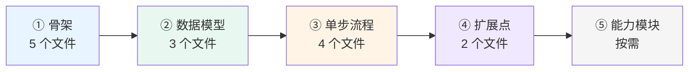

### 阶段 ① 骨架：先看清"一次 run 做了什么"

| 顺序 | 文件 | 读它是为了知道 |
| --- | --- | --- |
| 1 | `src/main.rs` | 全部依赖怎么装配、Agent 怎么被配置 |
| 2 | `src/agent/runtime.rs` | 主循环长什么样、什么条件下结束 |
| 3 | `src/agent/runtime/step.rs` | 一步 = 准备请求 → 调 LLM → 执行工具 → 判定终局 |
| 4 | `src/agent/model.rs` | `Agent` 有哪些字段、回调怎么注册、请求怎么准备 |
| 5 | `src/agent/runtime/think.rs` | 真正发给 LLM 的请求长什么样 |

> 读完这 5 个文件，就应该能画出"一次 `run()` 的完整流程图"。

### 阶段 ② 数据模型：把概念对应到类型

| 顺序 | 文件 | 读它是为了知道 |
| --- | --- | --- |
| 6 | `src/agent/event.rs` | `AgentEvent` / `ContentItem` 三种内容如何组织历史 |
| 7 | `src/session/model.rs` | `Session` 三块数据（events / state / pending_tool_calls） |
| 8 | `src/agent/context.rs` | `ExecutionContext` 与 `Session` 的区别（前者是单次执行的临时态） |

### 阶段 ③ 单步流程：把工具与确认机制吃透

| 顺序 | 文件 | 读它是为了知道 |
| --- | --- | --- |
| 9 | `src/agent/runtime/act.rs` | 工具怎么执行、回调怎么短路、确认怎么挂起 |
| 10 | `src/tool.rs` | `Tool` trait 契约、`build_toolbox()` 装配逻辑 |
| 11 | `src/agent/tool_confirmation.rs` | 审批数据结构和两阶段恢复协议 |
| 12 | `src/llm/llm_request.rs` | 事件如何翻译成 OpenAI 的 `messages` |

### 阶段 ④ 扩展点：理解框架的"可插拔"设计

| 顺序 | 文件 | 读它是为了知道 |
| --- | --- | --- |
| 13 | `src/agent/callback/before_llm_callback.rs` | 回调 trait 的签名与语义 |
| 14 | `src/agent/callback/before_tool_callback.rs` | 同上 |
| 15 | `src/agent/callback/after_tool_callback.rs` | 同上 |

### 阶段 ⑤ 能力模块：按兴趣深入

| 方向 | 文件 | 亮点 |
| --- | --- | --- |
| 记忆 | `src/memory/memory_manager.rs` | 提取 → embedding → 查重 → 存储的完整链路 |
| 上下文 | `src/agent/callback/before_llm_callback/context_optimizer.rs` | token 预算管理三种手段 |
| 检索 | `src/search/vector_search.rs` | RAG 管线的实现 |
| 评测 | `src/gaia/` | 有/无工具对照实验 |
| MCP | `src/tool/mcp/client.rs` | 子进程 stdio 协议 |

### 容易踩坑的三个点

```mermaid
flowchart TD
    P1["① Agent.model 字段<br/>实际未被 think&#40;&#41; 使用<br/>模型常量是硬编码的"]
    P2["② pending_tool_calls<br/>只在 run&#40;&#41; 入口检查<br/>第 2 次 run 需再次传入 confirmations"]
    P3["③ ContextOptimizer 的<br/>sliding_window 已实现<br/>但未挂到 before_llm_call"]

    style P1 fill:#fff4e6
    style P2 fill:#fff4e6
    style P3 fill:#fff4e6
```

---

## 图解总览

全篇用 20+ 张图串起整个项目。建议按下表顺序阅读：

| # | 图 | 所在小节 | 类型 | 回答什么问题 |
| --- | --- | --- | --- | --- |
| 1 | 项目全景脑图 | [项目全景脑图](#项目全景脑图) | mindmap | 这个项目有哪些部分？ |
| 2 | 模块依赖关系图 | [分层架构图](#分层架构图) | flowchart | 模块之间怎么依赖？ |
| 3 | 层级职责速览 | [分层架构图](#分层架构图) | flowchart | 五层职责怎么划？ |
| 4 | Agent 主流程（入口 + 主循环） | [Agent 运行主流程](#agent-运行主流程) | flowchart | `run()` 前后做了什么？ |
| 5 | Agent 状态机 | [Agent 运行主流程](#agent-运行主流程) | stateDiagram | `run()` 可能返回哪些状态？ |
| 6 | 单步决策树 | [Agent 运行主流程](#agent-运行主流程) | flowchart | LLM 响应三种分支分别怎么走？ |
| 7 | 工具执行细节 | [Agent 运行主流程](#agent-运行主流程) | flowchart | `act.rs` 里发生了什么？ |
| 8 | 工具确认时序图 | [Agent 运行主流程](#agent-运行主流程) | sequenceDiagram | 人工审批如何跨两次 `run()`？ |
| 9 | 回调三个扩展点 | [回调机制](#回调机制callback) | flowchart | 回调能改写什么？ |
| 10 | 回调顺序对比 | [回调机制](#回调机制callback) | flowchart | 为什么记忆注入要在优化前？ |
| 11 | `Tool` trait 装配 | [工具系统](#工具系统) | flowchart | schema 怎么变成 LLM 的 tools？ |
| 12 | `final_answer` 终局判定 | [工具系统](#工具系统) | flowchart | 什么时候算"答完了"？ |
| 13 | `build_toolbox()` 组装 | [工具系统](#工具系统) | flowchart | 工具从哪来？ |
| 14 | MCP 动态工具时序 | [工具系统](#工具系统) | sequenceDiagram | 子进程 MCP 怎么跑？ |
| 15 | 记忆写入 / 读取流程 | [长期记忆系统](#长期记忆系统) | flowchart | 记忆怎么存、怎么查？ |
| 16 | 记忆闭环时序 | [长期记忆系统](#长期记忆系统) | sequenceDiagram | 写入→检索→注入完整链路？ |
| 17 | 上下文优化四种手段 | [上下文优化器](#上下文优化器) | flowchart | token 超了怎么办？ |
| 18 | 核心类型关系图 | [会话与事件模型](#会话与事件模型) | classDiagram | 类型之间什么关系？ |
| 19 | GAIA 评测流程 | [GAIA 基准评测](#gaia-基准评测) | flowchart | 有/无工具如何对照？ |
| 20 | RAG 检索管线 | [模块详解](#模块详解) | flowchart | 切片→向量化→排序怎么做？ |

> **图例约定**：
> 🟦 蓝 = 入口/数据流　🟧 橙 = Agent 编排　🟪 紫 = 扩展点/回调　🟩 绿 = 能力模块　🟥 红 = 错误/失败路径

---

## 项目全景脑图

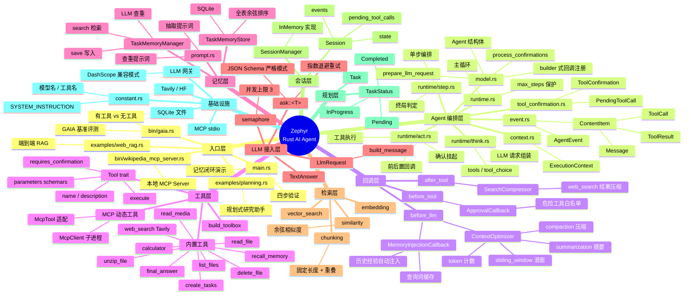

---

## 分层架构图

### 模块依赖关系

```mermaid
flowchart TB
    subgraph ENTRY["入口层 src/ · src/bin/ · examples/"]
        MAIN["main.rs<br/>记忆闭环演示"]
        GAIA["bin/gaia.rs<br/>GAIA 评测"]
        MCPBIN["bin/wikipedia_mcp_server.rs"]
        EX1["examples/web_rag.rs"]
        EX2["examples/planning.rs"]
    end

    subgraph AGENT["Agent 编排层 src/agent/"]
        MODEL["model.rs<br/>Agent / 回调注册"]
        RUNTIME["runtime.rs<br/>主循环"]
        STEP["runtime/step.rs<br/>单步编排"]
        THINK["runtime/think.rs"]
        ACT["runtime/act.rs"]
        CTX["context.rs<br/>ExecutionContext"]
        EVENT["event.rs<br/>AgentEvent"]
        CONF["tool_confirmation.rs"]
    end

    subgraph CALLBACK["回调层 src/agent/callback/"]
        MEM["before_llm<br/>MemoryInjectionCallback"]
        OPT["before_llm<br/>ContextOptimizer"]
        APPROVAL["before_tool<br/>ApprovalCallback"]
        COMP["after_tool<br/>SearchCompressor"]
    end

    subgraph TOOLS["工具层 src/tool/"]
        TOOL["tool.rs<br/>Tool trait + build_toolbox"]
        BUILTIN["calculator / web_search<br/>file/* / final_answer<br/>recall_memory / planning"]
        MCPC["mcp/client.rs<br/>mcp/mcp_tool.rs"]
    end

    subgraph MEMORY["记忆层 src/memory/"]
        MGR["memory_manager.rs<br/>TaskMemoryManager"]
        STORE["store.rs<br/>TaskMemoryStore (SQLite)"]
        MEMPROMPT["prompt.rs"]
    end

    subgraph LLM["LLM 接入层 src/llm/"]
        ASK["ask.rs<br/>ask::&lt;T&gt;"]
        REQ["llm_request.rs<br/>LlmRequest"]
        ANS["llm_answer.rs<br/>TextAnswer"]
        SEM["semaphore.rs"]
    end

    subgraph SEARCH["检索层 src/search/"]
        EMB["embedding.rs"]
        CHUNK["chunking.rs"]
        SIM["similarity.rs"]
        VEC["vector_search.rs"]
    end

    subgraph SESSION["会话层 src/session/"]
        SM["session_manager.rs<br/>SessionManager"]
        SMODEL["model.rs<br/>Session"]
    end

    subgraph PLAN["规划层 src/planning/"]
        TASK["task.rs<br/>Task / TaskStatus"]
    end

    subgraph CONST["基础设施"]
        CONSTANT["constant.rs<br/>模型名 / 工具名 / 提示词"]
    end

    subgraph EXT["外部服务"]
        GATEWAY["DashScope<br/>OpenAI 兼容网关"]
        MCPSRV["MCP Server<br/>(子进程 stdio)"]
        TAVILY["Tavily Search"]
        HF["HuggingFace Dataset"]
        DB[("SQLite 文件")]
    end

    MAIN --> AGENT
    MAIN --> MEMORY
    MAIN --> TOOLS
    GAIA --> AGENT
    GAIA --> TOOLS
    GAIA --> HF
    EX1 --> SEARCH
    EX1 --> TOOLS
    EX2 --> AGENT
    EX2 --> TOOLS
    MCPBIN -.stdio.-> MCPC

    AGENT --> CALLBACK
    AGENT --> TOOLS
    AGENT --> LLM
    AGENT --> SESSION

    MODEL --> TOOL
    RUNTIME --> STEP
    STEP --> THINK
    STEP --> ACT
    ACT --> TOOL
    THINK --> REQ
    THINK --> TOOL

    MEM --> MGR
    OPT --> REQ
    APPROVAL -.-> ACT
    COMP -.-> ACT

    TOOL --> BUILTIN
    TOOL --> MCPC
    BUILTIN --> TAVILY
    MCPC --> MCPSRV

    MGR --> STORE
    MGR --> MEMPROMPT
    MGR --> EMB
    MGR --> ASK
    STORE --> DB

    EMB --> GATEWAY
    ASK --> GATEWAY
    THINK --> GATEWAY
    VEC --> EMB
    VEC --> SIM
    VEC --> CHUNK

    SM --> SMODEL
    TOOL --> PLAN
    AGENT -.-> CONST
    SEM -.-> GAIA

    classDef entry fill:#e8f4ff,stroke:#4a90d9
    classDef agent fill:#fff4e6,stroke:#e8912d
    classDef cb fill:#f0e8ff,stroke:#8b5cf6
    classDef tool fill:#e8f8f0,stroke:#22a06b
    classDef mem fill:#ffe8ec,stroke:#d6405f
    classDef llm fill:#e6f7f7,stroke:#17a2b8
    classDef ext fill:#f5f5f5,stroke:#888

    class MAIN,GAIA,MCPBIN,EX1,EX2 entry
    class MODEL,RUNTIME,STEP,THINK,ACT,CTX,EVENT,CONF agent
    class MEM,OPT,APPROVAL,COMP cb
    class TOOL,BUILTIN,MCPC tool
    class MGR,STORE,MEMPROMPT mem
    class ASK,REQ,ANS,SEM llm
    class GATEWAY,MCPSRV,TAVILY,HF,DB ext
```

### 层级职责速览

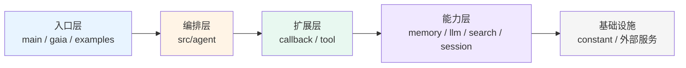

| 层 | 位置 | 职责 | 关键规则 |
| --- | --- | --- | --- |
| 入口层 | `src/main.rs`、`src/bin/`、`examples/` | 装配依赖、驱动场景 | 不写业务逻辑，只做装配 |
| 编排层 | `src/agent/` | 控制"想 → 做 → 判"的循环 | 只依赖 trait，不依赖具体实现 |
| 扩展层 | `src/agent/callback/`、`src/tool/` | 提供可插拔能力点 | 全部通过 trait 注册 |
| 能力层 | `src/memory/`、`src/llm/`、`src/search/`、`src/session/` | 提供具体能力 | 相互之间尽量不横向依赖 |
| 基础设施 | `src/constant.rs`、外部服务 | 配置与 IO | 配置不硬编码在业务代码 |

---

## Agent 运行主流程

### 1. 入口与上下文准备

```mermaid
flowchart TD
    START(["agent.run::&lt;T&gt;()"]) --> GET["session_manager.get_or_create(session_id)"]
    GET --> CTX["ExecutionContext::new&#40;session&#41;<br/>execution_id = uuid v4<br/>current_step = 0"]
    CTX --> EVT{"user_prompt 非空?"}
    EVT -->|yes| ADDEVT["追加 AgentEvent&#40;author=user, Message&#41;"]
    EVT -->|no| CONF
    ADDEVT --> CONF{"tool_confirmations 非空?"}
    CONF -->|yes| SETSTATE["session.state&#91;'tool_confirmations'&#93; = JSON"]
    CONF -->|no| LOOP
    SETSTATE --> LOOP["进入主循环"]

    style START fill:#e8f4ff
    style LOOP fill:#fff4e6
```

`Session` 承载三类数据：

| 字段                                       | 用途                                                                  |
| ------------------------------------------ | --------------------------------------------------------------------- |
| `events: Vec<AgentEvent>`                  | 完整对话/工具历史，是 LLM 请求的唯一来源                              |
| `state: HashMap<String, Value>`            | 扩展状态：`tool_confirmations`、`context_summary`、`last_summary_idx` |
| `pending_tool_calls: Vec<PendingToolCall>` | 等待人工确认的工具调用                                                |

### 2. 主循环

```mermaid
flowchart TD
    LOOP{{"loop"}} --> GUARD{"current_step >= max_steps?"}
    GUARD -->|yes| BAIL["bail! 'exceeded max steps'"]
    GUARD -->|no| STEP["step&#40;&client, &mut context&#41;"]

    STEP --> RES{"StepResult"}
    RES -->|"Final(s)"| PARSE{"has_final_answer_tool?"}
    PARSE -->|yes| JSON["s 作为 JSON 解析"]
    PARSE -->|no| TEXT["s 作为 String"]
    JSON --> SAVE1["session_manager.save&#40;session&#41;"]
    TEXT --> SAVE1
    SAVE1 --> RETC["return AgentResult&#40;output, Complete&#41;"]

    RES -->|"Continue"| INC["current_step += 1"]
    INC --> PEND{"pending_tool_calls 非空?"}
    PEND -->|yes| SAVE2["session_manager.save&#40;session&#41;"]
    SAVE2 --> RETP["return AgentResult&#40;None, PendingConfirmation&#41;"]
    PEND -->|no| LOOP

    style BAIL fill:#ffe8ec
    style RETC fill:#e8f8f0
    style RETP fill:#fff4e6
```

```mermaid
stateDiagram-v2
    [*] --> Idle: run&#40;&#41; 进入
    Idle --> Running: step&#40;&#41;
    Running --> Idle: StepResult 继续
    Running --> Completed: StepResult 终局
    Running --> AwaitingApproval: 产生 pending_tool_calls
    AwaitingApproval --> Running: 下次 run&#40;&#41; 携带 ToolConfirmation
    Idle --> Failed: 超过 max_steps / LLM 错误
    Running --> Failed: LLM 错误 / 空响应
    Completed --> [*]
    Failed --> [*]

    note right of AwaitingApproval
        AgentStatus 为 PendingConfirmation
        output = None
        session 已 save
    end note
```

### 3. 单步决策树

```mermaid
flowchart TD
    A["prepare_llm_request&#40;&#41;"] --> B{"pending_tool_calls 非空<br/>且 state 有 tool_confirmations?"}
    B -->|yes| PC["process_confirmations&#40;&#41;"]
    PC --> PC1["approved → 按（可被修改的）参数执行工具"]
    PC --> PC2["rejected → ToolResult&#40;Error, reason&#41;"]
    PC --> PC3["无对应确认 → ToolResult&#40;Error&#41;"]
    PC1 --> PCE["写入 tool 事件<br/>清空 pending_tool_calls 与 state"]
    PC2 --> PCE
    PC3 --> PCE
    B -->|no| D

    D["tool_choice = has_final_answer ? Required : Auto"] --> E["contents = session.events 摊平"]
    E --> F["LlmRequest::new&#40;instructions, contents&#41;"]
    F --> G["before_llm_callbacks 顺序执行"]
    G --> G1["① MemoryInjectionCallback<br/>注入历史经验"]
    G1 --> G2["② ContextOptimizer<br/>压缩 / 摘要上下文"]
    G2 --> H["think&#40;&#41; → LLM 请求"]

    H --> I{"响应类型"}
    I -->|"有 tool_calls"| J["act_all&#40;&#41;"]
    I -->|"仅 content"| K["记 assistant 事件"]
    I -->|"空响应"| L["bail! 'Empty response from model'"]

    K --> K1{"has_final_answer_tool?"}
    K1 -->|yes| M["StepResult::Continue"]
    K1 -->|no| N["StepResult::Final&#40;content&#41;"]

    J --> J1{"每个 tool_call"}
    J1 --> J2["工具不存在?"]
    J2 -->|yes| J3["ToolResult&#40;Error, unknown tool&#41;"]
    J2 -->|no| J4{"requires_confirmation&#40;&#41;?"}
    J4 -->|yes| J5["记 ToolCall 事件<br/>add_pending_tool_call<br/>→ 挂起"]
    J4 -->|no| J6["before_tool_callbacks"]
    J6 --> J7{"回调返回 Some?"}
    J7 -->|yes| J8["以回调文案作为工具结果"]
    J7 -->|no| J9["tool.execute&#40;args, ctx&#41;"]
    J9 --> J10["after_tool_callbacks"]
    J10 --> J11["SearchCompressor<br/>web_search 结果 ≥2000 字符 → top3"]
    J8 --> J3E["记 ToolResult 事件"]
    J11 --> J3E
    J3 --> J3E
    J5 --> O
    J3E --> O

    O{"final_answer_output&#40;&#41;<br/>倒序找 final_answer 的成功结果"} -->|yes| P["StepResult::Final&#40;json&#41;"]
    O -->|no| Q["StepResult::Continue"]

    style L fill:#ffe8ec
    style P fill:#e8f8f0
    style J5 fill:#fff4e6
```

### 4. 工具执行细节（`act.rs`）

```mermaid
flowchart TD
    T0["act_all&#40;&tool_calls&#41;"] --> T1{"ChatCompletionMessageToolCalls"}
    T1 -->|"Function"| T2{"tool.requires_confirmation&#40;&#41;"}
    T1 -->|"Custom"| TC["记 ToolResult&#40;Error,<br/>'Custom tool call not implemented'&#41;"]

    T2 -->|true| TP["记 AgentEvent&#40;assistant, ToolCall&#41;<br/>+ add_pending_tool_call&#40;确认文案&#41;<br/>continue 下一个"]
    T2 -->|false| TA["act&#40;tool_call, ctx&#41;"]

    TA --> TA1["记 AgentEvent&#40;assistant, ToolCall&#41;"]
    TA1 --> TA2["before_tool_callbacks 逐个调用<br/>任一返回 Some 即短路"]
    TA2 --> TA3{"短路?"}
    TA3 -->|yes| TA4["记 ToolResult&#40;Success, 回调文案&#41;"]
    TA3 -->|no| TA5["tool.execute&#40;args_json, ctx&#41;<br/>找不到工具 → Error 文案"]
    TA5 --> TA6["按 Ok/Err 映射为 Success/Error"]
    TA6 --> TA7["after_tool_callbacks 逐个调用<br/>任一返回 Some 即短路"]
    TA7 --> TA8{"短路?"}
    TA8 -->|yes| TA9["用回调结果替换原结果"]
    TA8 -->|no| TA10["保留原结果"]
    TA4 --> TA11["记 AgentEvent&#40;agent, ToolResult&#41;"]
    TA9 --> TA11
    TA10 --> TA11
    TC --> TA11

    style TP fill:#fff4e6
    style TA7 fill:#f0e8ff
```

### 5. 工具确认的两阶段协议

这是 Agent 支持"人工介入"的核心机制，跨越两次 `run()` 调用：

```mermaid
sequenceDiagram
    autonumber
    participant U as 用户/宿主应用
    participant A as Agent
    participant L as LLM
    participant T as Tool
    participant S as SessionManager

    Note over A,S: ——— 第 1 次 run() ———

    U->>A: run(prompt, session_id, None)
    A->>S: get_or_create(session_id)
    S-->>A: Session
    A->>L: think() → 请求 delete_file
    L-->>A: tool_calls[delete_file]
    A->>A: requires_confirmation&#40;&#41; == true
    A->>A: 记 Event&#40;assistant, ToolCall&#41;
    A->>A: session.add_pending_tool_call&#40;确认文案&#41;
    A->>S: save(session)
    A-->>U: AgentResult &#40;output=None,<br/>status=PendingConfirmation&#41;

    Note over U,S: ——— 宿主弹出确认框，收集决定 ———

    U->>A: run(prompt, session_id,<br/>Some&#40;vec&#91;ToolConfirmation&#93;&#41;&#41;)
    A->>S: get_or_create(session_id) → 同一 Session
    A->>A: state&#91;'tool_confirmations'&#93; = JSON
    A->>A: prepare_llm_request&#40;&#41;
    A->>A: 检测 pending_tool_calls + state
    A->>A: process_confirmations&#40;&#41;

    alt approved = true
        A->>T: execute&#40;可能已被 modified_arguments 改写的参数&#41;
        T-->>A: 执行结果
        A->>A: 记 ToolResult&#40;Success&#41;
    else approved = false
        A->>A: 记 ToolResult&#40;Error, reason&#41;
    end

    A->>A: 清空 pending_tool_calls 与 state
    A->>L: think() 继续下一步
    L-->>A: 后续响应
    A->>S: save(session)
    A-->>U: AgentResult &#40;output, Complete&#41;
```

`ToolConfirmation.modified_arguments` 允许审批者在批准的同时**修改工具参数**（如把 `delete_file` 的路径改掉）。

```mermaid
flowchart LR
    subgraph P1["第 1 次 run&#40;&#41;"]
        A1["LLM 请求 delete_file"] --> A2["requires_confirmation == true"]
        A2 --> A3["记 ToolCall 事件"]
        A3 --> A4["add_pending_tool_call"]
        A4 --> A5["step → Continue"]
        A5 --> A6["save&#40;session&#41;"]
        A6 --> A7["返回 PendingConfirmation"]
    end

    subgraph HOST["宿主应用"]
        H1["展示 confirmation_message"]
        H2["收集 approved / reason /<br/>modified_arguments"]
    end

    subgraph P2["第 2 次 run&#40;&#41;"]
        B1["run&#40;..., Some&#40;confirmations&#41;&#41;"]
        B1 --> B2["state&#91;'tool_confirmations'&#93;"]
        B2 --> B3["process_confirmations"]
        B3 --> B4{"approved?"}
        B4 -->|yes| B5["执行工具&#40;用改写后的参数&#41;"]
        B4 -->|no| B6["ToolResult&#40;Error, reason&#41;"]
        B5 --> B7["继续 think"]
        B6 --> B7
    end

    A7 --> H1 --> H2 --> B1

    style A7 fill:#fff4e6
    style B4 fill:#f0e8ff
```

## 模块详解

### `src/agent/` — Agent 编排

| 文件                   | 职责                                                                                                                                                                   |
| ---------------------- | ---------------------------------------------------------------------------------------------------------------------------------------------------------------------- |
| `model.rs`             | `Agent` 结构体、回调注册 builder（`with_max_steps` / `with_before_llm_callbacks` 等）、`prepare_llm_request`、`process_confirmations`、`AgentResult<T>`、`AgentStatus` |
| `runtime.rs`           | 主循环、步数上限保护、最终结果反序列化                                                                                                                                 |
| `runtime/step.rs`      | 单步编排：`think` → 分支决策 → `act_all` → 终局判定                                                                                                                    |
| `runtime/think.rs`     | 组装 `CreateChatCompletionRequestArgs`（model / max_tokens=2048 / tools / tool_choice）并发起调用                                                                      |
| `runtime/act.rs`       | 工具调用执行、确认挂起、前后置回调调用、事件写入                                                                                                                       |
| `context.rs`           | `ExecutionContext`：`execution_id` / `current_step` / `final_result` / `session`                                                                                       |
| `event.rs`             | `AgentEvent`（事件信封）与 `ContentItem`（`Message` / `ToolCall` / `ToolResult`）、`ToolResultStatus`                                                                  |
| `tool_confirmation.rs` | `PendingToolCall`（挂起项）、`ToolConfirmation`（审批结果）                                                                                                            |

`Agent` 的 builder 风格让装配非常直观：

```rust
let agent = Agent::new(
    GPT_6_LUNA_PRO_MODEL.to_owned(),
    vec!["You are a helpful study assistant for children.".to_owned()],
    Arc::new(toolbox),
)
.with_max_steps(10)
.with_before_llm_callbacks(Arc::new(MemoryInjectionCallback::new(memory_manager.clone())))
.with_before_llm_callbacks(Arc::new(
    ContextOptimizer::new(GPT_6_LUNA_PRO_MODEL).with_token_threshold(1000),
));
```

> 注意 `think()` 内部硬编码使用 `GPT_6_LUNA_PRO_MODEL` 作为请求模型，而 `Agent.model` 字段目前仅用于记录；这是当前实现的已知不一致点。

### `src/llm/` — LLM 接入层

| 文件             | 职责                                                                                                                         |
| ---------------- | ---------------------------------------------------------------------------------------------------------------------------- |
| `ask.rs`         | 泛型结构化调用：`ask::<T>()` 强制 JSON Schema 严格模式（`additionalProperties: false` + 全字段 required），指数退避重试 3 次 |
| `llm_request.rs` | `LlmRequest` 聚合 instructions + contents + tool_choice，`build_message()` 把 `ContentItem` 翻译成 OpenAI message 数组       |
| `llm_answer.rs`  | `TextAnswer { text: String }` —— 最小可用的结构化输出载体                                                                    |
| `semaphore.rs`   | 全局 `Semaphore`，并发上限 3，用于 GAIA 批量评测限流                                                                         |

#### `ask::<T>()` 结构化调用流程

```mermaid
flowchart TD
    A["ask::&lt;T&gt;&#40;model, prompt&#41;"] --> B["schema_for!&#40;T&#41;<br/>生成 JSON Schema"]
    B --> C["enforce_strict_schema&#40;&#41;<br/>递归为每个 object 加上<br/>additionalProperties=false<br/>+ 全字段 required"]
    C --> D["构造请求<br/>response_format = JsonSchema&#40;strict=true&#41;"]
    D --> E{"retry&#40;backon 指数退避<br/>max_times=3&#41;"}
    E --> F["client.chat&#40;&#41;.create&#40;request&#41;"]
    F --> G{"结果"}
    G -->|"Ok"| H{"message.refusal?"}
    G -->|"Err 且可重试"| E
    G -->|"Err 且不可重试"| X(["返回 Err"])
    H -->|"有 refusal"| Y(["Err 'LLM refused to answer'"])
    H -->|"无"| I{"content 存在?"}
    I -->|no| Z(["Err 'LLM returned empty content'"])
    I -->|yes| J["serde_json::from_str::&lt;T&gt;&#40;content&#41;"]
    J --> K(["Ok&#40;T&#41;"])

    style C fill:#f0e8ff
    style K fill:#e8f8f0
```

#### `is_retryable` 判定

```mermaid
flowchart TD
    A["OpenAIError"] --> B{"Reqwest&#40;&#41;?"}
    B -->|是| C["可重试<br/>网络层错误"]
    B -->|否| D{"ApiError?"}
    D -->|是| E{"type ==<br/>rate_limit_exceeded<br/>或 server_error?"}
    E -->|是| C
    E -->|否| F["不可重试"]
    D -->|否| F

    style C fill:#e8f8f0
    style F fill:#ffe8ec
```

```rust
fn is_retryable(e: &OpenAIError) -> bool {
    match e {
        OpenAIError::Reqwest(_) => true,                       // 网络层错误
        OpenAIError::ApiError(api) => matches!(
            api.api_error.r#type.as_deref(),
            Some("rate_limit_exceeded" | "server_error")      // 限流 / 服务端错误
        ),
        _ => false,
    }
}
```

#### `LlmRequest::build_message()` 翻译规则

| ContentItem            | 生成的 message                                                                   |
| ---------------------- | -------------------------------------------------------------------------------- |
| `Message{role:"user"}` | `user` message                                                                   |
| `Message{role:其他}`   | `assistant` message                                                              |
| `ToolCall`             | 追加到**上一条 assistant message** 的 `tool_calls`；若无则新建 assistant message |
| `ToolResult`           | `tool` message（携带 `tool_call_id`）                                            |

```mermaid
flowchart LR
    subgraph IN["输入 contents"]
        I1["Message&#40;user&#41;"]
        I2["Message&#40;assistant&#41;"]
        I3["ToolCall"]
        I4["ToolResult"]
    end

    subgraph OUT["输出 messages"]
        O1["user message"]
        O2["assistant message"]
        O3["assistant message<br/>&#40;合并 tool_calls&#41;"]
        O4["tool message<br/>&#40;tool_call_id&#41;"]
    end

    I1 --> O1
    I2 --> O2
    I3 -->|"若上一条是 assistant<br/>→ 追加 tool_calls"| O3
    I3 -->|"否则新建<br/>assistant message"| O3
    I4 --> O4

    style IN fill:#fff4e6
    style OUT fill:#e8f4ff
```

### `src/search/` — 检索层

| 文件            | 职责                                                                                    |
| --------------- | --------------------------------------------------------------------------------------- |
| `embedding.rs`  | `embed_texts()` / `embed_text()`，调用 OpenAI 兼容 embedding 接口并按 `index` 排序还原顺序 |
| `chunking.rs`   | `fixed_length_chunking(text, chunk_size, overlap)` 固定长度滑动切片                     |
| `similarity.rs` | `cosine_similarity(a, b)` 余弦相似度                                                    |
| `vector_search.rs` | `vector_search(query, chunks, top_k)`：查询与候选同时 embedding，按相似度降序取 top_k  |

#### RAG 检索管线

```mermaid
flowchart TD
    subgraph CH["① 切片 chunking.rs"]
        C1["原始文本"] --> C2["fixed_length_chunking&#40;text,<br/>chunk_size=500, overlap=50&#41;"]
        C2 --> C3["Vec&lt;String&gt;<br/>step = chunk_size - overlap"]
    end

    subgraph EM["② 向量化 embedding.rs"]
        E1["query 文本"] --> E3["embed_text&#40;query&#41;"]
        E2["所有 chunks"] --> E4["embed_texts&#40;chunks&#41;"]
        E3 --> E5["按 index 排序还原顺序"]
        E4 --> E5
    end

    subgraph VS["③ 排序检索 vector_search.rs"]
        V1["cosine_similarity&#40;query_emb, chunk_emb&#41;"] --> V2["按相似度降序排序"]
        V2 --> V3["take&#40;top_k&#41;"]
    end

    C3 --> E2
    E5 --> V1
    V3 --> OUT(["Vec&lt;SearchHit&gt;<br/>&#123;text, similarity&#125;"])

    style CH fill:#e8f8f0
    style EM fill:#f0e8ff
    style VS fill:#fff4e6
```

#### 切片算法示意

```
text = "abcdefghij", chunk_size = 5, overlap = 2  →  step = 5 - 2 = 3

start=0  → [0..5)  "abcde"
start=3  → [3..8)  "defgh"
start=6  → [6..10) "ghij"   （end == len，结束）

重叠部分保证语义连续性，避免答案正好被切在边界上
```

> embedding 接口单批最多 20 条，超出会报 `batch size is invalid`。

### `src/planning/` — 任务规划

极简的任务清单模型，用于让 LLM 在复杂任务中显式维护"待办"：

```rust
pub struct Task { pub content: String, pub status: TaskStatus }

pub enum TaskStatus { Pending, InProgress, Completed }
```

`Display` 实现直接渲染成 Markdown 风格的状态清单：

| 状态         | 渲染           |
| ------------ | -------------- |
| `Pending`    | `[ ] 内容`     |
| `InProgress` | `[>] **内容**` |
| `Completed`  | `[x] ~~内容~~` |

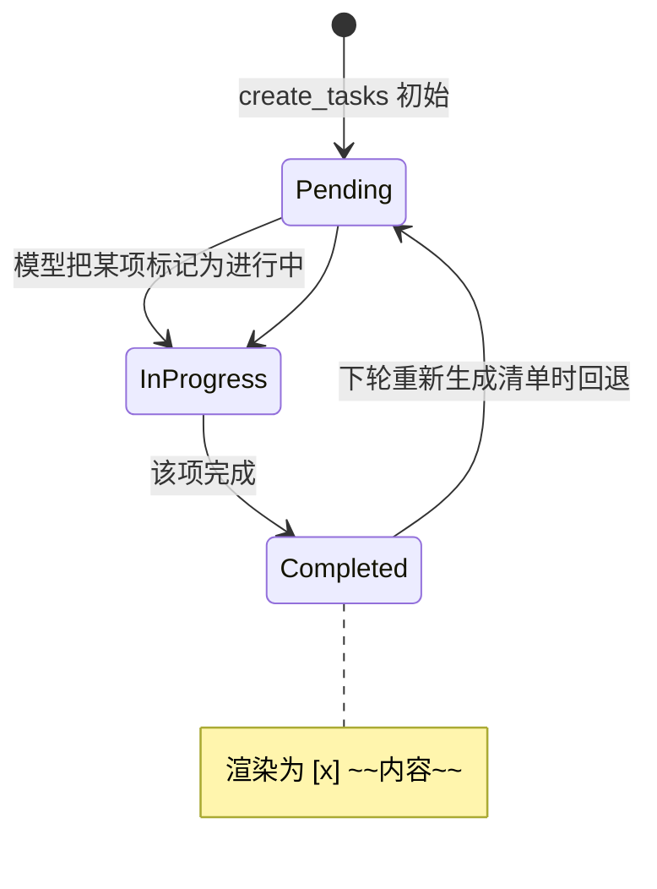

`CreateTasksTool` 要求模型**每次重新生成整个清单**并更新状态，从而把进度显式暴露在对话历史里。

```mermaid
flowchart LR
    A["LLM 决定下一步"] --> B["调用 create_tasks&#40;tasks[]&#41;"]
    B --> C["CreateTasksArgs 反序列化<br/>&#40;status 枚举校验&#41;"]
    C --> D["create_tasks&#40;&tasks&#41;<br/>渲染成 Markdown 清单"]
    D --> E["返回文本 → 作为 tool result<br/>写入会话历史"]
    E --> F["LLM 看到进度，继续执行"]

    style E fill:#e8f8f0
```

---

## 回调机制（Callback）

框架在三个时机提供回调扩展点，均为 `Arc<dyn Trait>`，注册顺序即执行顺序，且**一旦某个回调返回 `Some` 就短路**。

### 三个扩展点

```mermaid
flowchart TD
    subgraph BL["before_llm_callbacks"]
        BL1["签名: &#40;session: &mut Session,<br/>llm_request: &mut LlmRequest&#41;<br/>无返回值，可自由改写 request"]
    end

    subgraph BT["before_tool_callbacks"]
        BT1["签名: &#40;ctx: &ExecutionContext,<br/>tool_call&#41; → Option&lt;String&gt;"]
        BT2["Some&#40;str&#41; = 拦截工具执行，<br/>该文案作为工具结果"]
        BT3["None = 放行，继续执行"]
    end

    subgraph AT["after_tool_callbacks"]
        AT1["签名: &#40;ctx, tool_call,<br/>tool_result: &str&#41; → Option&lt;String&gt;"]
        AT2["Some&#40;str&#41; = 用该文案替换原工具结果"]
        AT3["None = 保留原工具结果"]
    end

    REQ["prepare_llm_request&#40;&#41;"] --> BL1
    BL1 --> LLM["think&#40;&#41; → LLM 请求"]

    LLM --> ACT["act&#40;tool_call&#41;"]
    ACT --> BT1
    BT1 --> BT2
    BT1 --> BT3
    BT3 --> EXEC["tool.execute&#40;&#41;"]
    EXEC --> AT1
    AT1 --> AT2
    AT1 --> AT3

    style BL fill:#f0e8ff
    style BT fill:#fff4e6
    style AT fill:#e8f8f0
```

### 内置回调一览

| 回调                      | 类型        | 触发条件                                              | 行为                                                                     |
| ------------------------- | ----------- | ----------------------------------------------------- | ------------------------------------------------------------------------ |
| `MemoryInjectionCallback` | before_llm  | 每轮 LLM 请求                                         | 以最近一条 user 消息为 query 检索历史记忆，命中则追加 system instruction |
| `ContextOptimizer`        | before_llm  | 每轮 LLM 请求                                         | 统计 token，超阈值时做压缩/摘要                                          |
| `ApprovalCallback`        | before_tool | 工具名 ∈ `delete_file` / `send_email` / `execute_sql` | 终端 `y/n` 交互；`n` 则返回错误文案拦截执行                              |
| `SearchCompressor`        | after_tool  | 工具名 == `web_search` 且结果长度 ≥ 2000              | 切片后向量检索，压缩为 top-3 相关片段                                    |

### 回调顺序的重要性

`src/main.rs` 中记忆注入必须放在上下文优化**之前**：

```rust
.with_before_llm_callbacks(Arc::new(MemoryInjectionCallback::new(memory_manager.clone())))
.with_before_llm_callbacks(Arc::new(
    ContextOptimizer::new(GPT_6_LUNA_PRO_MODEL).with_token_threshold(1000),
));
```

```mermaid
flowchart LR
    subgraph WRONG["❌ 顺序错误"]
        W1["ContextOptimizer<br/>统计 token&#40;不含记忆&#41;"] --> W2["压缩 / 摘要"]
        W2 --> W3["MemoryInjectionCallback<br/>追加记忆文本"]
        W3 --> W4["最终 token 超出预期阈值"]
    end

    subgraph RIGHT["✅ 顺序正确"]
        R1["MemoryInjectionCallback<br/>追加记忆文本"] --> R2["ContextOptimizer<br/>统计 token&#40;含记忆&#41;"]
        R2 --> R3["压缩 / 摘要"]
        R3 --> R4["最终 token 受控"]
    end

    style WRONG fill:#ffe8ec
    style RIGHT fill:#e8f8f0
```

原因：记忆注入会往 `instructions` 里追加文本，若先做上下文优化再注入，注入的内容不会被计入优化时的 token 统计，可能导致真实请求体超出预期阈值。

### `ApprovalCallback` 的危险工具白名单

```rust
const DANGEROUS_TOOLS: &[&str] = &["delete_file", "send_email", "execute_sql"];
```

```mermaid
flowchart TD
    A["before_tool: tool_call = delete_file"] --> B{"在 DANGEROUS_TOOLS 中?"}
    B -->|no| Z(["返回 None → 放行"])
    B -->|yes| C["打印工具名与参数"]
    C --> D["从 stdin 读一行"]
    D --> E{"输入"}
    E -->|"y"| F["打印 'Approved'<br/>返回 None → 放行"]
    E -->|"n"| G["打印 'Denied'<br/>返回 Some&#40;'User denied execution of ...'&#41;"]
    E -->|"其他"| H["返回 Some&#40;'invalid response: ...'&#41;"]

    style F fill:#e8f8f0
    style G fill:#ffe8ec
    style H fill:#ffe8ec
```

命中后从 stdin 读一行，`y` 放行（返回 `None`），`n` 或非法输入则返回错误文案（返回 `Some`），LLM 会看到"用户拒绝执行"并自行调整策略。

---

## 工具系统

### `Tool` trait

```rust
#[async_trait]
pub trait Tool: Send + Sync {
    fn name(&self) -> &str;
    fn description(&self) -> &str;
    fn parameters(&self) -> serde_json::Value;
    async fn execute(&self, args_json: &str, context: &ExecutionContext) -> anyhow::Result<String>;
    fn requires_confirmation(&self) -> bool;
    // 默认实现
    fn confirmation_message_template(&self) -> &str;
    fn get_confirmation_message(&self, arguments: &serde_json::Value) -> String;
    fn definition(&self) -> anyhow::Result<ChatCompletionTools>;
}
```

`definition()` 把 `name` / `description` / `parameters` 打包成 OpenAI 的 `tools` 数组元素；`parameters()` 通常由 `schemars::schema_for!(Args)` 自动生成，无需手写 JSON。

```mermaid
flowchart LR
    subgraph T["Tool 实现"]
        T1["name&#40;&#41;"]
        T2["description&#40;&#41;"]
        T3["parameters&#40;&#41;<br/>schema_for!&#40;Args&#41;"]
        T4["execute&#40;args_json, ctx&#41;"]
        T5["requires_confirmation&#40;&#41;"]
    end

    T1 --> D["definition&#40;&#41;"]
    T2 --> D
    T3 --> D
    D --> DEF["ChatCompletionTools::Function<br/>&#123;name, description, parameters&#125;"]
    DEF --> TOOLS["Agent::tool_definitions&#40;&#41;<br/>→ LLM 的 tools 数组"]

    style T fill:#e8f8f0
    style DEF fill:#f0e8ff
```

### 内置工具清单

| 工具名          | 类型 | 说明                                                           |
| --------------- | ---- | -------------------------------------------------------------- |
| `calculator`    | 内置 | 表达式求值                                                     |
| `web_search`    | 内置 | Tavily 联网搜索，返回原始文本                                  |
| `read_file`     | 内置 | 读取文件，自动识别 txt / csv / spreadsheet / image             |
| `list_files`    | 内置 | 列目录                                                         |
| `delete_file`   | 内置 | 删除文件（`requires_confirmation() == true`，走挂起-审批协议） |
| `unzip_file`    | 内置 | 解压 zip                                                       |
| `read_media`    | 内置 | 读取 PDF / 图片 / 音频                                         |
| `create_tasks`  | 内置 | 维护任务清单（规划）                                           |
| `final_answer`  | 内置 | 输出最终答案；存在时 `tool_choice` 强制 `Required`             |
| `recall_memory` | 内置 | 工具式记忆检索（与自动注入互补）                               |
| `<MCP 工具>`    | 动态 | 由 MCP Server `list_tools()` 动态注册                          |

### `final_answer` 的特殊地位

`final_answer` 是框架的"终局信号"：

- 工具箱中存在它 → `tool_choice = Required`，模型**必须**调用某个工具（不能直接输出文本）
- 一旦 `final_answer` 工具执行成功 → `final_answer_output()` 倒序扫描事件找到它 → `StepResult::Final`
- 有该工具时，最终输出按 JSON 解析为 `T`（如 `TextAnswer { text }` 或 `GaiaOutput`）；否则纯文本包装为 `String`

```mermaid
flowchart TD
    A["工具箱"] --> B{"contains_key&#40;'final_answer'&#41;?"}
    B -->|yes| C["tool_choice = Required<br/>模型必须调用工具"]
    B -->|no| D["tool_choice = Auto<br/>模型可直接输出文本"]

    C --> E["final_answer 执行成功"]
    E --> F["final_answer_output&#40;&#41;<br/>倒序扫描事件找成功结果"]
    F --> G["StepResult::Final&#40;json&#41;"]
    G --> H["serde_json::from_value::&lt;T&gt;&#40;&#41;<br/>→ AgentResult.output"]

    D --> I["模型输出纯 content"]
    I --> J["StepResult::Final&#40;content&#41;"]
    J --> H

    style C fill:#fff4e6
    style G fill:#e8f8f0
```

### `build_toolbox()` 组装流程

```mermaid
flowchart TD
    A(["build_toolbox&#40;&#41;"]) --> B["内置工具 vec&#91;"]
    B --> B1["calculator, web_search, unzip_file,<br/>list_files, delete_file, read_file,<br/>read_media, create_tasks"]
    B1 --> C["McpClient::connect&#40;&#41;"]
    C --> C1["cargo run --quiet --bin wikipedia_mcp_server<br/>&#40;stdin/stdout 子进程&#41;"]
    C1 --> C2["mcp_client.list_tools&#40;&#41;"]
    C2 --> C3["每个 Tool 包成 McpTool"]
    C3 --> D["按 name&#40;&#41; 收进<br/>HashMap&lt;String, Box&lt;dyn Tool&gt;&gt; → ToolBox"]
    B1 --> D

    style C fill:#f0e8ff
    style D fill:#e8f8f0
```

`main.rs` 在 `build_toolbox()` 之后额外插入 `final_answer` 与 `recall_memory`（它们依赖 `Arc<TaskMemoryManager>`，不放进通用工厂）。

### MCP 动态工具

```mermaid
sequenceDiagram
    autonumber
    participant A as Agent
    participant L as LLM
    participant MT as McpTool
    participant MC as McpClient
    participant S as wikipedia_mcp_server

    A->>A: build_toolbox&#40;&#41; → McpClient::connect&#40;&#41;
    A->>MC: spawn 子进程
    MC->>S: rmcp 握手
    A->>MC: list_tools&#40;&#41;
    MC->>S: tools/list
    S-->>MC: Tool 列表
    MC-->>A: Vec of rmcp Tool
    A->>A: 每个包成 McpTool 放进 ToolBox

    Note over A,S: ——— 运行期 ———

    A->>L: think&#40;&#41;，tools 含 MCP 工具
    L-->>A: tool_calls&#40;get_wikipedia_page&#41;
    A->>MT: McpTool::execute&#40;args_json, ctx&#41;
    MT->>MC: call_tool&#40;name, arguments&#41;
    MC->>S: tools/call
    S-->>MC: content 内容块
    MC->>MC: 过滤 text 块并 join&#40;'\\n'&#41;
    MC-->>MT: String
    MT-->>A: 工具结果字符串
    A->>A: 记 ToolResult 事件
```

---

## 长期记忆系统

记忆是本项目区别于通用 Agent 框架的重点：Agent 每完成一次任务，会把**解题过程**沉淀为结构化记忆，下次遇到相似问题时自动注入。

### 整体流程

```mermaid
flowchart TD
    subgraph SAVE["写入路径 memory_manager.save&#40;&events&#41;"]
        S0(["events"]) --> S1["① format_execution_history&#40;&#41;<br/>压成纯文本<br/>&#40;Tool Result 截断 500 字符&#41;"]
        S1 --> S2["② extract_memory&#40;history&#41;<br/>LLM 结构化输出 ask::&lt;TaskMemory&gt;"]
        S2 --> S3{"成功?"}
        S3 -->|no| SX1["warn 日志 → Ok&#40;None&#41;"]
        S3 -->|yes| S4["③ embed_text&#40;'Task: ' + task_summary&#41;"]
        S4 --> S5{"成功?"}
        S5 -->|no| SX2["warn 日志 → Ok&#40;None&#41;"]
        S5 -->|yes| S6["④ store.query&#40;embedding, TOP_K=3&#41;<br/>过滤 similarity ≥ 0.8"]
        S6 --> S7{"候选非空?"}
        S7 -->|no| S9
        S7 -->|yes| S8["⑤ is_duplicate&#40;new, candidates&#41;<br/>LLM 判断 ADD / SKIP"]
        S8 --> S8A{"判为重复?"}
        S8A -->|yes| SX3["Ok&#40;None&#41; 跳过存储"]
        S8A -->|no| S9
        S9["⑥ store.add&#40;uuid, memory, embedding&#41;<br/>SQLite INSERT"]
        S9 --> S10(["Ok&#40;Some&#40;memory_id&#41;&#41;"])
    end

    subgraph SEARCH["读取路径 memory_manager.search&#40;query, top_k&#41;"]
        Q0(["query"]) --> Q1["embed_text&#40;query&#41;"]
        Q1 --> Q2["store.query&#40;embedding, top_k&#41;<br/>全表扫描 + 余弦相似度 + 排序截断"]
        Q2 --> Q3["过滤 similarity ≥ 0.5"]
        Q3 --> Q4(["Vec&lt;TaskMemory&gt;"])
    end

    style SX1 fill:#ffe8ec
    style SX2 fill:#ffe8ec
    style SX3 fill:#ffe8ec
    style S10 fill:#e8f8f0
    style Q4 fill:#e8f8f0
```

### 记忆闭环时序

```mermaid
sequenceDiagram
    autonumber
    participant U as 用户
    participant A as Agent
    participant M as TaskMemoryManager
    participant L as LLM
    participant E as Embedding API
    participant D as SQLite

    Note over U,D: ——— 阶段一：写入 ———

    U->>A: run&#40;"圆的直径 10cm,面积?"&#41;
    A->>L: think&#40;&#41;
    L-->>A: tool_calls&#40;calculator&#41;
    A->>A: calculator → 78.5
    A-->>U: AgentResult&#40;TextAnswer&#41;

    U->>A: 追加家长反馈事件&#40;"答对了,方法 πr²"&#41;
    U->>M: save&#40;&events&#41;
    M->>M: format_execution_history&#40;events&#41;
    M->>L: ask::TaskMemory&#40;抽取提示词&#41;
    L-->>M: TaskMemory&#40;summary, approach,<br/>final_answer=78.5, is_correct=true&#41;
    M->>E: embed_text&#40;"Task: 圆的面积"&#41;
    E-->>M: embedding
    M->>D: query&#40;embedding, 3&#41; 取近邻
    D-->>M: 近邻记忆
    M->>L: ask::DuplicateCheckResult&#40;查重提示词&#41;
    L-->>M: ADD
    M->>D: INSERT task_memories
    M-->>U: Some&#40;memory_id&#41;

    Note over U,D: ——— 阶段二：直接检索验证 ———

    U->>M: search&#40;"半径 3cm 的圆面积", 3&#41;
    M->>E: embed_text&#40;query&#41;
    M->>D: query&#40;embedding, 3&#41;
    D-->>M: 命中 1 条
    M-->>U: Vec of TaskMemory

    Note over U,D: ——— 阶段三：新会话自动注入 ———

    U->>A: run&#40;"圆的直径 20cm,面积?"&#41; 新 session_id
    A->>M: MemoryInjectionCallback.before_llm_call
    M->>E: embed_text&#40;最近 user 消息&#41;
    M->>D: query&#40;embedding, 3&#41;
    D-->>M: 命中历史经验
    M-->>A: 格式化记忆文本
    A->>A: append_instruction&#40;"PAST_EXPERIENCES 块"&#41;
    A->>L: think&#40;&#41; 带历史经验的请求
    L-->>A: 参考"先除以 2 求半径"的方法
    A-->>U: AgentResult&#40;正确答案&#41;
```

### 两种记忆使用方式对比

```mermaid
flowchart LR
    subgraph AUTO["自动注入 MemoryInjectionCallback"]
        A1["每轮 LLM 请求自动执行"] --> A2["LLM 不可见<br/>&#40;不进 ToolBox&#41;"]
        A2 --> A3["内容进 system instruction"]
    end

    subgraph TOOL["工具式召回 RecallMemoryTool"]
        T1["LLM 主动调用 recall_memory"] --> T2["LLM 可见<br/>&#40;是 ToolBox 一员&#41;"]
        T2 --> T3["返回文本作为 tool result"]
    end

    MGR[("共享<br/>Arc&lt;TaskMemoryManager&gt;")]
    FMT["共享格式化逻辑<br/>format_memories&#40;&#41;"]

    AUTO --- MGR
    TOOL --- MGR
    AUTO --- FMT
    TOOL --- FMT

    style AUTO fill:#f0e8ff
    style TOOL fill:#e8f8f0
```

### 数据结构

```mermaid
classDiagram
    class TaskMemory {
        +String task_summary
        +String approach
        +String final_answer
        +bool is_correct
        +Option~String~ error_analysis
        +to_embedding_text() String
    }

    class DuplicateCheckResult {
        +MemoryDecision decision
        +String reason
        +is_duplicate() bool
    }

    class MemoryDecision {
        <<enumeration>>
        ADD
        SKIP
    }

    class TaskMemoryStore {
        -Mutex~Connection~ conn
        +open(path) TaskMemoryStore
        +init_schema(conn)
        +add(id, memory, embedding)
        +query(query_embedding, top_k) Vec~(f32, TaskMemory)~
    }

    class TaskMemoryManager {
        -TaskMemoryStore store
        -String chat_model
        -String embedding_model
        +save(events) Option~String~
        +search(query, top_k) Vec~TaskMemory~
        -extract_memory(history) TaskMemory
        -is_duplicate(new, existing) bool
        -format_execution_history(events) String
        -render_for_dedup(mem) String
    }

    TaskMemoryManager --> TaskMemoryStore : 组合
    TaskMemoryManager --> TaskMemory : 产出
    DuplicateCheckResult --> MemoryDecision : 组合
```

```rust
pub struct TaskMemory {
    pub task_summary: String,        // 问题摘要（中性描述，不含结果）
    pub approach: String,            // 实际使用的方法/公式/工具
    pub final_answer: String,        // 最终答案
    pub is_correct: bool,            // 是否正确（即使事后被纠正也算 false）
    pub error_analysis: Option<String>, // 错误时必须非空
}
```

### SQLite 表结构

表名 `task_memories`：

| 列               | 类型             | 说明                   |
| ---------------- | ---------------- | ---------------------- |
| `id`             | TEXT PK          | uuid v4                |
| `task_summary`   | TEXT NOT NULL    | 问题摘要               |
| `approach`       | TEXT NOT NULL    | 方法                   |
| `final_answer`   | TEXT NOT NULL    | 答案                   |
| `is_correct`     | INTEGER NOT NULL | 0/1                    |
| `error_analysis` | TEXT             | 错误分析               |
| `embedding_text` | TEXT NOT NULL    | 参与 embedding 的文本  |
| `embedding`      | TEXT NOT NULL    | JSON 序列化的 f32 向量 |
| `created_at`     | INTEGER NOT NULL | Unix 时间戳            |

> 当前实现是**全表扫描 + 内存计算余弦相似度**，数据量大时应换成向量索引（如 HNSW / sqlite-vec）。

### 关键阈值常量

```rust
const DUPLICATE_CANDIDATE_THRESHOLD: f32 = 0.8;  // 低于此相似度不查重，直接存
const SEARCH_MIN_SIMILARITY: f32 = 0.5;          // 低于此相似度不返回，避免污染上下文
const DUPLICATE_CHECK_TOP_K: usize = 3;          // 查重时最多取多少条近邻
const TOOL_RESULT_PREVIEW_CHARS: usize = 500;    // 工具结果在历史里最多保留字符数
```

### 查重语义

`DUPLICATE_CHECK_PROMPT` 定义的判重标准：

- 同一问题 + 不同方法 **或** 不同结果 → 算**新信息**（ADD）
- 同一问题 + 相同方法 + 相同结果 → 算**重复**（SKIP）

由于判重标准包含"相同结果"，传给 LLM 的比较文本必须带上 `final_answer`：

```rust
fn render_for_dedup(mem: &TaskMemory) -> String {
    format!(
        "task_summary: {}, approach: {}, final_answer: {}, is_correct: {}",
        mem.task_summary, mem.approach, mem.final_answer, mem.is_correct
    )
}
```

查重失败时**默认返回 false（继续存储）** —— 记忆是辅助功能，宁可多存也不要因一次 LLM 抖动丢掉经验。

### 自动注入的缓存机制

`MemoryInjectionCallback` 内部有一个 `Mutex<Option<CachedRecall>>`：

```
每轮请求 → 取最近一条 user 消息作为 query
   │
   ├─ 缓存命中（同 query）→ 直接复用文本，不重复 embedding
   ├─ 未命中 → search(query, top_k=3)
   │     ├─ 命中 → 缓存 (query, Some(text))
   │     ├─ 空结果 → 缓存 (query, None)（避免反复空检索）
   │     └─ 出错 → 不缓存，下一步重试
   ▼
注入的 instruction：
  以下是过去解决类似问题的记录:
  <PAST_EXPERIENCES> ... </PAST_EXPERIENCES>
  请参考成功的方法,避免重复失败的尝试。
```

> 由于 `MutexGuard` 不能跨 `.await` 持有，代码把"查缓存"和"写缓存"拆成两个独立函数。
> 注入内容只存在于当次的 `LlmRequest`（每步重建），所以每步都要重新注入。

## 上下文优化器

`ContextOptimizer` 解决长会话 token 膨胀问题，是 `before_llm_callback` 中可改写 `LlmRequest` 的典型范例。

### 四种手段总览

```mermaid
flowchart TD
    A["before_llm_call&#40;session, llm_request&#41;"] --> B["count_token&#40;model, request&#41;<br/>tiktoken o200k_base"]
    B --> C{"enable_compaction<br/>&& token > threshold?"}
    C -->|yes| D["compact&#40;&#41;<br/>按工具名规则压缩内容"]
    C -->|no| E
    D --> E{"enbale_summarization<br/>&& token > threshold?"}
    E -->|yes| F["summarize&#40;&#41;<br/>LLM 生成摘要 → append_instruction"]
    E -->|no| G(["返回，请求继续"])
    F --> G

    style D fill:#f0e8ff
    style F fill:#f0e8ff
```

| 手段       | 文件                   | 触发                            | 做法                                                                                   |
| ---------- | ---------------------- | ------------------------------- | -------------------------------------------------------------------------------------- |
| token 计数 | `context_optimizer.rs` | 每次请求                        | `tiktoken-rs` 的 `o200k_base` 编码，指令按 `4 + tokens` 累加，消息按 `4 + tokens` 累加 |
| 压缩       | `compaction.rs`        | `enable_compaction` 且超阈值    | 按工具名规则把大内容替换为占位文本                                                     |
| 滑动窗口   | `sliding_window.rs`    | 手动调用 `slide_window()`       | 保留首条 user 消息 + 最近 N 条，其余裁掉并补齐孤儿 ToolCall                            |
| 摘要       | `summarization.rs`     | `enbale_summarization` 且超阈值 | LLM 摘要中段历史，作为 instruction 追加                                                |

> `sliding_window` 已实现但**未挂到 `before_llm_call`** 上，需要手动调用。

### 压缩规则表

```rust
// ToolCall 参数压缩
TOOLCALL_COMPACTION_RULES = { "create_file" → "[Content saved to file]" }

// ToolResult 内容压缩
TOOLRESULT_COMPACTION_RULES = {
    "read_file"    → "File content from {file_path}. Re-read if needed.",
    "search_web"   → "Search results processed. Query: {query}. Re-search if needed.",
    "tavily_search"→ "Search results processed. Query: {query}. Re-search if needed.",
}
```

`{file_path}` / `{query}` 会从对应的 `ToolCall.arguments` 中提取（`file_path` 或 `path` / `query`），替换成占位说明，大幅削减 token。

```mermaid
flowchart LR
    subgraph BEFORE["压缩前"]
        B1["ToolCall&#40;read_file,&#41;<br/>&#123;file_path: '/tmp/a.txt'&#125;"]
        B2["ToolResult&#40;read_file, Success,&#41;<br/>'文件的前 5000 行……&#41;"]
    end

    subgraph AFTER["压缩后"]
        A1["ToolCall&#40;read_file,&#41;<br/>&#123;file_path: '/tmp/a.txt'&#125;"]
        A2["ToolResult&#40;read_file, Success,&#41;<br/>'File content from /tmp/a.txt.<br/>Re-read if needed.'"]
    end

    B1 --> A1
    B2 -->|"按规则表替换<br/>并从 arguments 提取<br/>&#123;file_path&#125;"| A2

    style AFTER fill:#e8f8f0
```

### 摘要的增量机制

摘要不是每次重做，而是靠 `session.state` 里两个键做增量：

```
session.state["last_summary_idx"]  → 上次摘要覆盖到的内容下标
session.state["context_summary"]  → 已累积的摘要全文
```

```mermaid
flowchart TD
    A["contents 数组"] --> B["找首条 user 消息下标 user_message_idx"]
    B --> C["preserved_start = contents&#91;0..=user_idx&#93;"]
    B --> D["remaining = contents&#91;user_idx+1..&#93;"]
    D --> E{"remaining.len&#40;&#41; > keep_recent<br/>&#40;默认 5&#41;?"}
    E -->|no| E1(["直接返回，不摘要"])
    E -->|yes| F["end = contents.len&#40;&#41; - keep_recent"]
    F --> G{"start = last_summary_idx + 1<br/>&#40;首次为 user_idx + 1&#41;"}
    G --> H{"end <= start?"}
    H -->|yes| H1(["无需摘要，直接返回"])
    H -->|no| I["to_summarize = contents&#91;start..end&#93;"]
    I --> J["format_history&#40;&#41;<br/>Message 500 字符 / ToolResult 200 字符"]
    J --> K["LLM 生成摘要&#40;max_tokens=512&#41;"]
    K --> L["full_summary = 旧摘要 + '\\n\\n' + 新摘要"]
    L --> M["append_instruction&#40;'&#91;Summary of earlier progress&#93;...'&#41;"]
    M --> N["更新 state&#91;'last_summary_idx'&#93;<br/>state&#91;'context_summary'&#93;"]
    N --> O["重建 contents =<br/>preserved_start + 孤儿 ToolCall + preserved_end"]

    style K fill:#f0e8ff
    style M fill:#f0e8ff
```

### 孤儿 ToolCall 修复

裁剪历史时，某个 `ToolResult` 的 `tool_call_id` 若对应的 `ToolCall` 被裁掉了，OpenAI 接口会报错。因此在滑动窗口与摘要中都会：

```mermaid
flowchart TD
    A["preserved_end 片段"] --> B["收集其中所有 ToolCall 的 tool_call_id"]
    A --> C["找出 ToolResult 中 id 不在集合内的<br/>&#40;即孤儿&#41;"]
    C --> D["从 session.events 里找回这些孤儿 ToolCall"]
    D --> E["最终 contents =<br/>preserved_start + 找回的 ToolCall + preserved_end"]

    style E fill:#e8f8f0
```

```
裁剪前:  [user] [call_A] [result_A] [call_B] [result_B] [call_C] [result_C] ...
                            ↑ 被裁掉
裁剪后:  [user]              [call_C] [result_C]
                              └─ 补回 call_B，保证 result_B 有对应 call
```

### 默认配置

```rust
ContextOptimizer::new(model)
    .with_token_threshold(1000)   // main.rs 中设为 1000 便于演示
// 默认值：token_threshold = 20_000
//         enable_compaction = false
//         enbale_summarization = true
//         summarization_keep_recent = 5
```

## 会话与事件模型

### 核心类型关系图

```mermaid
classDiagram
    class Agent {
        +String name
        +String model
        +Vec~String~ instructions
        +Arc~ToolBox~ toolbox
        +usize max_steps
        +Vec~BeforeToolCallback~ before_tool_callbacks
        +Vec~AfterToolCallback~ after_tool_callbacks
        +Vec~BeforeLlmCallback~ before_llm_callbacks
        +Box~SessionManager~ session_manager
        +run&#40;T&#41;&#40;prompt, session_id, confirmations&#41; AgentResult~T~
        +prepare_llm_request&#40;ctx&#41; LlmRequest
        +process_confirmations&#40;ctx&#41; Vec~ContentItem~
        +tool_definitions&#40;&#41; Vec~ChatCompletionTools~
        +has_final_answer_tool&#40;&#41; bool
    }

    class ExecutionContext {
        +String execution_id
        +usize current_step
        +Option~String~ final_result
        +Session session
        +new&#40;session&#41; ExecutionContext
        +increment_step&#40;&#41;
    }

    class Session {
        +String session_id
        +Option~String~ user_id
        +Vec~AgentEvent~ events
        +State state
        +DateTime created_at
        +DateTime updated_at
        +Vec~PendingToolCall~ pending_tool_calls
        +add_event&#40;event&#41;
        +add_pending_tool_call&#40;call&#41;
    }

    class AgentEvent {
        +String id
        +String execution_id
        +DateTime timestamp
        +String author
        +Vec~ContentItem~ content
    }

    class ContentItem {
        <<enumeration>>
        Message
        ToolCall
        ToolResult
    }

    class Message {
        +String role
        +String content
    }

    class ToolCall {
        +String tool_call_id
        +String name
        +Value arguments
    }

    class ToolResult {
        +String tool_call_id
        +String name
        +ToolResultStatus status
        +String content
    }

    class ToolResultStatus {
        <<enumeration>>
        Success
        Error
    }

    class PendingToolCall {
        +ChatCompletionMessageToolCall tool_call
        +String confirmation_message
    }

    class ToolConfirmation {
        +String tool_call_id
        +Option~String~ reason
        +bool approved
        +Option~ToolArguments~ modified_arguments
    }

    class AgentResult~T~ {
        +Option~T~ output
        +ExecutionContext context
        +AgentStatus status
    }

    class AgentStatus {
        <<enumeration>>
        Complete
        PendingConfirmation
        Error
    }

    class LlmRequest {
        +Vec~String~ instructions
        +Vec~ContentItem~ contents
        +Option~Vec~Box~Tool~~ tools
        +ToolChoice tool_choice
        +append_instruction&#40;String&#41;
        +append_content&#40;ContentItem&#41;
        +build_message&#40;&#41; Vec~ChatCompletionRequestMessage~
    }

    class ToolChoice {
        <<enumeration>>
        Auto
        Required
    }

    Agent --> ExecutionContext : 持有
    ExecutionContext --> Session : 持有
    Session --> AgentEvent : 聚合
    Session --> PendingToolCall : 聚合
    AgentEvent --> ContentItem : 聚合
    ContentItem --> Message
    ContentItem --> ToolCall
    ContentItem --> ToolResult
    ToolResult --> ToolResultStatus
    AgentResult~T~ --> ExecutionContext
    AgentResult~T~ --> AgentStatus
    PendingToolCall ..> ToolConfirmation : 由其解除
    Agent --> LlmRequest : 构造
    LlmRequest --> ToolChoice
    Agent --> Tool : 通过 ToolBox
```

### 事件信封

```rust
pub struct AgentEvent {
    pub id: String,                     // uuid v4
    pub execution_id: String,           // 同一次 run() 共享
    pub timestamp: DateTime<Utc>,
    pub author: String,                 // "user" | "assistant" | "agent" | "tool"
    pub content: Vec<ContentItem>,
}
```

`ContentItem` 是三分联合：

```mermaid
flowchart LR
    CI["ContentItem"] --> M["Message<br/>&#40;role, content&#41;<br/>纯对话"]
    CI --> TC["ToolCall<br/>&#40;tool_call_id, name, arguments&#41;<br/>模型发起调用"]
    CI --> TR["ToolResult<br/>&#40;tool_call_id, name,<br/>status, content&#41;<br/>工具返回<br/>status: Success | Error"]
```

事件流示例：

```
[user]      Message("圆的直径是 10 厘米,面积?")
[assistant] ToolCall{ calculator, {"expr":"3.14*5*5"} }
[agent]     ToolResult{ calculator, Success, "78.5" }
[assistant] ToolCall{ final_answer, {"text":"78.5 平方厘米"} }
[agent]     ToolResult{ final_answer, Success, "{\"text\":\"78.5 平方厘米\"}" }
```

`session.events` 摊平成 `contents` 后由 `LlmRequest::build_message()` 还原成 OpenAI 的 `messages` 数组，**事件模型与 LLM 协议解耦**。

```mermaid
flowchart LR
    E["session.events<br/>Vec&lt;AgentEvent&gt;"] --> F["flat_map content"]
    F --> C["Vec&lt;ContentItem&gt;"]
    C --> BM["LlmRequest::build_message&#40;&#41;"]
    BM --> M1["system message<br/>&#40;每条 instruction 一条&#41;"]
    BM --> M2["user / assistant message"]
    BM --> M3["assistant message<br/>+ tool_calls 数组"]
    BM --> M4["tool message<br/>+ tool_call_id"]

    style E fill:#fff4e6
    style M1 fill:#e8f4ff
    style M4 fill:#e8f8f0
```

### 状态字典

`Session.state` 是一个 `HashMap<String, serde_json::Value>`，框架内部占用这些键：

| 键                   | 写入方             | 含义                  |
| -------------------- | ------------------ | --------------------- |
| `tool_confirmations` | `Agent::run` 入参  | 待处理的审批结果 JSON |
| `context_summary`    | `ContextOptimizer` | 累积摘要全文          |
| `last_summary_idx`   | `ContextOptimizer` | 上次摘要覆盖到的下标  |

---

## GAIA 基准评测

`src/bin/gaia.rs` 提供 GAIA（General AI Assistant Assessment）基准的**有工具 / 无工具对照评测**。

### 评测流程

```mermaid
flowchart TD
    START(["gaia_experiment&#40;&#41;"]) --> LOAD["load_gaia_dataset&#40;&#41;<br/>HuggingFace 拉取&#40;需 HF_TOKEN&#41;"]
    LOAD --> DL["download_gaia_dataset_attachments&#40;&#41;<br/>下载附件到本地缓存目录"]
    DL --> STAT["统计: 总题数 / 带附件数 / 带 zip 数"]

    STAT --> G1{{"group 1: 无工具"}}
    G1 --> G1A["JoinSet 并发 spawn 每题"]
    G1A --> G1B["get_semaphore&#40;&#41;.acquire&#40;&#41;<br/>全局并发上限 3"]
    G1B --> G1C["evaluate_gaia_single&#40;problem, model&#41;"]
    G1C --> G1D["solve_gaia_problem_with_retry<br/>纯 LLM&#40;JSON Schema 严格模式&#41;<br/>backon 指数退避 ×3"]
    G1D --> G1E["汇总: 评测数 / 失败数 / 准确率"]

    STAT --> G2{{"group 2: 带工具"}}
    G2 --> G2A["build_toolbox&#40;&#41; + final_answer"]
    G2A --> G2B["JoinSet 并发 spawn 每题"]
    G2B --> G2C["evaluate_gaia_single_with_tools"]
    G2C --> G2D["solve_problem_with_tools<br/>Agent::run::&lt;GaiaOutput&gt;<br/>完整 ReAct 循环"]
    G2D --> G2E["汇总: 评测数 / 失败数 / 准确率"]

    G1E --> OUT
    G2E --> OUT(["对比输出两组准确率"])

    style G1 fill:#f5f5f5
    style G2 fill:#e8f8f0
    style OUT fill:#e8f4ff
```

```mermaid
flowchart LR
    subgraph NOG["无工具组"]
        N1["题目文本"] --> N2["LLM 单次调用<br/>response_format = JsonSchema"]
        N2 --> N3["GaiaOutput&#40;is_solvable,<br/>unsolvable_reason, final_answer&#41;"]
        N3 --> N4["is_correct&#40;prediction, answer&#41;"]
    end

    subgraph WITH["带工具组"]
        W1["题目文本 + 附件路径"] --> W2["Agent::run::&lt;GaiaOutput&gt;"]
        W2 --> W3["ReAct 循环<br/>可用 calculator / web_search /<br/>read_file / unzip_file / MCP"]
        W3 --> W4["final_answer 工具<br/>产出 GaiaOutput"]
        W4 --> W5["is_correct&#40;prediction, answer&#41;"]
    end

    style WITH fill:#e8f8f0
```

两种模式对比输出：

```
Without tools done: 165 evaluated, 3 failed, accuracy = 12.73%
With tools done:    165 evaluated, 1 failed, accuracy = 24.85%
```

### 判分逻辑

```rust
fn is_correct(prediction: &str, answer: &str) -> bool {
    if prediction.is_empty() { false }
    else { prediction.trim().to_lowercase() == answer.trim().to_lowercase() }
}
```

即去除首尾空白后忽略大小写做全等比较 —— 因此提示词要求模型输出"数字或尽量少的词"。

### GAIA 输出结构

```mermaid
classDiagram
    class GaiaOutput {
        +bool is_solvable
        +String unsolvable_reason
        +String final_answer
    }

    class GaiaRow {
        +String task_id
        +String question
        +String level
        +String final_answer
        +Option~String~ file_name
        +Option~String~ file_path
    }

    class GaiaEvalResult {
        +String task_id
        +String model
        +bool correct
        +Option~bool~ is_solvable
        +Option~String~ prediction
        +String answer
        +Option~String~ unsolvable_reason
        +Option~String~ error
    }

    GaiaRow --> GaiaOutput : 题目 → 求解结果
    GaiaOutput --> GaiaEvalResult : 转换并判分
```

```rust
#[schemars(deny_unknown_fields)]
pub struct GaiaOutput {
    pub is_solvable: bool,
    pub unsolvable_reason: String,
    pub final_answer: String,
}
```

模型先自评"能否解决"，不可解则给出原因，避免为不可解题强行编造答案。

---

## 配置项

### `src/constant.rs`

所有易漂移配置集中在常量模块，业务代码不硬编码字符串：

| 常量                              | 当前值              | 说明                                          |
| --------------------------------- | ------------------- | --------------------------------------------- |
| `GPT_6_LUNA_PRO_MODEL`            | `qwen-plus`         | 主对话模型                                    |
| `NEMOTRON_3_ULTRA_MODEL`          | `qwen-max`          | 更强推理模型                                  |
| `DEEPSEEK_V41_FLASH_MODEL`        | `qwen-turbo`        | 快速模型                                      |
| `SPACE_BUNNY_ALPHA_MODEL`         | `qwen-vl-max`       | 视觉模型                                      |
| `MUSE_SPARK_13_CONTRIBUTOR_MODEL` | `qwen-plus-latest`  | 最新版                                        |
| `TEXT_EMBEDDING_3_SMALL_MODEL`    | `text-embedding-v3` | embedding 模型                                |
| `AGENT_NAME`                      | `zephyr`            | Agent 名称                                    |
| `FINAL_ANSWER_TOOL_NAME`          | `final_answer`      | 终局工具名                                    |
| `SYSTEM_INSTRUCTION`              | 长文本              | 面向儿童的学习助手系统提示词（11 节教学原则） |

> **命名说明**：常量名沿用了"角色代号"风格（`GPT_6_LUNA_PRO` 等），但实际值是百炼网关的 Qwen 系列。修改时注意 `TaskMemoryManager` 的 embedding 模型也引用了 `TEXT_EMBEDDING_3_SMALL_MODEL`，改动需同步调用点。

### `SYSTEM_INSTRUCTION` 覆盖的教学原则

`SYSTEM_INSTRUCTION` 是一份完整的儿童教学系统提示词，包含 11 节：教学原则、互动方式、回答问题、使用学习材料、练习与提问、记忆与复习、尊重自主性、语言、儿童安全、面向家长的信息、核心原则。

例如「理解 > 机械记忆」「推理 > 猜测」「主动回忆 > 被动重复阅读」「小步骤 > 信息过载」。

---

## 目录结构

```
Zephyr/
├── Cargo.toml
├── README.md
├── AGENTS.md
├── .env                                # 密钥配置（不入库）
├── examples/
│   └── web_rag.rs                      # 端到端 RAG 示例
├── src/
│   ├── lib.rs                          # 模块导出
│   ├── main.rs                         # 默认二进制：记忆闭环演示
│   ├── constant.rs                     # 模型名 / 工具名 / 系统提示词
│   │
│   ├── agent/                          # ── Agent 编排 ──
│   │   ├── model.rs                    # Agent 结构体 + 回调注册 + 请求准备
│   │   ├── runtime.rs                  # 主循环
│   │   ├── runtime/step.rs             # 单步编排
│   │   ├── runtime/think.rs            # LLM 调用
│   │   ├── runtime/act.rs              # 工具执行
│   │   ├── context.rs                  # ExecutionContext
│   │   ├── event.rs                    # AgentEvent / ContentItem
│   │   ├── tool_confirmation.rs        # PendingToolCall / ToolConfirmation
│   │   └── callback/                   # ── 回调扩展点 ──
│   │       ├── before_llm_callback.rs
│   │       ├── before_llm_callback/
│   │       │   ├── memory_injection.rs        # 记忆自动注入
│   │       │   └── context_optimizer.rs       # 上下文优化器
│   │       │       └── context_optimizer/
│   │       │           ├── compaction.rs       # 结果压缩
│   │       │           ├── sliding_window.rs  # 滑动窗口
│   │       │           └── summarization.rs    # 增量摘要
│   │       ├── before_tool_callback.rs
│   │       ├── before_tool_callback/
│   │       │   └── approval_callback.rs       # 危险工具确认
│   │       └── after_tool_callback.rs
│   │       └── after_tool_callback/
│   │           └── search_compressor.rs       # 搜索结果压缩
│   │
│   ├── tool.rs                         # Tool trait + build_toolbox()
│   ├── tool/                           # ── 工具实现 ──
│   │   ├── calculator.rs
│   │   ├── web_search.rs
│   │   ├── final_answer.rs
│   │   ├── memory_tool.rs               # recall_memory
│   │   ├── planning.rs                  # create_tasks
│   │   ├── file/
│   │   │   ├── read.rs  list.rs  delete.rs  unzip.rs
│   │   │   ├── read/                    # txt / csv / spreadsheet / image
│   │   │   └── read_media/              # pdf / image / audio
│   │   └── mcp/
│   │       ├── client.rs                # 子进程 MCP 客户端
│   │       └── mcp_tool.rs              # MCP 工具适配
│   │
│   ├── llm.rs
│   ├── llm/                            # ── LLM 接入 ──
│   │   ├── ask.rs                       # 泛型结构化调用 + 重试
│   │   ├── llm_request.rs               # LlmRequest / build_message
│   │   ├── llm_answer.rs                # TextAnswer
│   │   └── semaphore.rs                 # 全局并发信号量
│   │
│   ├── memory.rs
│   ├── memory/                          # ── 长期记忆 ──
│   │   ├── memory_manager.rs            # save / search / 查重
│   │   ├── task_memory.rs               # TaskMemory 数据结构
│   │   ├── store.rs                     # SQLite 存储
│   │   └── prompt.rs                    # 抽取 / 查重提示词
│   │
│   ├── search.rs
│   ├── search/                          # ── 检索 ──
│   │   ├── embedding.rs  chunking.rs
│   │   ├── similarity.rs  vector_search.rs
│   │
│   ├── session.rs
│   ├── session/                         # ── 会话 ──
│   │   ├── model.rs                     # Session / State
│   │   └── session_manager.rs           # SessionManager trait + 内存实现
│   │
│   ├── planning.rs
│   ├── planning/task.rs                 # Task / TaskStatus
│   │
│   ├── gaia.rs
│   ├── gaia/                            # ── 基准评测 ──
│   │   ├── dataset.rs  evaluator.rs  model.rs  solver.rs
│   │
│   └── bin/
│       ├── gaia.rs                      # GAIA 评测入口
│       └── wikipedia_mcp_server.rs      # 本地 MCP Server
```

---

## 开发约定

- **配置集中**：模型名、端点、工具名一律放 `src/constant.rs`，业务代码不写魔法字符串
- **注释与文档**：中文注释 + 模块职责说明 + ASCII 流程图
- **注释类改动保持纯增量**：不改动既有代码逻辑
- **分层习惯**：`src/tool` 扁平工具模块、`src/llm/*`、`src/agent/callback/*`、`src/search/*`、`src/memory/*`、`src/session/*`
- **上游对齐**：与 `solenovex/rust-ai-agent` 上游保持文件树一致，上游以 `epNN` 形式打 tag
- **测试**：模块内 `#[cfg(test)]` 单元测试，内存库（`:memory:`）跑存储层测试，不依赖外部服务

### 常用命令

```bash
cargo build                        # 编译
cargo test                         # 单元测试
cargo fmt                          # 格式化
cargo clippy -- -D warnings        # lint
cargo run                          # 记忆闭环演示
cargo run --bin gaia               # GAIA 评测
```

---

## 已知限制与改进方向

| 现状                                                          | 改进方向                           |
| ------------------------------------------------------------- | ---------------------------------- |
| `think()` 硬编码模型常量，未使用 `Agent.model`                | 改为使用 `self.model`              |
| 向量检索全表扫描 + 内存算余弦                                 | 引入 HNSW / sqlite-vec 等向量索引  |
| 记忆存储与 embedding 未分批（>20 条会失败）                   | 批量 embedding + 分块插入          |
| `ContextOptimizer.compaction` 中 `enable_compaction` 默认关闭 | 按场景开启                         |
| 危险工具确认是阻塞式终端 `stdin` 读取                         | 抽象为异步确认接口，适配 GUI / Web |
| `AgentEvent` 无持久化，`InMemorySessionManager` 进程重启即丢  | 增加 SQLite / Redis SessionManager |

---

## 致谢与参考

- 教程系列：**《用Rust构建AI Agent》** — https://space.bilibili.com/361469957
- 上游仓库：https://github.com/solenovex/rust-ai-agent
- LLM 网关：阿里云百炼（DashScope）OpenAI 兼容模式
- 关键依赖：`async-openai`、`rmcp`（MCP）、`rusqlite`（bundled）、`schemars`、`tiktoken-rs`、`backon`
